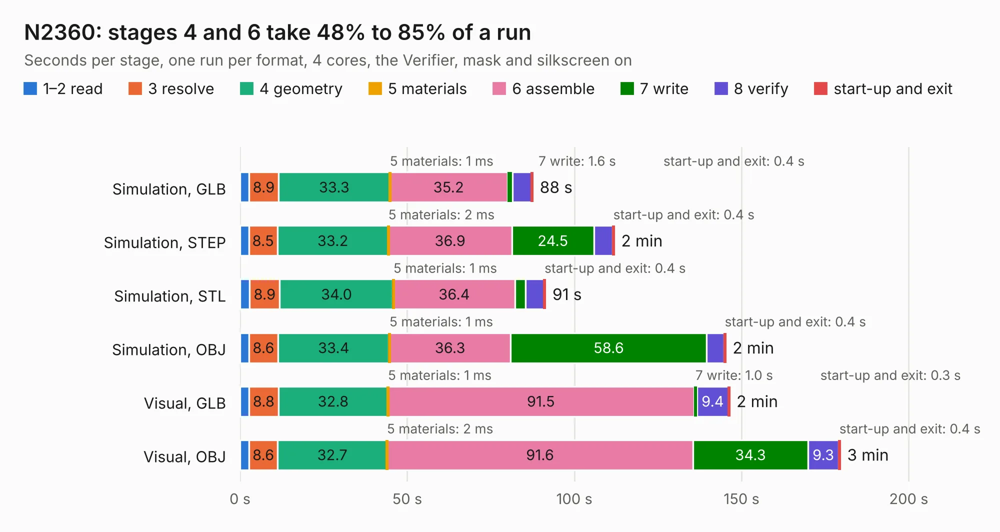

# 1357. N2360

Board 1,357 of the 3,101 of [Corpus Testing](../Corpus-Testing.md), on [Corpus Page 13](../CorpusTestingPages/Corpus-Testing-13.md#1357-n2360).

| Mode and format | 1–2 read | 3 resolve | 4 geometry | 5 materials | 6 assemble | 7 write | 8 verify | start-up and exit | Total |
|---|---:|---:|---:|---:|---:|---:|---:|---:|---:|
| Simulation, GLB | 2.7 | 8.9 | 33.3 | 1&nbsp;ms | 35.2 | 1.6 | 5.6 | 0.4 | 87.5 |
| Simulation, STEP | 2.6 | 8.5 | 33.2 | 2&nbsp;ms | 36.9 | 24.5 | 5.6 | 0.4 | 111.9 |
| Simulation, STL | 2.9 | 8.9 | 34.0 | 1&nbsp;ms | 36.4 | 3.1 | 5.5 | 0.4 | 91.3 |
| Simulation, OBJ | 2.7 | 8.6 | 33.4 | 1&nbsp;ms | 36.3 | 58.6 | 5.2 | 0.4 | 145.2 |
| Visual, GLB | 2.7 | 8.8 | 32.8 | 1&nbsp;ms | 91.5 | 1.0 | 9.4 | 0.3 | 146.3 |
| Visual, OBJ | 2.7 | 8.6 | 32.7 | 2&nbsp;ms | 91.6 | 34.3 | 9.3 | 0.4 | 179.4 |

<table align="center"><tr><td valign="top">

| Board | Repo: [jasonsbeer/Amiga-N2630](https://github.com/jasonsbeer/Amiga-N2630) Board: `N2360.kicad_pcb` |
|---|---|
| Folder | KiCAD / Archive / A2630-New-KiCAD-Rev401-PGA |
| Complexity | 389&nbsp;/&nbsp;1000 (size&nbsp;294, features&nbsp;95) |
| KESE&nbsp;features | through vias, rounded, trapezoid or chamfered pads, filled zones, copper text, curved board outline, stack-up, dielectric εr and tanδ |
| Tested | 9th November 2026 |
| Copper&nbsp;layers | 4 |
| File&nbsp;format | KiCad 6 (20211014) |
| Parts,&nbsp;tracks,&nbsp;vias | 230, 7,442, 838 |
| Triangles,&nbsp;simulation | 9,445,514 in 468 parts |
| Verifier | PASS in all six runs |

</td><td valign="top">

<table>
<tr><th>File type</th><th>File size</th><th>Peak memory used</th></tr>
<tr><th colspan="3" align="left">Simulation</th></tr>
<tr><td>GLB</td><td align="right">321&nbsp;MB</td><td align="right">2.4&nbsp;GB</td></tr>
<tr><td>STEP</td><td align="right">1.5&nbsp;GB</td><td align="right">3.3&nbsp;GB</td></tr>
<tr><td>STL</td><td align="right">472&nbsp;MB</td><td align="right">2.4&nbsp;GB</td></tr>
<tr><td>OBJ</td><td align="right">1.0&nbsp;GB</td><td align="right">6.0&nbsp;GB</td></tr>
<tr><th colspan="3" align="left">Visual</th></tr>
<tr><td>GLB</td><td align="right">206&nbsp;MB</td><td align="right">3.3&nbsp;GB</td></tr>
<tr><td>OBJ</td><td align="right">668&nbsp;MB</td><td align="right">4.3&nbsp;GB</td></tr>
</table>

</td></tr></table>

| Previous | Next |
|:---|---:|
| [1356. N2360](b1356b_Amiga-N2630_KiCAD-A2630-New-KiCAD-Rev410-PLCC_N2360.md) | [1358. N2360](b1358b_Amiga-N2630_KiCAD-Archive-A2630-New-KiCAD-Rev401-PLCC_N2360.md) |
