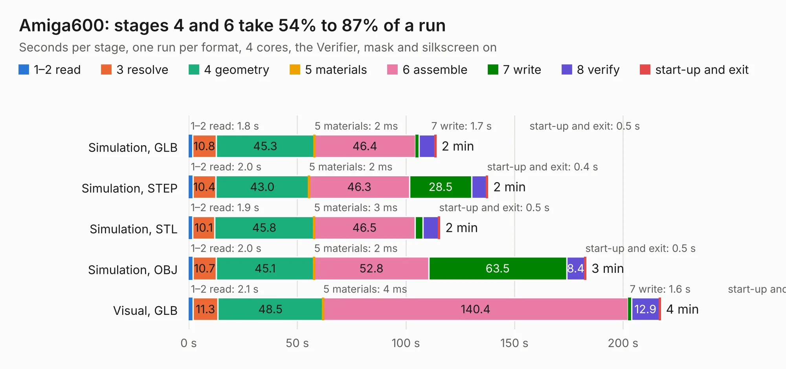

# 1358. Amiga600

Board 1,358 of the 3,138 of [Corpus Testing](../Corpus-Testing.md), on [Corpus Page 13](../CorpusTestingPages/Corpus-Testing-13.md#1358-amiga600).

| Mode and format | 1–2 read | 3 resolve | 4 geometry | 5 materials | 6 assemble | 7 write | 8 verify | start-up and exit | Total |
|---|---:|---:|---:|---:|---:|---:|---:|---:|---:|
| Simulation, GLB | 1.8 | 10.8 | 45.3 | 2&nbsp;ms | 46.4 | 1.7 | 7.3 | 0.5 | 113.8 |
| Simulation, STEP | 2.0 | 10.4 | 43.0 | 2&nbsp;ms | 46.3 | 28.5 | 6.9 | 0.4 | 137.6 |
| Simulation, STL | 1.9 | 10.1 | 45.8 | 3&nbsp;ms | 46.5 | 3.6 | 7.3 | 0.5 | 115.6 |
| Simulation, OBJ | 2.0 | 10.7 | 45.1 | 2&nbsp;ms | 52.8 | 63.5 | 8.4 | 0.5 | 182.9 |
| Visual, GLB | 2.1 | 11.3 | 48.5 | 4&nbsp;ms | 140.4 | 1.6 | 12.9 | 0.4 | 217.1 |
| Visual, OBJ | 2.1 | 10.3 | 44.3 | 2&nbsp;ms | 147.3 | 64.4 | 14.9 | 0.4 | 283.7 |

<table align="center"><tr><td valign="top">

| Board | Repo: [istedman/A600Reborn](https://github.com/istedman/A600Reborn) Board: `Amiga600.kicad_pcb` |
|---|---|
| Folder | A600_Svideo_Working / KiCAD |
| Complexity | 386&nbsp;/&nbsp;1000 (size&nbsp;306, features&nbsp;80) |
| KESE&nbsp;features | through vias, slotted holes, custom pads, filled zones, copper drawings, curved board outline |
| Tested | 9th November 2026 |
| Copper&nbsp;layers | 2 |
| File&nbsp;format | KiCad 5 (20171130) |
| Parts,&nbsp;tracks,&nbsp;vias | 565, 13,837, 1,423 |
| Triangles,&nbsp;simulation | 8,472,872 in 626 parts |
| Verifier | PASS in all six runs |

</td><td valign="top">

<table>
<tr><th>File type</th><th>File size</th><th>Peak memory used</th></tr>
<tr><th colspan="3" align="left">Simulation</th></tr>
<tr><td>GLB</td><td align="right">293&nbsp;MB</td><td align="right">2.3&nbsp;GB</td></tr>
<tr><td>STEP</td><td align="right">1.6&nbsp;GB</td><td align="right">3.4&nbsp;GB</td></tr>
<tr><td>STL</td><td align="right">424&nbsp;MB</td><td align="right">2.3&nbsp;GB</td></tr>
<tr><td>OBJ</td><td align="right">911&nbsp;MB</td><td align="right">5.4&nbsp;GB</td></tr>
<tr><th colspan="3" align="left">Visual</th></tr>
<tr><td>GLB</td><td align="right">261&nbsp;MB</td><td align="right">3.8&nbsp;GB</td></tr>
<tr><td>OBJ</td><td align="right">837&nbsp;MB</td><td align="right">5.4&nbsp;GB</td></tr>
</table>

</td></tr></table>

| Previous | Next |
|:---|---:|
| [1357. TeleDecoder-revB](b1357b_iss-pcb_TeleDecoder-revB.md) | [1359. M68000](b1359b_mcd-pcb_M68000.md) |
