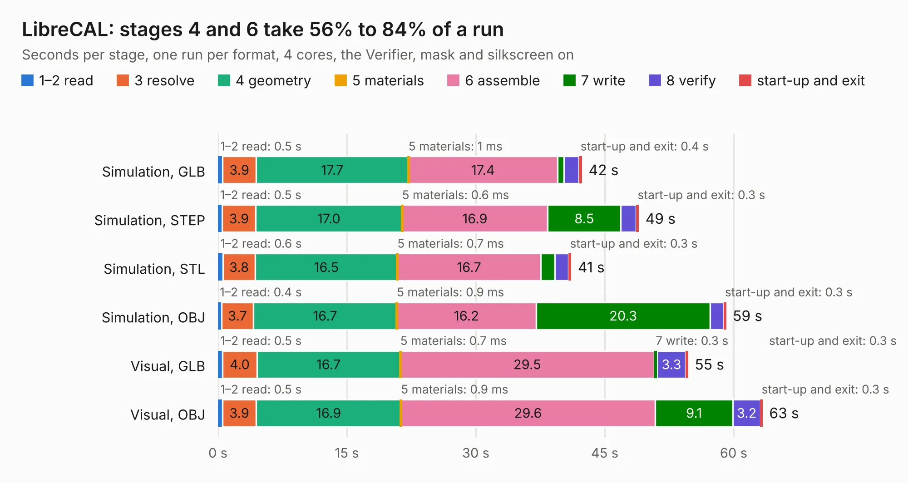

# 1358. LibreCAL

Board 1,358 of the 3,109 of [Corpus Testing](../Corpus-Testing.md), on [Corpus Page 13](../CorpusTestingPages/Corpus-Testing-13.md#1358-librecal).

| Mode and format | 1–2 read | 3 resolve | 4 geometry | 5 materials | 6 assemble | 7 write | 8 verify | start-up and exit | Total |
|---|---:|---:|---:|---:|---:|---:|---:|---:|---:|
| Simulation, GLB | 0.5 | 3.9 | 17.7 | 1&nbsp;ms | 17.4 | 0.7 | 1.8 | 0.4 | 42.4 |
| Simulation, STEP | 0.5 | 3.9 | 17.0 | 0.6&nbsp;ms | 16.9 | 8.5 | 1.8 | 0.3 | 49.0 |
| Simulation, STL | 0.6 | 3.8 | 16.5 | 0.7&nbsp;ms | 16.7 | 1.6 | 1.6 | 0.3 | 41.1 |
| Simulation, OBJ | 0.4 | 3.7 | 16.7 | 0.9&nbsp;ms | 16.2 | 20.3 | 1.6 | 0.3 | 59.1 |
| Visual, GLB | 0.5 | 4.0 | 16.7 | 0.7&nbsp;ms | 29.5 | 0.3 | 3.3 | 0.3 | 54.7 |
| Visual, OBJ | 0.5 | 3.9 | 16.9 | 0.9&nbsp;ms | 29.6 | 9.1 | 3.2 | 0.3 | 63.4 |

<table align="center"><tr><td valign="top">

| Board | Repo: [jankae/LibreCAL](https://github.com/jankae/LibreCAL) Board: `LibreCAL.kicad_pcb` |
|---|---|
| Folder | Hardware / LibreCAL |
| Complexity | 350&nbsp;/&nbsp;1000 (size&nbsp;225, features&nbsp;125) |
| KESE&nbsp;features | through vias, slotted holes, rounded, trapezoid or chamfered pads, arc tracks, filled zones, curved board outline, stack-up, dielectric εr and tanδ, copper finish |
| Tested | 9th November 2026 |
| Copper&nbsp;layers | 4 |
| File&nbsp;format | KiCad 7 (20221018) |
| Parts,&nbsp;tracks,&nbsp;vias | 130, 1,232, 1,196 |
| Triangles,&nbsp;simulation | 4,302,336 in 137 parts |
| Verifier | PASS in all six runs |

</td><td valign="top">

<table>
<tr><th>File type</th><th>File size</th><th>Peak memory used</th></tr>
<tr><th colspan="3" align="left">Simulation</th></tr>
<tr><td>GLB</td><td align="right">143&nbsp;MB</td><td align="right">1.6&nbsp;GB</td></tr>
<tr><td>STEP</td><td align="right">426&nbsp;MB</td><td align="right">1.7&nbsp;GB</td></tr>
<tr><td>STL</td><td align="right">215&nbsp;MB</td><td align="right">1.5&nbsp;GB</td></tr>
<tr><td>OBJ</td><td align="right">445&nbsp;MB</td><td align="right">2.7&nbsp;GB</td></tr>
<tr><th colspan="3" align="left">Visual</th></tr>
<tr><td>GLB</td><td align="right">65&nbsp;MB</td><td align="right">1.2&nbsp;GB</td></tr>
<tr><td>OBJ</td><td align="right">207&nbsp;MB</td><td align="right">1.5&nbsp;GB</td></tr>
</table>

</td></tr></table>

| Previous | Next |
|:---|---:|
| [1357. bench_stm32_esc](b1357b_stm32-brushless-motor-controller_bench-stm32-esc.md) | [1359. VNA](b1359b_LibreVNA_VNA.md) |
