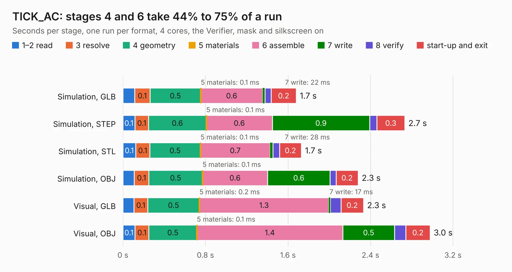

# 1359. TICK_AC

Board 1,359 of the 3,107 of [Corpus Testing](../Corpus-Testing.md), on [Corpus Page 13](../CorpusTestingPages/Corpus-Testing-13.md#1359-tick_ac).

| Mode and format | 1–2 read | 3 resolve | 4 geometry | 5 materials | 6 assemble | 7 write | 8 verify | start-up and exit | Total |
|---|---:|---:|---:|---:|---:|---:|---:|---:|---:|
| Simulation, GLB | 0.1 | 0.1 | 0.5 | 0.1&nbsp;ms | 0.6 | 22&nbsp;ms | 60&nbsp;ms | 0.2 | 1.7 |
| Simulation, STEP | 0.1 | 0.1 | 0.6 | 0.1&nbsp;ms | 0.6 | 0.9 | 70&nbsp;ms | 0.3 | 2.7 |
| Simulation, STL | 0.1 | 0.1 | 0.5 | 0.1&nbsp;ms | 0.7 | 28&nbsp;ms | 63&nbsp;ms | 0.2 | 1.7 |
| Simulation, OBJ | 0.1 | 0.1 | 0.5 | 0.1&nbsp;ms | 0.6 | 0.6 | 58&nbsp;ms | 0.2 | 2.3 |
| Visual, GLB | 0.1 | 0.1 | 0.5 | 0.2&nbsp;ms | 1.3 | 17&nbsp;ms | 0.1 | 0.2 | 2.3 |
| Visual, OBJ | 0.1 | 0.1 | 0.5 | 0.1&nbsp;ms | 1.4 | 0.5 | 0.1 | 0.2 | 3.0 |

<table align="center"><tr><td valign="top">

| Board | Repo: [jasonsbeer/Amiga-2000-EATX](https://github.com/jasonsbeer/Amiga-2000-EATX) Board: `TICK_AC.kicad_pcb` |
|---|---|
| Folder | TICK / TICK_AC_KiCAD |
| Complexity | 155&nbsp;/&nbsp;1000 (size&nbsp;100, features&nbsp;55) |
| KESE&nbsp;features | through vias, slotted holes, rounded, trapezoid or chamfered pads, filled zones |
| Tested | 9th November 2026 |
| Copper&nbsp;layers | 2 |
| File&nbsp;format | KiCad 5 (20171130) |
| Parts,&nbsp;tracks,&nbsp;vias | 7, 12, 9 |
| Triangles,&nbsp;simulation | 101,752 in 19 parts |
| Verifier | PASS in all six runs |

</td><td valign="top">

<table>
<tr><th>File type</th><th>File size</th><th>Peak memory used</th></tr>
<tr><th colspan="3" align="left">Simulation</th></tr>
<tr><td>GLB</td><td align="right">3.5&nbsp;MB</td><td align="right">182&nbsp;MB</td></tr>
<tr><td>STEP</td><td align="right">16&nbsp;MB</td><td align="right">190&nbsp;MB</td></tr>
<tr><td>STL</td><td align="right">5.1&nbsp;MB</td><td align="right">180&nbsp;MB</td></tr>
<tr><td>OBJ</td><td align="right">9.9&nbsp;MB</td><td align="right">182&nbsp;MB</td></tr>
<tr><th colspan="3" align="left">Visual</th></tr>
<tr><td>GLB</td><td align="right">2.9&nbsp;MB</td><td align="right">154&nbsp;MB</td></tr>
<tr><td>OBJ</td><td align="right">8.1&nbsp;MB</td><td align="right">152&nbsp;MB</td></tr>
</table>

</td></tr></table>

| Previous | Next |
|:---|---:|
| [1358. TICK](b1358b_Amiga-2000-EATX_TICK-TICK-Dual-0805_TICK.md) | [1360. TICK](b1360b_Amiga-2000-EATX_TICK-TICK-OSC-KiCAD_TICK.md) |
