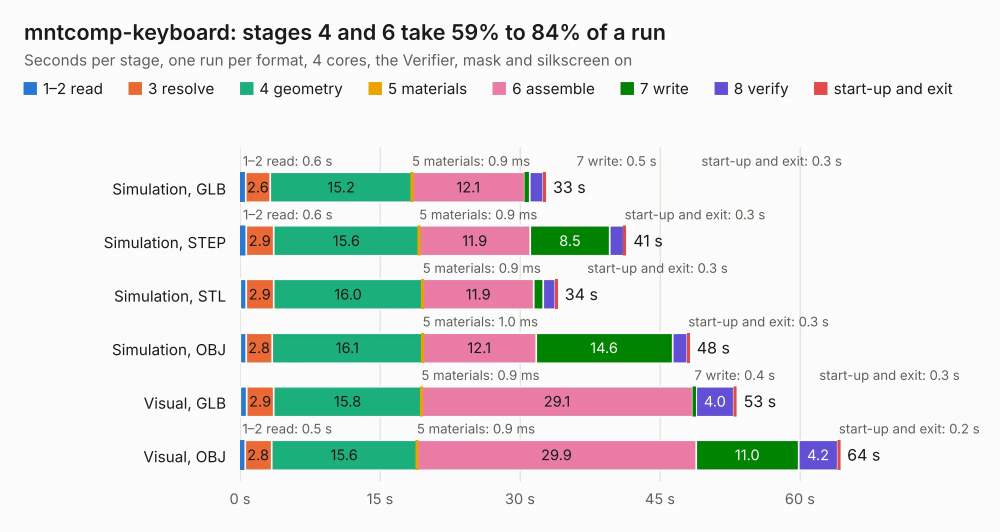

# 1360. mntcomp-keyboard

Board 1,360 of the 3,138 of [Corpus Testing](../Corpus-Testing.md), on [Corpus Page 13](../CorpusTestingPages/Corpus-Testing-13.md#1360-mntcomp-keyboard).

| Mode and format | 1–2 read | 3 resolve | 4 geometry | 5 materials | 6 assemble | 7 write | 8 verify | start-up and exit | Total |
|---|---:|---:|---:|---:|---:|---:|---:|---:|---:|
| Simulation, GLB | 0.6 | 2.6 | 15.2 | 0.9&nbsp;ms | 12.1 | 0.5 | 1.5 | 0.3 | 32.8 |
| Simulation, STEP | 0.6 | 2.9 | 15.6 | 0.9&nbsp;ms | 11.9 | 8.5 | 1.5 | 0.3 | 41.4 |
| Simulation, STL | 0.6 | 2.9 | 16.0 | 0.9&nbsp;ms | 11.9 | 1.0 | 1.3 | 0.3 | 34.0 |
| Simulation, OBJ | 0.7 | 2.8 | 16.1 | 1.0&nbsp;ms | 12.1 | 14.6 | 1.6 | 0.3 | 48.2 |
| Visual, GLB | 0.7 | 2.9 | 15.8 | 0.9&nbsp;ms | 29.1 | 0.4 | 4.0 | 0.3 | 53.2 |
| Visual, OBJ | 0.5 | 2.8 | 15.6 | 0.9&nbsp;ms | 29.9 | 11.0 | 4.2 | 0.2 | 64.3 |

<table align="center"><tr><td valign="top">

| Board | Repo: [jackhumbert/reform](https://github.com/jackhumbert/reform) Board: `mntcomp-keyboard.kicad_pcb` |
|---|---|
| Folder | historic-reform1 / reform-keyboard-pcb |
| Complexity | 265&nbsp;/&nbsp;1000 (size&nbsp;230, features&nbsp;35) |
| KESE&nbsp;features | through vias, filled zones |
| Tested | 9th November 2026 |
| Copper&nbsp;layers | 2 |
| File&nbsp;format | KiCad 4 (4) |
| Parts,&nbsp;tracks,&nbsp;vias | 173, 1,136, 55 |
| Triangles,&nbsp;simulation | 3,187,550 in 287 parts |
| Verifier | PASS in all six runs |

</td><td valign="top">

<table>
<tr><th>File type</th><th>File size</th><th>Peak memory used</th></tr>
<tr><th colspan="3" align="left">Simulation</th></tr>
<tr><td>GLB</td><td align="right">109&nbsp;MB</td><td align="right">1.0&nbsp;GB</td></tr>
<tr><td>STEP</td><td align="right">578&nbsp;MB</td><td align="right">1.2&nbsp;GB</td></tr>
<tr><td>STL</td><td align="right">159&nbsp;MB</td><td align="right">1.0&nbsp;GB</td></tr>
<tr><td>OBJ</td><td align="right">340&nbsp;MB</td><td align="right">2.1&nbsp;GB</td></tr>
<tr><th colspan="3" align="left">Visual</th></tr>
<tr><td>GLB</td><td align="right">76&nbsp;MB</td><td align="right">1.3&nbsp;GB</td></tr>
<tr><td>OBJ</td><td align="right">237&nbsp;MB</td><td align="right">1.6&nbsp;GB</td></tr>
</table>

</td></tr></table>

| Previous | Next |
|:---|---:|
| [1359. M68000](b1359b_mcd-pcb_M68000.md) | [1361. reform-motherboard](b1361b_reform_reform-motherboard.md) |
