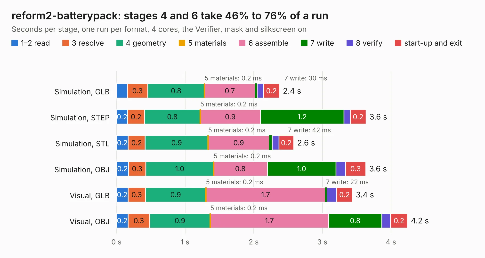

# 1361. reform2-batterypack

Board 1,361 of the 3,132 of [Corpus Testing](../Corpus-Testing.md), on [Corpus Page 13](../CorpusTestingPages/Corpus-Testing-13.md#1361-reform2-batterypack).

| Mode and format | 1–2 read | 3 resolve | 4 geometry | 5 materials | 6 assemble | 7 write | 8 verify | start-up and exit | Total |
|---|---:|---:|---:|---:|---:|---:|---:|---:|---:|
| Simulation, GLB | 0.2 | 0.3 | 0.8 | 0.2&nbsp;ms | 0.7 | 30&nbsp;ms | 92&nbsp;ms | 0.2 | 2.4 |
| Simulation, STEP | 0.2 | 0.2 | 0.8 | 0.2&nbsp;ms | 0.9 | 1.2 | 93&nbsp;ms | 0.2 | 3.6 |
| Simulation, STL | 0.2 | 0.2 | 0.9 | 0.2&nbsp;ms | 0.9 | 42&nbsp;ms | 98&nbsp;ms | 0.2 | 2.6 |
| Simulation, OBJ | 0.2 | 0.3 | 1.0 | 0.2&nbsp;ms | 0.8 | 1.0 | 0.1 | 0.3 | 3.6 |
| Visual, GLB | 0.2 | 0.3 | 0.9 | 0.2&nbsp;ms | 1.7 | 22&nbsp;ms | 0.1 | 0.2 | 3.4 |
| Visual, OBJ | 0.2 | 0.3 | 0.9 | 0.2&nbsp;ms | 1.7 | 0.8 | 0.1 | 0.2 | 4.2 |

<table align="center"><tr><td valign="top">

| Board | Repo: [jackhumbert/reform](https://github.com/jackhumbert/reform) Board: `reform2-batterypack.kicad_pcb` |
|---|---|
| Folder | reform2-batterypack-pcb |
| Complexity | 135&nbsp;/&nbsp;1000 (size&nbsp;105, features&nbsp;30) |
| KESE&nbsp;features | slotted holes, rounded, trapezoid or chamfered pads, curved board outline |
| Tested | 9th November 2026 |
| Copper&nbsp;layers | 2 |
| File&nbsp;format | KiCad 5 (20171130) |
| Parts,&nbsp;tracks,&nbsp;vias | 5, 64, 0 |
| Triangles,&nbsp;simulation | 172,212 in 16 parts |
| Verifier | PASS in all six runs |

</td><td valign="top">

<table>
<tr><th>File type</th><th>File size</th><th>Peak memory used</th></tr>
<tr><th colspan="3" align="left">Simulation</th></tr>
<tr><td>GLB</td><td align="right">6.1&nbsp;MB</td><td align="right">201&nbsp;MB</td></tr>
<tr><td>STEP</td><td align="right">37&nbsp;MB</td><td align="right">220&nbsp;MB</td></tr>
<tr><td>STL</td><td align="right">8.6&nbsp;MB</td><td align="right">202&nbsp;MB</td></tr>
<tr><td>OBJ</td><td align="right">17&nbsp;MB</td><td align="right">203&nbsp;MB</td></tr>
<tr><th colspan="3" align="left">Visual</th></tr>
<tr><td>GLB</td><td align="right">4.0&nbsp;MB</td><td align="right">173&nbsp;MB</td></tr>
<tr><td>OBJ</td><td align="right">11&nbsp;MB</td><td align="right">177&nbsp;MB</td></tr>
</table>

</td></tr></table>

| Previous | Next |
|:---|---:|
| [1360. reform2-batterypack-upstream](b1360b_reform_reform2-batterypack-upstream.md) | [1362. reform2-imx8mplus](b1362b_reform_reform2-imx8mplus.md) |
