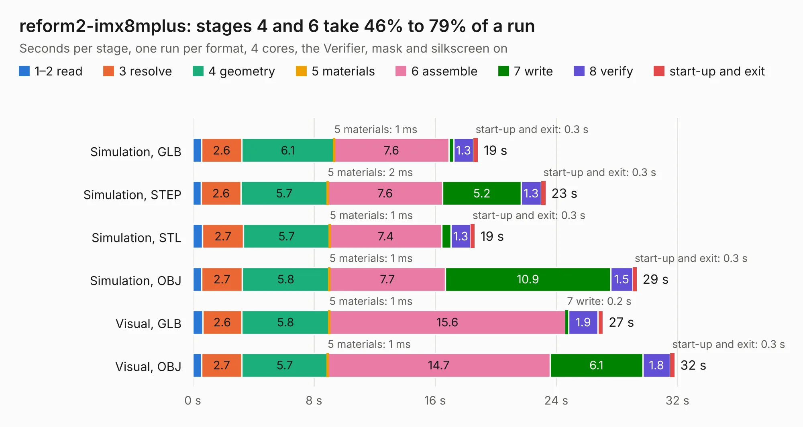

# 1362. reform2-imx8mplus

Board 1,362 of the 3,132 of [Corpus Testing](../Corpus-Testing.md), on [Corpus Page 13](../CorpusTestingPages/Corpus-Testing-13.md#1362-reform2-imx8mplus).

| Mode and format | 1–2 read | 3 resolve | 4 geometry | 5 materials | 6 assemble | 7 write | 8 verify | start-up and exit | Total |
|---|---:|---:|---:|---:|---:|---:|---:|---:|---:|
| Simulation, GLB | 0.6 | 2.6 | 6.1 | 1&nbsp;ms | 7.6 | 0.3 | 1.3 | 0.3 | 18.8 |
| Simulation, STEP | 0.6 | 2.6 | 5.7 | 2&nbsp;ms | 7.6 | 5.2 | 1.3 | 0.3 | 23.3 |
| Simulation, STL | 0.6 | 2.7 | 5.7 | 1&nbsp;ms | 7.4 | 0.6 | 1.3 | 0.3 | 18.6 |
| Simulation, OBJ | 0.6 | 2.7 | 5.8 | 1&nbsp;ms | 7.7 | 10.9 | 1.5 | 0.3 | 29.3 |
| Visual, GLB | 0.7 | 2.6 | 5.8 | 1&nbsp;ms | 15.6 | 0.2 | 1.9 | 0.3 | 27.1 |
| Visual, OBJ | 0.6 | 2.7 | 5.7 | 1&nbsp;ms | 14.7 | 6.1 | 1.8 | 0.3 | 31.8 |

<table align="center"><tr><td valign="top">

| Board | Repo: [jackhumbert/reform](https://github.com/jackhumbert/reform) Board: `reform2-imx8mplus.kicad_pcb` |
|---|---|
| Folder | reform2-imx8mplus |
| Complexity | 346&nbsp;/&nbsp;1000 (size&nbsp;246, features&nbsp;100) |
| KESE&nbsp;features | through vias, rounded, trapezoid or chamfered pads, arc tracks, filled zones, curved board outline, stack-up, dielectric εr and tanδ |
| Tested | 9th November 2026 |
| Copper&nbsp;layers | 6 |
| File&nbsp;format | KiCad 6 (20211014) |
| Parts,&nbsp;tracks,&nbsp;vias | 16, 2,171, 338 |
| Triangles,&nbsp;simulation | 2,120,290 in 326 parts |
| Verifier | PASS in all six runs |

</td><td valign="top">

<table>
<tr><th>File type</th><th>File size</th><th>Peak memory used</th></tr>
<tr><th colspan="3" align="left">Simulation</th></tr>
<tr><td>GLB</td><td align="right">70&nbsp;MB</td><td align="right">721&nbsp;MB</td></tr>
<tr><td>STEP</td><td align="right">257&nbsp;MB</td><td align="right">931&nbsp;MB</td></tr>
<tr><td>STL</td><td align="right">106&nbsp;MB</td><td align="right">726&nbsp;MB</td></tr>
<tr><td>OBJ</td><td align="right">221&nbsp;MB</td><td align="right">1.4&nbsp;GB</td></tr>
<tr><th colspan="3" align="left">Visual</th></tr>
<tr><td>GLB</td><td align="right">39&nbsp;MB</td><td align="right">772&nbsp;MB</td></tr>
<tr><td>OBJ</td><td align="right">124&nbsp;MB</td><td align="right">928&nbsp;MB</td></tr>
</table>

</td></tr></table>

| Previous | Next |
|:---|---:|
| [1361. reform2-batterypack](b1361b_reform_reform2-batterypack.md) | [1363. reform2-keyboard](b1363b_reform_reform2-keyboard.md) |
