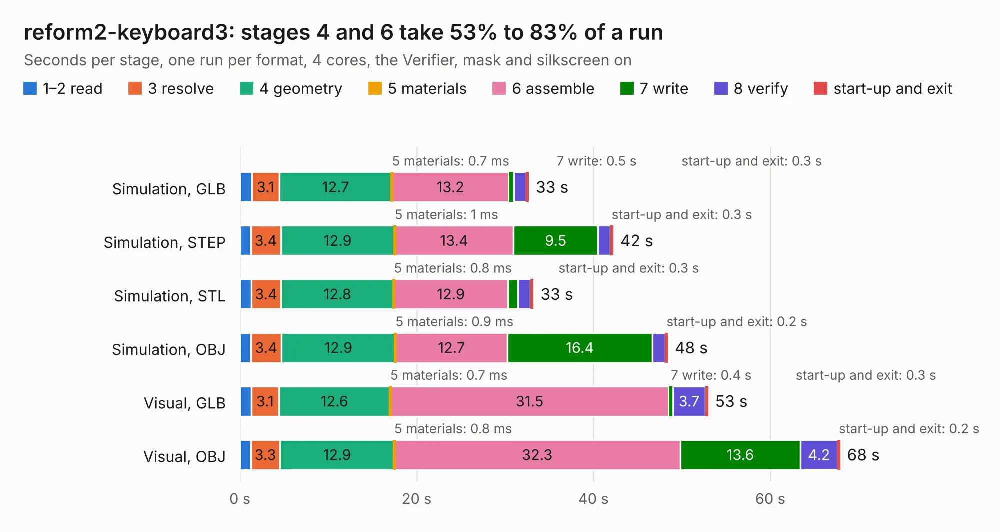

# 1362. reform2-keyboard3

Board 1,362 of the 3,130 of [Corpus Testing](../Corpus-Testing.md), on [Corpus Page 13](../CorpusTestingPages/Corpus-Testing-13.md#1362-reform2-keyboard3).

| Mode and format | 1–2 read | 3 resolve | 4 geometry | 5 materials | 6 assemble | 7 write | 8 verify | start-up and exit | Total |
|---|---:|---:|---:|---:|---:|---:|---:|---:|---:|
| Simulation, GLB | 1.3 | 3.1 | 12.7 | 0.7&nbsp;ms | 13.2 | 0.5 | 1.4 | 0.3 | 32.7 |
| Simulation, STEP | 1.2 | 3.4 | 12.9 | 1&nbsp;ms | 13.4 | 9.5 | 1.4 | 0.3 | 42.2 |
| Simulation, STL | 1.3 | 3.4 | 12.8 | 0.8&nbsp;ms | 12.9 | 1.1 | 1.4 | 0.3 | 33.2 |
| Simulation, OBJ | 1.3 | 3.4 | 12.9 | 0.9&nbsp;ms | 12.7 | 16.4 | 1.5 | 0.2 | 48.4 |
| Visual, GLB | 1.3 | 3.1 | 12.6 | 0.7&nbsp;ms | 31.5 | 0.4 | 3.7 | 0.3 | 52.9 |
| Visual, OBJ | 1.2 | 3.3 | 12.9 | 0.8&nbsp;ms | 32.3 | 13.6 | 4.2 | 0.2 | 67.9 |

<table align="center"><tr><td valign="top">

| Board | Repo: [jackhumbert/reform](https://github.com/jackhumbert/reform) Board: `reform2-keyboard3.kicad_pcb` |
|---|---|
| Folder | reform2-keyboard3-pcb |
| Complexity | 347&nbsp;/&nbsp;1000 (size&nbsp;257, features&nbsp;90) |
| KESE&nbsp;features | through vias, slotted holes, rounded, trapezoid or chamfered pads, filled zones, stack-up, dielectric εr and tanδ, mask and silkscreen colours |
| Tested | 9th November 2026 |
| Copper&nbsp;layers | 2 |
| File&nbsp;format | KiCad 6 (20211014) |
| Parts,&nbsp;tracks,&nbsp;vias | 289, 2,085, 383 |
| Triangles,&nbsp;simulation | 3,916,436 in 232 parts |
| Verifier | PASS in all six runs |

</td><td valign="top">

<table>
<tr><th>File type</th><th>File size</th><th>Peak memory used</th></tr>
<tr><th colspan="3" align="left">Simulation</th></tr>
<tr><td>GLB</td><td align="right">133&nbsp;MB</td><td align="right">1.5&nbsp;GB</td></tr>
<tr><td>STEP</td><td align="right">671&nbsp;MB</td><td align="right">1.7&nbsp;GB</td></tr>
<tr><td>STL</td><td align="right">196&nbsp;MB</td><td align="right">1.6&nbsp;GB</td></tr>
<tr><td>OBJ</td><td align="right">415&nbsp;MB</td><td align="right">2.6&nbsp;GB</td></tr>
<tr><th colspan="3" align="left">Visual</th></tr>
<tr><td>GLB</td><td align="right">112&nbsp;MB</td><td align="right">2.2&nbsp;GB</td></tr>
<tr><td>OBJ</td><td align="right">354&nbsp;MB</td><td align="right">2.3&nbsp;GB</td></tr>
</table>

</td></tr></table>

| Previous | Next |
|:---|---:|
| [1361. reform2-keyboard](b1361b_reform_reform2-keyboard.md) | [1363. reform2-motherboard](b1363b_reform_reform2-motherboard.md) |
