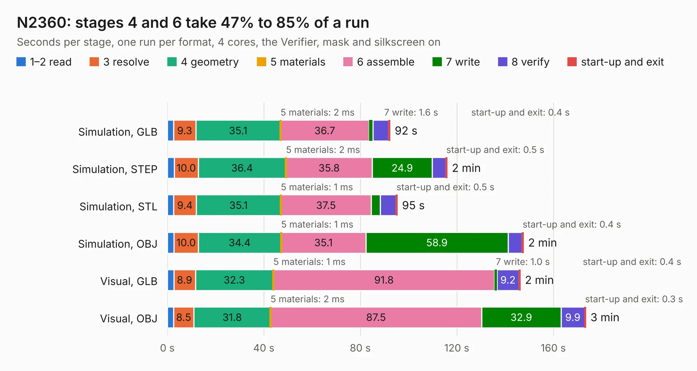

# 1363. N2360

Board 1,363 of the 3,109 of [Corpus Testing](../Corpus-Testing.md), on [Corpus Page 13](../CorpusTestingPages/Corpus-Testing-13.md#1363-n2360).

| Mode and format | 1–2 read | 3 resolve | 4 geometry | 5 materials | 6 assemble | 7 write | 8 verify | start-up and exit | Total |
|---|---:|---:|---:|---:|---:|---:|---:|---:|---:|
| Simulation, GLB | 2.6 | 9.3 | 35.1 | 2&nbsp;ms | 36.7 | 1.6 | 6.6 | 0.4 | 92.2 |
| Simulation, STEP | 2.9 | 10.0 | 36.4 | 2&nbsp;ms | 35.8 | 24.9 | 5.6 | 0.5 | 115.9 |
| Simulation, STL | 2.6 | 9.4 | 35.1 | 1&nbsp;ms | 37.5 | 3.7 | 6.6 | 0.5 | 95.2 |
| Simulation, OBJ | 2.8 | 10.0 | 34.4 | 1&nbsp;ms | 35.1 | 58.9 | 5.9 | 0.4 | 147.5 |
| Visual, GLB | 2.7 | 8.9 | 32.3 | 1&nbsp;ms | 91.8 | 1.0 | 9.2 | 0.4 | 146.2 |
| Visual, OBJ | 2.6 | 8.5 | 31.8 | 2&nbsp;ms | 87.5 | 32.9 | 9.9 | 0.3 | 173.4 |

<table align="center"><tr><td valign="top">

| Board | Repo: [jasonsbeer/Amiga-N2630](https://github.com/jasonsbeer/Amiga-N2630) Board: `N2360.kicad_pcb` |
|---|---|
| Folder | KiCAD / A2630-New-KiCAD-Rev410-PGA |
| Complexity | 389&nbsp;/&nbsp;1000 (size&nbsp;294, features&nbsp;95) |
| KESE&nbsp;features | through vias, rounded, trapezoid or chamfered pads, filled zones, copper text, curved board outline, stack-up, dielectric εr and tanδ |
| Tested | 9th November 2026 |
| Copper&nbsp;layers | 4 |
| File&nbsp;format | KiCad 8 (20240108) |
| Parts,&nbsp;tracks,&nbsp;vias | 233, 7,443, 844 |
| Triangles,&nbsp;simulation | 9,166,598 in 471 parts |
| Verifier | PASS in all six runs |

</td><td valign="top">

<table>
<tr><th>File type</th><th>File size</th><th>Peak memory used</th></tr>
<tr><th colspan="3" align="left">Simulation</th></tr>
<tr><td>GLB</td><td align="right">312&nbsp;MB</td><td align="right">2.2&nbsp;GB</td></tr>
<tr><td>STEP</td><td align="right">1.4&nbsp;GB</td><td align="right">3.2&nbsp;GB</td></tr>
<tr><td>STL</td><td align="right">458&nbsp;MB</td><td align="right">2.2&nbsp;GB</td></tr>
<tr><td>OBJ</td><td align="right">992&nbsp;MB</td><td align="right">5.8&nbsp;GB</td></tr>
<tr><th colspan="3" align="left">Visual</th></tr>
<tr><td>GLB</td><td align="right">200&nbsp;MB</td><td align="right">3.2&nbsp;GB</td></tr>
<tr><td>OBJ</td><td align="right">646&nbsp;MB</td><td align="right">4.1&nbsp;GB</td></tr>
</table>

</td></tr></table>

| Previous | Next |
|:---|---:|
| [1362. TICK](b1362b_Amiga-2000-EATX_TICK-TICK-OSC-KiCAD_TICK.md) | [1364. N2360](b1364b_Amiga-N2630_KiCAD-A2630-New-KiCAD-Rev410-PLCC_N2360.md) |
