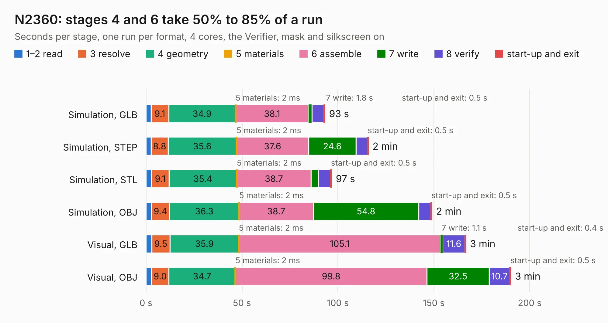

# 1363. N2360

Board 1,363 of the 3,106 of [Corpus Testing](../Corpus-Testing.md), on [Corpus Page 13](../CorpusTestingPages/Corpus-Testing-13.md#1363-n2360).

| Mode and format | 1–2 read | 3 resolve | 4 geometry | 5 materials | 6 assemble | 7 write | 8 verify | start-up and exit | Total |
|---|---:|---:|---:|---:|---:|---:|---:|---:|---:|
| Simulation, GLB | 2.7 | 9.1 | 34.9 | 2&nbsp;ms | 38.1 | 1.8 | 6.1 | 0.5 | 93.2 |
| Simulation, STEP | 2.8 | 8.8 | 35.6 | 2&nbsp;ms | 37.6 | 24.6 | 5.9 | 0.5 | 115.8 |
| Simulation, STL | 2.9 | 9.1 | 35.4 | 2&nbsp;ms | 38.7 | 3.8 | 6.4 | 0.5 | 96.7 |
| Simulation, OBJ | 2.9 | 9.4 | 36.3 | 2&nbsp;ms | 38.7 | 54.8 | 6.4 | 0.5 | 149.0 |
| Visual, GLB | 3.0 | 9.5 | 35.9 | 2&nbsp;ms | 105.1 | 1.1 | 11.6 | 0.4 | 166.6 |
| Visual, OBJ | 2.9 | 9.0 | 34.7 | 2&nbsp;ms | 99.8 | 32.5 | 10.7 | 0.5 | 190.1 |

<table align="center"><tr><td valign="top">

| Board | Repo: [jasonsbeer/Amiga-N2630](https://github.com/jasonsbeer/Amiga-N2630) Board: `N2360.kicad_pcb` |
|---|---|
| Folder | KiCAD / Archive / A2630-New-KiCAD-Rev401-PLCC |
| Complexity | 391&nbsp;/&nbsp;1000 (size&nbsp;296, features&nbsp;95) |
| KESE&nbsp;features | through vias, rounded, trapezoid or chamfered pads, filled zones, copper text, curved board outline, stack-up, dielectric εr and tanδ |
| Tested | 9th November 2026 |
| Copper&nbsp;layers | 4 |
| File&nbsp;format | KiCad 6 (20211014) |
| Parts,&nbsp;tracks,&nbsp;vias | 230, 7,313, 839 |
| Triangles,&nbsp;simulation | 9,464,140 in 468 parts |
| Verifier | PASS in all six runs |

</td><td valign="top">

<table>
<tr><th>File type</th><th>File size</th><th>Peak memory used</th></tr>
<tr><th colspan="3" align="left">Simulation</th></tr>
<tr><td>GLB</td><td align="right">322&nbsp;MB</td><td align="right">2.4&nbsp;GB</td></tr>
<tr><td>STEP</td><td align="right">1.5&nbsp;GB</td><td align="right">3.3&nbsp;GB</td></tr>
<tr><td>STL</td><td align="right">473&nbsp;MB</td><td align="right">2.4&nbsp;GB</td></tr>
<tr><td>OBJ</td><td align="right">1.0&nbsp;GB</td><td align="right">6.1&nbsp;GB</td></tr>
<tr><th colspan="3" align="left">Visual</th></tr>
<tr><td>GLB</td><td align="right">207&nbsp;MB</td><td align="right">3.3&nbsp;GB</td></tr>
<tr><td>OBJ</td><td align="right">670&nbsp;MB</td><td align="right">4.3&nbsp;GB</td></tr>
</table>

</td></tr></table>

| Previous | Next |
|:---|---:|
| [1362. N2360](b1362b_Amiga-N2630_KiCAD-Archive-A2630-New-KiCAD-Rev401-PGA_N2360.md) | [1364. BeamBender](b1364b_BeamBender_BeamBender.md) |
