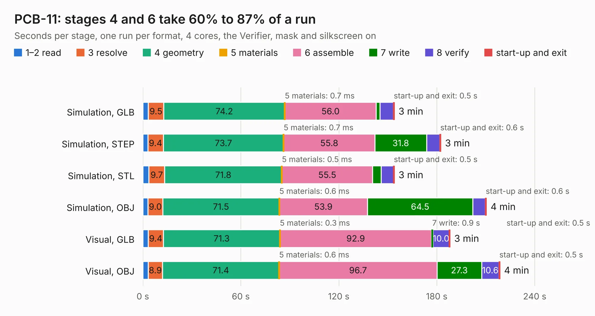

# 1363. PCB-11

Board 1,363 of the 3,101 of [Corpus Testing](../Corpus-Testing.md), on [Corpus Page 13](../CorpusTestingPages/Corpus-Testing-13.md#1363-pcb-11).

| Mode and format | 1–2 read | 3 resolve | 4 geometry | 5 materials | 6 assemble | 7 write | 8 verify | start-up and exit | Total |
|---|---:|---:|---:|---:|---:|---:|---:|---:|---:|
| Simulation, GLB | 3.3 | 9.5 | 74.2 | 0.7&nbsp;ms | 56.0 | 2.3 | 8.2 | 0.5 | 154.0 |
| Simulation, STEP | 3.1 | 9.4 | 73.7 | 0.7&nbsp;ms | 55.8 | 31.8 | 8.1 | 0.6 | 182.5 |
| Simulation, STL | 3.7 | 9.7 | 71.8 | 0.5&nbsp;ms | 55.5 | 5.2 | 7.6 | 0.5 | 154.0 |
| Simulation, OBJ | 3.2 | 9.0 | 71.5 | 0.6&nbsp;ms | 53.9 | 64.5 | 7.6 | 0.6 | 210.3 |
| Visual, GLB | 3.2 | 9.4 | 71.3 | 0.3&nbsp;ms | 92.9 | 0.9 | 10.0 | 0.5 | 188.1 |
| Visual, OBJ | 3.2 | 8.9 | 71.4 | 0.6&nbsp;ms | 96.7 | 27.3 | 10.6 | 0.5 | 218.6 |

<table align="center"><tr><td valign="top">

| Board | Repo: [jgw4/doppel-1](https://github.com/jgw4/doppel-1) Board: `PCB-11.kicad_pcb` |
|---|---|
| Folder | gerbers |
| Complexity | 214&nbsp;/&nbsp;1000 (size&nbsp;189, features&nbsp;25) |
| KESE&nbsp;features | through vias, copper drawings |
| Tested | 9th November 2026 |
| Copper&nbsp;layers | 2 |
| File&nbsp;format | KiCad 9 (20240928) |
| Parts,&nbsp;tracks,&nbsp;vias | 0, 31,410, 1,720 |
| Triangles,&nbsp;simulation | 10,815,304 in 11 parts |
| Note | no components |
| Verifier | PASS in all six runs |

</td><td valign="top">

<table>
<tr><th>File type</th><th>File size</th><th>Peak memory used</th></tr>
<tr><th colspan="3" align="left">Simulation</th></tr>
<tr><td>GLB</td><td align="right">369&nbsp;MB</td><td align="right">3.2&nbsp;GB</td></tr>
<tr><td>STEP</td><td align="right">2.0&nbsp;GB</td><td align="right">4.0&nbsp;GB</td></tr>
<tr><td>STL</td><td align="right">541&nbsp;MB</td><td align="right">3.3&nbsp;GB</td></tr>
<tr><td>OBJ</td><td align="right">1.2&nbsp;GB</td><td align="right">6.9&nbsp;GB</td></tr>
<tr><th colspan="3" align="left">Visual</th></tr>
<tr><td>GLB</td><td align="right">180&nbsp;MB</td><td align="right">3.2&nbsp;GB</td></tr>
<tr><td>OBJ</td><td align="right">576&nbsp;MB</td><td align="right">3.8&nbsp;GB</td></tr>
</table>

</td></tr></table>

| Previous | Next |
|:---|---:|
| [1362. d1](b1362b_doppel-1_d1.md) | [1364. pong](b1364b_pong_pong.md) |
