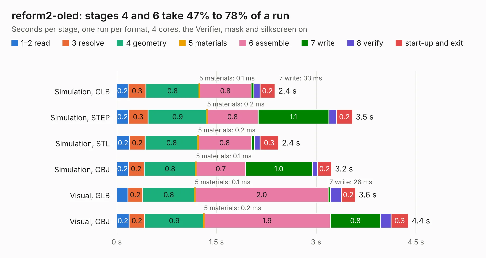

# 1365. reform2-oled

Board 1,365 of the 3,130 of [Corpus Testing](../Corpus-Testing.md), on [Corpus Page 13](../CorpusTestingPages/Corpus-Testing-13.md#1365-reform2-oled).

| Mode and format | 1–2 read | 3 resolve | 4 geometry | 5 materials | 6 assemble | 7 write | 8 verify | start-up and exit | Total |
|---|---:|---:|---:|---:|---:|---:|---:|---:|---:|
| Simulation, GLB | 0.2 | 0.3 | 0.8 | 0.1&nbsp;ms | 0.8 | 33&nbsp;ms | 94&nbsp;ms | 0.2 | 2.4 |
| Simulation, STEP | 0.2 | 0.3 | 0.9 | 0.2&nbsp;ms | 0.8 | 1.1 | 0.1 | 0.2 | 3.5 |
| Simulation, STL | 0.2 | 0.2 | 0.8 | 0.2&nbsp;ms | 0.8 | 45&nbsp;ms | 88&nbsp;ms | 0.3 | 2.4 |
| Simulation, OBJ | 0.2 | 0.2 | 0.8 | 0.1&nbsp;ms | 0.7 | 1.0 | 81&nbsp;ms | 0.2 | 3.2 |
| Visual, GLB | 0.2 | 0.2 | 0.8 | 0.1&nbsp;ms | 2.0 | 26&nbsp;ms | 0.2 | 0.2 | 3.6 |
| Visual, OBJ | 0.2 | 0.2 | 0.9 | 0.2&nbsp;ms | 1.9 | 0.8 | 0.2 | 0.3 | 4.4 |

<table align="center"><tr><td valign="top">

| Board | Repo: [jackhumbert/reform](https://github.com/jackhumbert/reform) Board: `reform2-oled.kicad_pcb` |
|---|---|
| Folder | reform2-oled-pcb |
| Complexity | 172&nbsp;/&nbsp;1000 (size&nbsp;127, features&nbsp;45) |
| KESE&nbsp;features | through vias, rounded, trapezoid or chamfered pads, filled zones |
| Tested | 9th November 2026 |
| Copper&nbsp;layers | 2 |
| File&nbsp;format | KiCad 5 (20171130) |
| Parts,&nbsp;tracks,&nbsp;vias | 11, 77, 27 |
| Triangles,&nbsp;simulation | 163,598 in 25 parts |
| Verifier | PASS in all six runs |

</td><td valign="top">

<table>
<tr><th>File type</th><th>File size</th><th>Peak memory used</th></tr>
<tr><th colspan="3" align="left">Simulation</th></tr>
<tr><td>GLB</td><td align="right">5.8&nbsp;MB</td><td align="right">201&nbsp;MB</td></tr>
<tr><td>STEP</td><td align="right">30&nbsp;MB</td><td align="right">225&nbsp;MB</td></tr>
<tr><td>STL</td><td align="right">8.2&nbsp;MB</td><td align="right">204&nbsp;MB</td></tr>
<tr><td>OBJ</td><td align="right">16&nbsp;MB</td><td align="right">215&nbsp;MB</td></tr>
<tr><th colspan="3" align="left">Visual</th></tr>
<tr><td>GLB</td><td align="right">4.7&nbsp;MB</td><td align="right">191&nbsp;MB</td></tr>
<tr><td>OBJ</td><td align="right">14&nbsp;MB</td><td align="right">185&nbsp;MB</td></tr>
</table>

</td></tr></table>

| Previous | Next |
|:---|---:|
| [1364. reform2-motherboard25](b1364b_reform_reform2-motherboard25.md) | [1366. reform2-protected-batterypack-pcb](b1366b_reform_reform2-protected-batterypack-pcb.md) |
