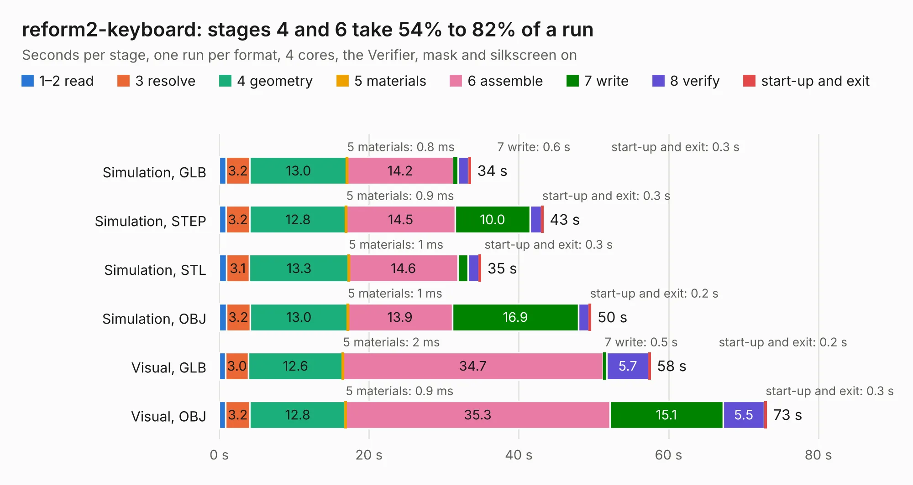

# 1366 reform2-keyboard

Board 1,366 of the 3,138 of [Corpus Testing](../Corpus-Testing.md), on [Corpus Page 13](../CorpusTestingPages/Corpus-Testing-13.md#1366-reform2-keyboard).

| Mode and format | 1–2 read | 3 resolve | 4 geometry | 5 materials | 6 assemble | 7 write | 8 verify | start-up and exit | Total |
|---|---:|---:|---:|---:|---:|---:|---:|---:|---:|
| Simulation, GLB | 0.9 | 3.2 | 13.0 | 0.8&nbsp;ms | 14.2 | 0.6 | 1.4 | 0.3 | 33.6 |
| Simulation, STEP | 0.9 | 3.2 | 12.8 | 0.9&nbsp;ms | 14.5 | 10.0 | 1.5 | 0.3 | 43.3 |
| Simulation, STL | 1.0 | 3.1 | 13.3 | 1&nbsp;ms | 14.6 | 1.3 | 1.5 | 0.3 | 34.9 |
| Simulation, OBJ | 1.0 | 3.2 | 13.0 | 1&nbsp;ms | 13.9 | 16.9 | 1.4 | 0.2 | 49.6 |
| Visual, GLB | 0.9 | 3.0 | 12.6 | 2&nbsp;ms | 34.7 | 0.5 | 5.7 | 0.2 | 57.6 |
| Visual, OBJ | 0.9 | 3.2 | 12.8 | 0.9&nbsp;ms | 35.3 | 15.1 | 5.5 | 0.3 | 73.1 |

<table align="center"><tr><td valign="top">

| Board | Repo: [jackhumbert/reform](https://github.com/jackhumbert/reform) Board: `reform2-keyboard.kicad_pcb` |
|---|---|
| Folder | reform2-keyboard-pcb |
| Complexity | 313&nbsp;/&nbsp;1000 (size&nbsp;258, features&nbsp;55) |
| KESE&nbsp;features | through vias, slotted holes, rounded, trapezoid or chamfered pads, filled zones |
| Tested | 9th November 2026 |
| Copper&nbsp;layers | 2 |
| File&nbsp;format | KiCad 5 (20171130) |
| Parts,&nbsp;tracks,&nbsp;vias | 293, 2,054, 411 |
| Triangles,&nbsp;simulation | 4,193,572 in 234 parts |
| Verifier | PASS in all six runs |

</td><td valign="top">

<table>
<tr><th>File type</th><th>File size</th><th>Peak memory used</th></tr>
<tr><th colspan="3" align="left">Simulation</th></tr>
<tr><td>GLB</td><td align="right">141&nbsp;MB</td><td align="right">1.6&nbsp;GB</td></tr>
<tr><td>STEP</td><td align="right">672&nbsp;MB</td><td align="right">1.8&nbsp;GB</td></tr>
<tr><td>STL</td><td align="right">210&nbsp;MB</td><td align="right">1.6&nbsp;GB</td></tr>
<tr><td>OBJ</td><td align="right">442&nbsp;MB</td><td align="right">2.7&nbsp;GB</td></tr>
<tr><th colspan="3" align="left">Visual</th></tr>
<tr><td>GLB</td><td align="right">122&nbsp;MB</td><td align="right">1.9&nbsp;GB</td></tr>
<tr><td>OBJ</td><td align="right">385&nbsp;MB</td><td align="right">2.4&nbsp;GB</td></tr>
</table>

</td></tr></table>

| Previous | Next |
|:---|---:|
| [1365 reform2-imx8mplus](b1365b_reform_reform2-imx8mplus.md) | [1367 reform2-keyboard3](b1367b_reform_reform2-keyboard3.md) |
