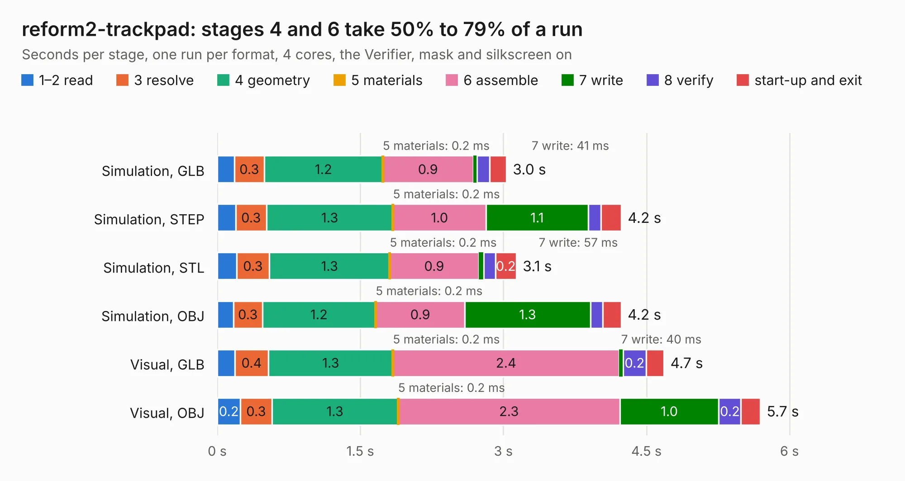

# 1366. reform2-trackpad

Board 1,366 of the 3,121 of [Corpus Testing](../Corpus-Testing.md), on [Corpus Page 13](../CorpusTestingPages/Corpus-Testing-13.md#1366-reform2-trackpad).

| Mode and format | 1–2 read | 3 resolve | 4 geometry | 5 materials | 6 assemble | 7 write | 8 verify | start-up and exit | Total |
|---|---:|---:|---:|---:|---:|---:|---:|---:|---:|
| Simulation, GLB | 0.2 | 0.3 | 1.2 | 0.2&nbsp;ms | 0.9 | 41&nbsp;ms | 0.1 | 0.2 | 3.0 |
| Simulation, STEP | 0.2 | 0.3 | 1.3 | 0.2&nbsp;ms | 1.0 | 1.1 | 0.1 | 0.2 | 4.2 |
| Simulation, STL | 0.2 | 0.3 | 1.3 | 0.2&nbsp;ms | 0.9 | 57&nbsp;ms | 0.1 | 0.2 | 3.1 |
| Simulation, OBJ | 0.2 | 0.3 | 1.2 | 0.2&nbsp;ms | 0.9 | 1.3 | 0.1 | 0.2 | 4.2 |
| Visual, GLB | 0.2 | 0.4 | 1.3 | 0.2&nbsp;ms | 2.4 | 40&nbsp;ms | 0.2 | 0.2 | 4.7 |
| Visual, OBJ | 0.2 | 0.3 | 1.3 | 0.2&nbsp;ms | 2.3 | 1.0 | 0.2 | 0.2 | 5.7 |

<table align="center"><tr><td valign="top">

| Board | Repo: [jackhumbert/reform](https://github.com/jackhumbert/reform) Board: `reform2-trackpad.kicad_pcb` |
|---|---|
| Folder | reform2-trackpad-pcb |
| Complexity | 225&nbsp;/&nbsp;1000 (size&nbsp;180, features&nbsp;45) |
| KESE&nbsp;features | through vias, rounded, trapezoid or chamfered pads, filled zones |
| Tested | 9th November 2026 |
| Copper&nbsp;layers | 2 |
| File&nbsp;format | KiCad 5 (20171130) |
| Parts,&nbsp;tracks,&nbsp;vias | 22, 148, 30 |
| Triangles,&nbsp;simulation | 252,768 in 50 parts |
| Verifier | PASS in all six runs |

</td><td valign="top">

<table>
<tr><th>File type</th><th>File size</th><th>Peak memory used</th></tr>
<tr><th colspan="3" align="left">Simulation</th></tr>
<tr><td>GLB</td><td align="right">9.1&nbsp;MB</td><td align="right">231&nbsp;MB</td></tr>
<tr><td>STEP</td><td align="right">48&nbsp;MB</td><td align="right">261&nbsp;MB</td></tr>
<tr><td>STL</td><td align="right">13&nbsp;MB</td><td align="right">231&nbsp;MB</td></tr>
<tr><td>OBJ</td><td align="right">26&nbsp;MB</td><td align="right">239&nbsp;MB</td></tr>
<tr><th colspan="3" align="left">Visual</th></tr>
<tr><td>GLB</td><td align="right">7.5&nbsp;MB</td><td align="right">237&nbsp;MB</td></tr>
<tr><td>OBJ</td><td align="right">22&nbsp;MB</td><td align="right">228&nbsp;MB</td></tr>
</table>

</td></tr></table>

| Previous | Next |
|:---|---:|
| [1365. reform2-trackball2](b1365b_reform_reform2-trackball2.md) | [1367. bench_stm32_esc](b1367b_stm32-brushless-motor-controller_bench-stm32-esc.md) |
