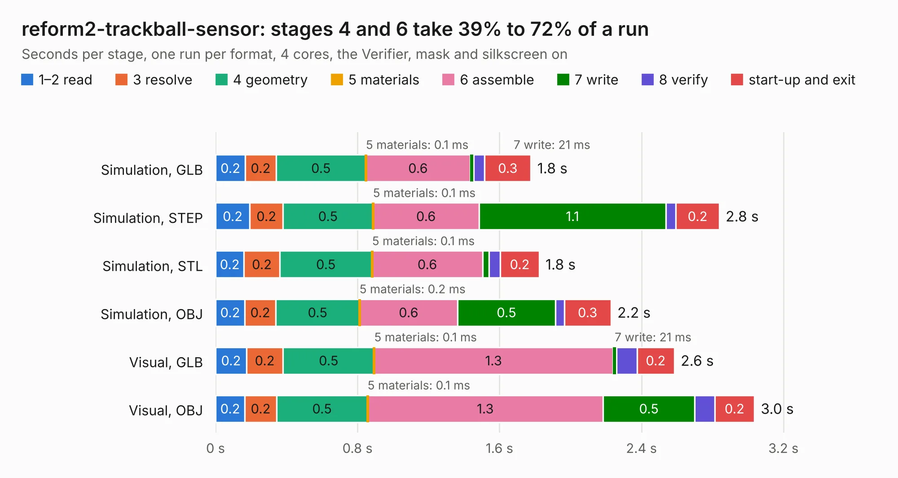

# 1367. reform2-trackball-sensor

Board 1,367 of the 3,126 of [Corpus Testing](../Corpus-Testing.md), on [Corpus Page 13](../CorpusTestingPages/Corpus-Testing-13.md#1367-reform2-trackball-sensor).

| Mode and format | 1–2 read | 3 resolve | 4 geometry | 5 materials | 6 assemble | 7 write | 8 verify | start-up and exit | Total |
|---|---:|---:|---:|---:|---:|---:|---:|---:|---:|
| Simulation, GLB | 0.2 | 0.2 | 0.5 | 0.1&nbsp;ms | 0.6 | 21&nbsp;ms | 60&nbsp;ms | 0.3 | 1.8 |
| Simulation, STEP | 0.2 | 0.2 | 0.5 | 0.1&nbsp;ms | 0.6 | 1.1 | 57&nbsp;ms | 0.2 | 2.8 |
| Simulation, STL | 0.2 | 0.2 | 0.5 | 0.1&nbsp;ms | 0.6 | 37&nbsp;ms | 64&nbsp;ms | 0.2 | 1.8 |
| Simulation, OBJ | 0.2 | 0.2 | 0.5 | 0.2&nbsp;ms | 0.6 | 0.5 | 51&nbsp;ms | 0.3 | 2.2 |
| Visual, GLB | 0.2 | 0.2 | 0.5 | 0.1&nbsp;ms | 1.3 | 21&nbsp;ms | 0.1 | 0.2 | 2.6 |
| Visual, OBJ | 0.2 | 0.2 | 0.5 | 0.1&nbsp;ms | 1.3 | 0.5 | 0.1 | 0.2 | 3.0 |

<table align="center"><tr><td valign="top">

| Board | Repo: [jackhumbert/reform](https://github.com/jackhumbert/reform) Board: `reform2-trackball-sensor.kicad_pcb` |
|---|---|
| Folder | reform2-trackball-sensor-pcb |
| Complexity | 151&nbsp;/&nbsp;1000 (size&nbsp;106, features&nbsp;45) |
| KESE&nbsp;features | through vias, rounded, trapezoid or chamfered pads, filled zones |
| Tested | 9th November 2026 |
| Copper&nbsp;layers | 2 |
| File&nbsp;format | KiCad 5 (20171130) |
| Parts,&nbsp;tracks,&nbsp;vias | 6, 41, 8 |
| Triangles,&nbsp;simulation | 88,568 in 17 parts |
| Verifier | PASS in all six runs |

</td><td valign="top">

<table>
<tr><th>File type</th><th>File size</th><th>Peak memory used</th></tr>
<tr><th colspan="3" align="left">Simulation</th></tr>
<tr><td>GLB</td><td align="right">3.2&nbsp;MB</td><td align="right">194&nbsp;MB</td></tr>
<tr><td>STEP</td><td align="right">18&nbsp;MB</td><td align="right">198&nbsp;MB</td></tr>
<tr><td>STL</td><td align="right">4.4&nbsp;MB</td><td align="right">190&nbsp;MB</td></tr>
<tr><td>OBJ</td><td align="right">8.9&nbsp;MB</td><td align="right">192&nbsp;MB</td></tr>
<tr><th colspan="3" align="left">Visual</th></tr>
<tr><td>GLB</td><td align="right">2.8&nbsp;MB</td><td align="right">159&nbsp;MB</td></tr>
<tr><td>OBJ</td><td align="right">7.8&nbsp;MB</td><td align="right">158&nbsp;MB</td></tr>
</table>

</td></tr></table>

| Previous | Next |
|:---|---:|
| [1366. reform2-trackball](b1366b_reform_reform2-trackball.md) | [1368. reform2-trackball2](b1368b_reform_reform2-trackball2.md) |
