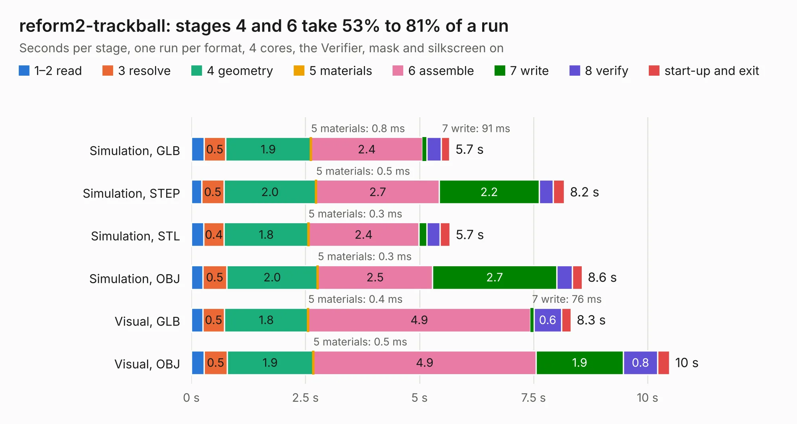

# 1368. reform2-trackball

Board 1,368 of the 3,131 of [Corpus Testing](../Corpus-Testing.md), on [Corpus Page 13](../CorpusTestingPages/Corpus-Testing-13.md#1368-reform2-trackball).

| Mode and format | 1–2 read | 3 resolve | 4 geometry | 5 materials | 6 assemble | 7 write | 8 verify | start-up and exit | Total |
|---|---:|---:|---:|---:|---:|---:|---:|---:|---:|
| Simulation, GLB | 0.3 | 0.5 | 1.9 | 0.8&nbsp;ms | 2.4 | 91&nbsp;ms | 0.3 | 0.2 | 5.7 |
| Simulation, STEP | 0.2 | 0.5 | 2.0 | 0.5&nbsp;ms | 2.7 | 2.2 | 0.3 | 0.2 | 8.2 |
| Simulation, STL | 0.3 | 0.4 | 1.8 | 0.3&nbsp;ms | 2.4 | 0.2 | 0.3 | 0.2 | 5.7 |
| Simulation, OBJ | 0.3 | 0.5 | 2.0 | 0.3&nbsp;ms | 2.5 | 2.7 | 0.3 | 0.2 | 8.6 |
| Visual, GLB | 0.3 | 0.5 | 1.8 | 0.4&nbsp;ms | 4.9 | 76&nbsp;ms | 0.6 | 0.2 | 8.3 |
| Visual, OBJ | 0.3 | 0.5 | 1.9 | 0.5&nbsp;ms | 4.9 | 1.9 | 0.8 | 0.3 | 10.5 |

<table align="center"><tr><td valign="top">

| Board | Repo: [jackhumbert/reform](https://github.com/jackhumbert/reform) Board: `reform2-trackball.kicad_pcb` |
|---|---|
| Folder | reform2-trackball-pcb |
| Complexity | 246&nbsp;/&nbsp;1000 (size&nbsp;201, features&nbsp;45) |
| KESE&nbsp;features | through vias, rounded, trapezoid or chamfered pads, filled zones |
| Tested | 9th November 2026 |
| Copper&nbsp;layers | 2 |
| File&nbsp;format | KiCad 5 (20171130) |
| Parts,&nbsp;tracks,&nbsp;vias | 37, 376, 74 |
| Triangles,&nbsp;simulation | 545,428 in 55 parts |
| Verifier | PASS in all six runs |

</td><td valign="top">

<table>
<tr><th>File type</th><th>File size</th><th>Peak memory used</th></tr>
<tr><th colspan="3" align="left">Simulation</th></tr>
<tr><td>GLB</td><td align="right">19&nbsp;MB</td><td align="right">328&nbsp;MB</td></tr>
<tr><td>STEP</td><td align="right">89&nbsp;MB</td><td align="right">410&nbsp;MB</td></tr>
<tr><td>STL</td><td align="right">27&nbsp;MB</td><td align="right">323&nbsp;MB</td></tr>
<tr><td>OBJ</td><td align="right">55&nbsp;MB</td><td align="right">414&nbsp;MB</td></tr>
<tr><th colspan="3" align="left">Visual</th></tr>
<tr><td>GLB</td><td align="right">16&nbsp;MB</td><td align="right">445&nbsp;MB</td></tr>
<tr><td>OBJ</td><td align="right">48&nbsp;MB</td><td align="right">444&nbsp;MB</td></tr>
</table>

</td></tr></table>

| Previous | Next |
|:---|---:|
| [1367. reform2-protected-batterypack-pcb](b1367b_reform_reform2-protected-batterypack-pcb.md) | [1369. reform2-trackball-sensor](b1369b_reform_reform2-trackball-sensor.md) |
