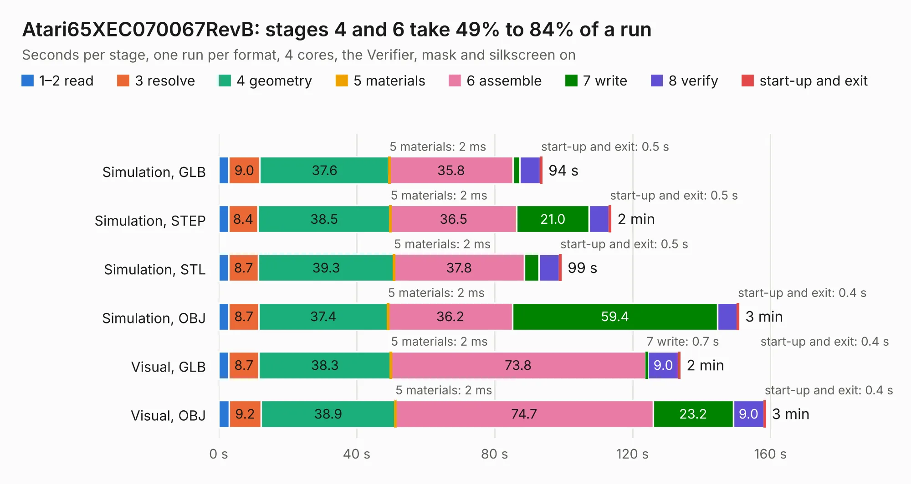

# 1369. Atari65XEC070067RevB

Board 1,369 of the 3,105 of [Corpus Testing](../Corpus-Testing.md), on [Corpus Page 13](../CorpusTestingPages/Corpus-Testing-13.md#1369-atari65xec070067revb).

| Mode and format | 1–2 read | 3 resolve | 4 geometry | 5 materials | 6 assemble | 7 write | 8 verify | start-up and exit | Total |
|---|---:|---:|---:|---:|---:|---:|---:|---:|---:|
| Simulation, GLB | 2.9 | 9.0 | 37.6 | 2&nbsp;ms | 35.8 | 2.0 | 6.0 | 0.5 | 93.7 |
| Simulation, STEP | 2.9 | 8.4 | 38.5 | 2&nbsp;ms | 36.5 | 21.0 | 5.8 | 0.5 | 113.7 |
| Simulation, STL | 2.9 | 8.7 | 39.3 | 2&nbsp;ms | 37.8 | 4.3 | 5.9 | 0.5 | 99.3 |
| Simulation, OBJ | 3.0 | 8.7 | 37.4 | 2&nbsp;ms | 36.2 | 59.4 | 5.8 | 0.4 | 150.8 |
| Visual, GLB | 2.9 | 8.7 | 38.3 | 2&nbsp;ms | 73.8 | 0.7 | 9.0 | 0.4 | 133.8 |
| Visual, OBJ | 3.1 | 9.2 | 38.9 | 2&nbsp;ms | 74.7 | 23.2 | 9.0 | 0.4 | 158.5 |

<table align="center"><tr><td valign="top">

| Board | Repo: [jimbro1000/Atari65_130XE_C070067](https://github.com/jimbro1000/Atari65_130XE_C070067) Board: `Atari65XEC070067RevB.kicad_pcb` |
|---|---|
| Complexity | 338&nbsp;/&nbsp;1000 (size&nbsp;243, features&nbsp;95) |
| KESE&nbsp;features | through vias, slotted holes, rounded, trapezoid or chamfered pads, filled zones, copper text, stack-up, dielectric εr and tanδ |
| Tested | 9th November 2026 |
| Copper&nbsp;layers | 4 |
| File&nbsp;format | KiCad 9 (20241229) |
| Parts,&nbsp;tracks,&nbsp;vias | 340, 6,477, 429 |
| Triangles,&nbsp;simulation | 11,867,082 in 328 parts |
| Verifier | PASS in all six runs |

</td><td valign="top">

<table>
<tr><th>File type</th><th>File size</th><th>Peak memory used</th></tr>
<tr><th colspan="3" align="left">Simulation</th></tr>
<tr><td>GLB</td><td align="right">401&nbsp;MB</td><td align="right">2.6&nbsp;GB</td></tr>
<tr><td>STEP</td><td align="right">1.4&nbsp;GB</td><td align="right">3.5&nbsp;GB</td></tr>
<tr><td>STL</td><td align="right">593&nbsp;MB</td><td align="right">2.7&nbsp;GB</td></tr>
<tr><td>OBJ</td><td align="right">1.3&nbsp;GB</td><td align="right">7.4&nbsp;GB</td></tr>
<tr><th colspan="3" align="left">Visual</th></tr>
<tr><td>GLB</td><td align="right">179&nbsp;MB</td><td align="right">3.0&nbsp;GB</td></tr>
<tr><td>OBJ</td><td align="right">577&nbsp;MB</td><td align="right">3.6&nbsp;GB</td></tr>
</table>

</td></tr></table>

| Previous | Next |
|:---|---:|
| [1368. pong](b1368b_pong_pong.md) | [1370. Commodore-Vic-20](b1370b_Commodore-Vic-20_Commodore-Vic-20.md) |
