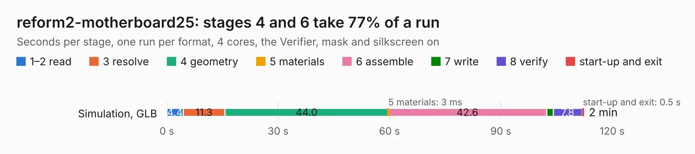

# 1369. reform2-motherboard25

Board 1,369 of the 3,138 of [Corpus Testing](../Corpus-Testing.md), on [Corpus Page 13](../CorpusTestingPages/Corpus-Testing-13.md#1369-reform2-motherboard25).

| Mode and format | 1–2 read | 3 resolve | 4 geometry | 5 materials | 6 assemble | 7 write | 8 verify | start-up and exit | Total |
|---|---:|---:|---:|---:|---:|---:|---:|---:|---:|
| Simulation, GLB | 4.4 | 11.3 | 44.0 | 3&nbsp;ms | 42.6 | 1.8 | 7.8 | 0.5 | 112.4 |
| Simulation, STEP | 4.4 | 11.1 | 43.4 | 2&nbsp;ms | 41.3 | 26.5 | 7.1 | 0.5 | 134.4 |
| Simulation, STL | 3.9 | 11.0 | 41.5 | 3&nbsp;ms | 41.0 | 3.8 | 7.4 | 0.5 | 109.0 |
| Simulation, OBJ | 3.8 | 10.6 | 40.2 | 4&nbsp;ms | 39.9 | 58.5 | 7.1 | 0.5 | 160.6 |
| Visual, GLB | 3.8 | 10.9 | 40.2 | 2&nbsp;ms | 92.0 | 1.0 | 8.6 | 0.4 | 156.9 |
| Visual, OBJ | 3.7 | 10.7 | 42.4 | 2&nbsp;ms | 93.4 | 36.9 | 11.2 | 0.4 | 198.7 |

<table align="center"><tr><td valign="top">

| Board | Repo: [jackhumbert/reform](https://github.com/jackhumbert/reform) Board: `reform2-motherboard25.kicad_pcb` |
|---|---|
| Folder | reform2-motherboard25-pcb |
| Complexity | 451&nbsp;/&nbsp;1000 (size&nbsp;326, features&nbsp;125) |
| KESE&nbsp;features | through vias, slotted holes, custom pads, rounded, trapezoid or chamfered pads, arc tracks, filled zones, copper drawings, stack-up, dielectric εr and tanδ |
| Tested | 9th November 2026 |
| Copper&nbsp;layers | 6 |
| File&nbsp;format | KiCad 6 (20211014) |
| Parts,&nbsp;tracks,&nbsp;vias | 486, 11,115, 1,079 |
| Triangles,&nbsp;simulation | 9,815,150 in 665 parts |
| Verifier | PASS in all six runs |

</td><td valign="top">

<table>
<tr><th>File type</th><th>File size</th><th>Peak memory used</th></tr>
<tr><th colspan="3" align="left">Simulation</th></tr>
<tr><td>GLB</td><td align="right">328&nbsp;MB</td><td align="right">2.5&nbsp;GB</td></tr>
<tr><td>STEP</td><td align="right">1.4&nbsp;GB</td><td align="right">3.6&nbsp;GB</td></tr>
<tr><td>STL</td><td align="right">491&nbsp;MB</td><td align="right">2.5&nbsp;GB</td></tr>
<tr><td>OBJ</td><td align="right">1.1&nbsp;GB</td><td align="right">6.2&nbsp;GB</td></tr>
<tr><th colspan="3" align="left">Visual</th></tr>
<tr><td>GLB</td><td align="right">187&nbsp;MB</td><td align="right">3.1&nbsp;GB</td></tr>
<tr><td>OBJ</td><td align="right">608&nbsp;MB</td><td align="right">4.0&nbsp;GB</td></tr>
</table>

</td></tr></table>

| Previous | Next |
|:---|---:|
| [1368. reform2-motherboard](b1368b_reform_reform2-motherboard.md) | [1370. reform2-oled](b1370b_reform_reform2-oled.md) |
