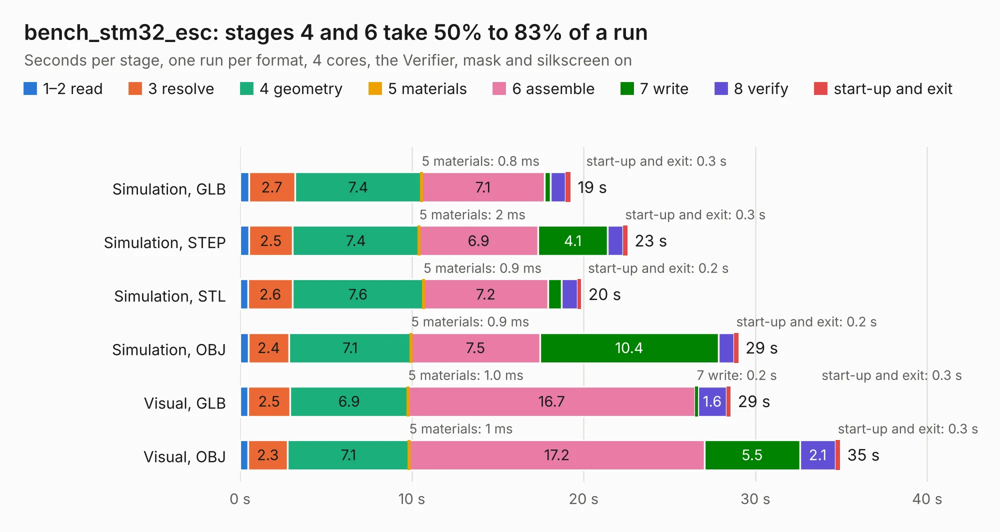

# 1370. bench_stm32_esc

Board 1,370 of the 3,128 of [Corpus Testing](../Corpus-Testing.md), on [Corpus Page 13](../CorpusTestingPages/Corpus-Testing-13.md#1370-bench_stm32_esc).

| Mode and format | 1–2 read | 3 resolve | 4 geometry | 5 materials | 6 assemble | 7 write | 8 verify | start-up and exit | Total |
|---|---:|---:|---:|---:|---:|---:|---:|---:|---:|
| Simulation, GLB | 0.5 | 2.7 | 7.4 | 0.8&nbsp;ms | 7.1 | 0.4 | 0.9 | 0.3 | 19.2 |
| Simulation, STEP | 0.5 | 2.5 | 7.4 | 2&nbsp;ms | 6.9 | 4.1 | 0.9 | 0.3 | 22.6 |
| Simulation, STL | 0.5 | 2.6 | 7.6 | 0.9&nbsp;ms | 7.2 | 0.8 | 0.9 | 0.2 | 19.9 |
| Simulation, OBJ | 0.5 | 2.4 | 7.1 | 0.9&nbsp;ms | 7.5 | 10.4 | 0.9 | 0.2 | 29.0 |
| Visual, GLB | 0.5 | 2.5 | 6.9 | 1.0&nbsp;ms | 16.7 | 0.2 | 1.6 | 0.3 | 28.6 |
| Visual, OBJ | 0.5 | 2.3 | 7.1 | 1&nbsp;ms | 17.2 | 5.5 | 2.1 | 0.3 | 34.9 |

<table align="center"><tr><td valign="top">

| Board | Repo: [jamesgossy/stm32-brushless-motor-controller](https://github.com/jamesgossy/stm32-brushless-motor-controller) Board: `bench_stm32_esc.kicad_pcb` |
|---|---|
| Folder | controller_hardware |
| Complexity | 366&nbsp;/&nbsp;1000 (size&nbsp;266, features&nbsp;100) |
| KESE&nbsp;features | through vias, slotted holes, custom pads, rounded, trapezoid or chamfered pads, filled zones, stack-up, dielectric εr and tanδ |
| Tested | 9th November 2026 |
| Copper&nbsp;layers | 4 |
| File&nbsp;format | KiCad 10 (20260206) |
| Parts,&nbsp;tracks,&nbsp;vias | 171, 752, 666 |
| Triangles,&nbsp;simulation | 2,472,356 in 153 parts |
| Verifier | PASS in all six runs |

</td><td valign="top">

<table>
<tr><th>File type</th><th>File size</th><th>Peak memory used</th></tr>
<tr><th colspan="3" align="left">Simulation</th></tr>
<tr><td>GLB</td><td align="right">84&nbsp;MB</td><td align="right">847&nbsp;MB</td></tr>
<tr><td>STEP</td><td align="right">276&nbsp;MB</td><td align="right">1.0&nbsp;GB</td></tr>
<tr><td>STL</td><td align="right">124&nbsp;MB</td><td align="right">905&nbsp;MB</td></tr>
<tr><td>OBJ</td><td align="right">259&nbsp;MB</td><td align="right">1.6&nbsp;GB</td></tr>
<tr><th colspan="3" align="left">Visual</th></tr>
<tr><td>GLB</td><td align="right">46&nbsp;MB</td><td align="right">904&nbsp;MB</td></tr>
<tr><td>OBJ</td><td align="right">144&nbsp;MB</td><td align="right">985&nbsp;MB</td></tr>
</table>

</td></tr></table>

| Previous | Next |
|:---|---:|
| [1369. reform2-trackpad](b1369b_reform_reform2-trackpad.md) | [1371. LibreCAL](b1371b_LibreCAL_LibreCAL.md) |
