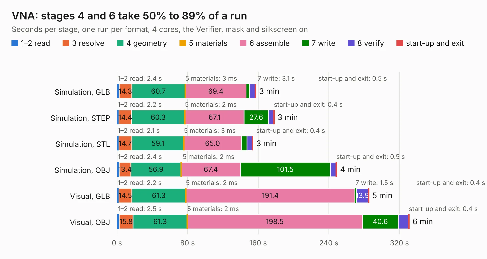

# 1372. VNA

Board 1,372 of the 3,126 of [Corpus Testing](../Corpus-Testing.md), on [Corpus Page 13](../CorpusTestingPages/Corpus-Testing-13.md#1372-vna).

| Mode and format | 1–2 read | 3 resolve | 4 geometry | 5 materials | 6 assemble | 7 write | 8 verify | start-up and exit | Total |
|---|---:|---:|---:|---:|---:|---:|---:|---:|---:|
| Simulation, GLB | 2.4 | 14.3 | 60.7 | 3&nbsp;ms | 69.4 | 3.1 | 6.8 | 0.5 | 157.1 |
| Simulation, STEP | 2.2 | 14.4 | 60.3 | 2&nbsp;ms | 67.1 | 27.6 | 6.0 | 0.4 | 178.0 |
| Simulation, STL | 2.1 | 14.7 | 59.1 | 3&nbsp;ms | 65.0 | 6.6 | 6.1 | 0.4 | 153.9 |
| Simulation, OBJ | 2.4 | 13.4 | 56.9 | 2&nbsp;ms | 67.4 | 101.5 | 6.8 | 0.5 | 248.8 |
| Visual, GLB | 2.2 | 14.5 | 61.3 | 2&nbsp;ms | 191.4 | 1.5 | 13.9 | 0.4 | 285.3 |
| Visual, OBJ | 2.5 | 15.8 | 61.3 | 2&nbsp;ms | 198.5 | 40.6 | 11.9 | 0.4 | 330.9 |

<table align="center"><tr><td valign="top">

| Board | Repo: [jankae/LibreVNA](https://github.com/jankae/LibreVNA) Board: `VNA.kicad_pcb` |
|---|---|
| Folder | Hardware / Kicad |
| Complexity | 435&nbsp;/&nbsp;1000 (size&nbsp;320, features&nbsp;115) |
| KESE&nbsp;features | through vias, slotted holes, rounded, trapezoid or chamfered pads, arc tracks, filled zones, copper drawings, stack-up, dielectric εr and tanδ, mask and silkscreen colours |
| Tested | 9th November 2026 |
| Copper&nbsp;layers | 6 |
| File&nbsp;format | KiCad 9 (20241229) |
| Parts,&nbsp;tracks,&nbsp;vias | 571, 3,708, 2,932 |
| Triangles,&nbsp;simulation | 14,321,852 in 455 parts |
| Verifier | PASS in all six runs |

</td><td valign="top">

<table>
<tr><th>File type</th><th>File size</th><th>Peak memory used</th></tr>
<tr><th colspan="3" align="left">Simulation</th></tr>
<tr><td>GLB</td><td align="right">464&nbsp;MB</td><td align="right">3.8&nbsp;GB</td></tr>
<tr><td>STEP</td><td align="right">1.3&nbsp;GB</td><td align="right">5.1&nbsp;GB</td></tr>
<tr><td>STL</td><td align="right">716&nbsp;MB</td><td align="right">3.8&nbsp;GB</td></tr>
<tr><td>OBJ</td><td align="right">1.5&nbsp;GB</td><td align="right">8.8&nbsp;GB</td></tr>
<tr><th colspan="3" align="left">Visual</th></tr>
<tr><td>GLB</td><td align="right">202&nbsp;MB</td><td align="right">3.6&nbsp;GB</td></tr>
<tr><td>OBJ</td><td align="right">677&nbsp;MB</td><td align="right">4.3&nbsp;GB</td></tr>
</table>

</td></tr></table>

| Previous | Next |
|:---|---:|
| [1371. LibreCAL](b1371b_LibreCAL_LibreCAL.md) | [1373. TICK](b1373b_Amiga-2000-EATX_TICK-TICK-Dual-0805_TICK.md) |
