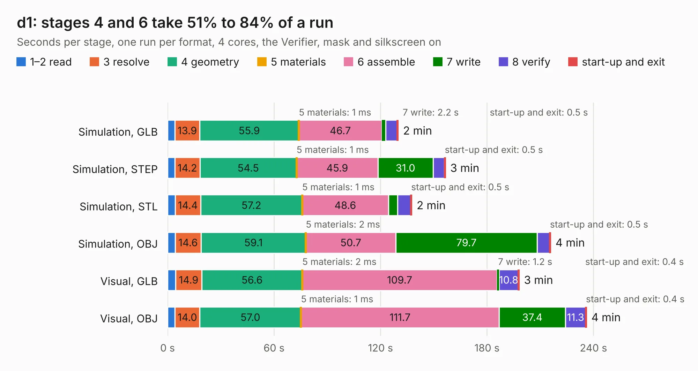

# 1372. d1

Board 1,372 of the 3,111 of [Corpus Testing](../Corpus-Testing.md), on [Corpus Page 13](../CorpusTestingPages/Corpus-Testing-13.md#1372-d1).

| Mode and format | 1–2 read | 3 resolve | 4 geometry | 5 materials | 6 assemble | 7 write | 8 verify | start-up and exit | Total |
|---|---:|---:|---:|---:|---:|---:|---:|---:|---:|
| Simulation, GLB | 4.2 | 13.9 | 55.9 | 1&nbsp;ms | 46.7 | 2.2 | 6.4 | 0.5 | 129.9 |
| Simulation, STEP | 4.1 | 14.2 | 54.5 | 1&nbsp;ms | 45.9 | 31.0 | 6.4 | 0.5 | 156.5 |
| Simulation, STL | 4.3 | 14.4 | 57.2 | 1&nbsp;ms | 48.6 | 5.0 | 7.5 | 0.5 | 137.6 |
| Simulation, OBJ | 4.3 | 14.6 | 59.1 | 2&nbsp;ms | 50.7 | 79.7 | 7.0 | 0.5 | 215.8 |
| Visual, GLB | 4.4 | 14.9 | 56.6 | 2&nbsp;ms | 109.7 | 1.2 | 10.8 | 0.4 | 198.0 |
| Visual, OBJ | 4.2 | 14.0 | 57.0 | 1&nbsp;ms | 111.7 | 37.4 | 11.3 | 0.4 | 236.0 |

<table align="center"><tr><td valign="top">

| Board | Repo: [jgw4/doppel-1](https://github.com/jgw4/doppel-1) Board: `d1.kicad_pcb` |
|---|---|
| Complexity | 437&nbsp;/&nbsp;1000 (size&nbsp;237, features&nbsp;200) |
| KESE&nbsp;features | through vias, padstacks, arc tracks, filled zones, copper drawings, copper text, curved board outline, TrueType text, hatched fills, stack-up, dielectric εr and tanδ, copper finish, mask and silkscreen colours |
| Tested | 9th November 2026 |
| Copper&nbsp;layers | 2 |
| File&nbsp;format | KiCad 10 (20260206) |
| Parts,&nbsp;tracks,&nbsp;vias | 165, 22,935, 299 |
| Triangles,&nbsp;simulation | 10,495,926 in 298 parts |
| Verifier | PASS in all six runs |

</td><td valign="top">

<table>
<tr><th>File type</th><th>File size</th><th>Peak memory used</th></tr>
<tr><th colspan="3" align="left">Simulation</th></tr>
<tr><td>GLB</td><td align="right">354&nbsp;MB</td><td align="right">2.8&nbsp;GB</td></tr>
<tr><td>STEP</td><td align="right">1.9&nbsp;GB</td><td align="right">3.9&nbsp;GB</td></tr>
<tr><td>STL</td><td align="right">525&nbsp;MB</td><td align="right">2.7&nbsp;GB</td></tr>
<tr><td>OBJ</td><td align="right">1.1&nbsp;GB</td><td align="right">8.8&nbsp;GB</td></tr>
<tr><th colspan="3" align="left">Visual</th></tr>
<tr><td>GLB</td><td align="right">205&nbsp;MB</td><td align="right">3.3&nbsp;GB</td></tr>
<tr><td>OBJ</td><td align="right">654&nbsp;MB</td><td align="right">4.2&nbsp;GB</td></tr>
</table>

</td></tr></table>

| Previous | Next |
|:---|---:|
| [1371. baseboard](b1371b_baseboard_baseboard.md) | [1373. PCB-11](b1373b_doppel-1_PCB-11.md) |
