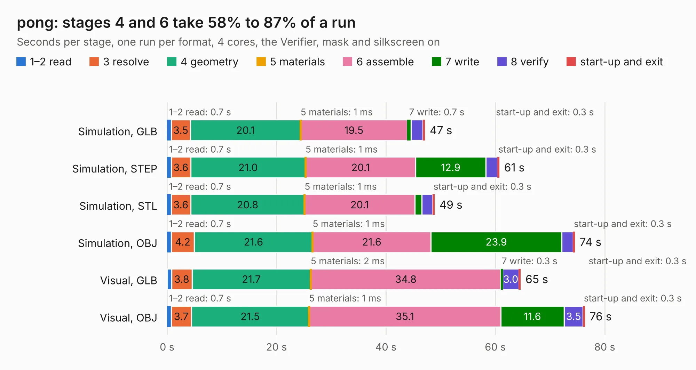

# 1373. pong

Board 1,373 of the 3,110 of [Corpus Testing](../Corpus-Testing.md), on [Corpus Page 13](../CorpusTestingPages/Corpus-Testing-13.md#1373-pong).

| Mode and format | 1–2 read | 3 resolve | 4 geometry | 5 materials | 6 assemble | 7 write | 8 verify | start-up and exit | Total |
|---|---:|---:|---:|---:|---:|---:|---:|---:|---:|
| Simulation, GLB | 0.7 | 3.5 | 20.1 | 1&nbsp;ms | 19.5 | 0.7 | 2.2 | 0.3 | 47.1 |
| Simulation, STEP | 0.7 | 3.6 | 21.0 | 1&nbsp;ms | 20.1 | 12.9 | 2.1 | 0.3 | 60.7 |
| Simulation, STL | 0.7 | 3.6 | 20.8 | 1&nbsp;ms | 20.1 | 1.3 | 2.0 | 0.3 | 48.9 |
| Simulation, OBJ | 0.7 | 4.2 | 21.6 | 1&nbsp;ms | 21.6 | 23.9 | 2.0 | 0.3 | 74.5 |
| Visual, GLB | 0.8 | 3.8 | 21.7 | 2&nbsp;ms | 34.8 | 0.3 | 3.0 | 0.3 | 64.6 |
| Visual, OBJ | 0.7 | 3.7 | 21.5 | 1&nbsp;ms | 35.1 | 11.6 | 3.5 | 0.3 | 76.3 |

<table align="center"><tr><td valign="top">

| Board | Repo: [jgw4/pong](https://github.com/jgw4/pong) Board: `pong.kicad_pcb` |
|---|---|
| Complexity | 251&nbsp;/&nbsp;1000 (size&nbsp;186, features&nbsp;65) |
| KESE&nbsp;features | through vias, rounded, trapezoid or chamfered pads, filled zones, copper text, curved board outline |
| Tested | 9th November 2026 |
| Copper&nbsp;layers | 2 |
| File&nbsp;format | KiCad 10 (20260206) |
| Parts,&nbsp;tracks,&nbsp;vias | 131, 1,133, 20 |
| Triangles,&nbsp;simulation | 4,215,822 in 374 parts |
| Verifier | PASS in all six runs |

</td><td valign="top">

<table>
<tr><th>File type</th><th>File size</th><th>Peak memory used</th></tr>
<tr><th colspan="3" align="left">Simulation</th></tr>
<tr><td>GLB</td><td align="right">140&nbsp;MB</td><td align="right">1.2&nbsp;GB</td></tr>
<tr><td>STEP</td><td align="right">663&nbsp;MB</td><td align="right">1.7&nbsp;GB</td></tr>
<tr><td>STL</td><td align="right">211&nbsp;MB</td><td align="right">1.2&nbsp;GB</td></tr>
<tr><td>OBJ</td><td align="right">443&nbsp;MB</td><td align="right">2.7&nbsp;GB</td></tr>
<tr><th colspan="3" align="left">Visual</th></tr>
<tr><td>GLB</td><td align="right">68&nbsp;MB</td><td align="right">1.2&nbsp;GB</td></tr>
<tr><td>OBJ</td><td align="right">216&nbsp;MB</td><td align="right">1.5&nbsp;GB</td></tr>
</table>

</td></tr></table>

| Previous | Next |
|:---|---:|
| [1372. PCB-11](b1372b_doppel-1_PCB-11.md) | [1374. Atari65XEC070067RevB](b1374b_Atari65-130XE-C070067_Atari65XEC070067RevB.md) |
