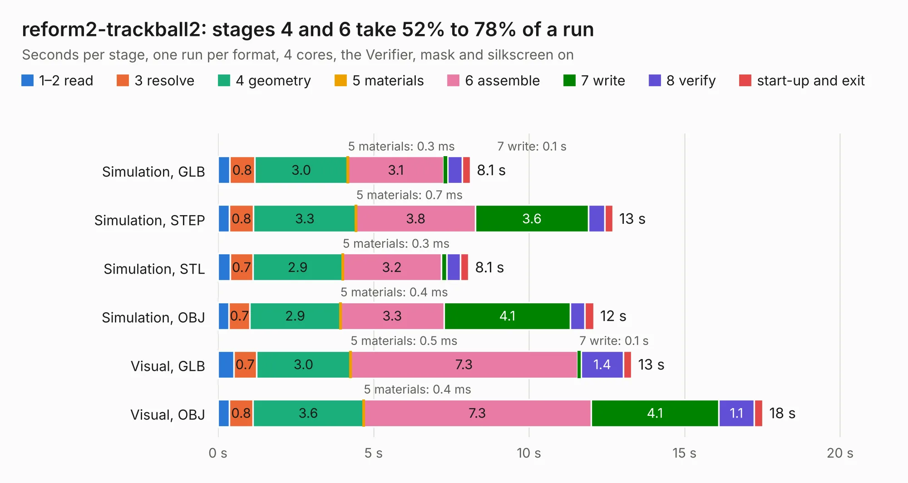

# 1374. reform2-trackball2

Board 1,374 of the 3,139 of [Corpus Testing](../Corpus-Testing.md), on [Corpus Page 13](../CorpusTestingPages/Corpus-Testing-13.md#1374-reform2-trackball2).

| Mode and format | 1–2 read | 3 resolve | 4 geometry | 5 materials | 6 assemble | 7 write | 8 verify | start-up and exit | Total |
|---|---:|---:|---:|---:|---:|---:|---:|---:|---:|
| Simulation, GLB | 0.4 | 0.8 | 3.0 | 0.3&nbsp;ms | 3.1 | 0.1 | 0.5 | 0.3 | 8.1 |
| Simulation, STEP | 0.4 | 0.8 | 3.3 | 0.7&nbsp;ms | 3.8 | 3.6 | 0.5 | 0.3 | 12.7 |
| Simulation, STL | 0.4 | 0.7 | 2.9 | 0.3&nbsp;ms | 3.2 | 0.2 | 0.4 | 0.3 | 8.1 |
| Simulation, OBJ | 0.4 | 0.7 | 2.9 | 0.4&nbsp;ms | 3.3 | 4.1 | 0.5 | 0.3 | 12.1 |
| Visual, GLB | 0.5 | 0.7 | 3.0 | 0.5&nbsp;ms | 7.3 | 0.1 | 1.4 | 0.3 | 13.3 |
| Visual, OBJ | 0.4 | 0.8 | 3.6 | 0.4&nbsp;ms | 7.3 | 4.1 | 1.1 | 0.3 | 17.5 |

<table align="center"><tr><td valign="top">

| Board | Repo: [jackhumbert/reform](https://github.com/jackhumbert/reform) Board: `reform2-trackball2.kicad_pcb` |
|---|---|
| Folder | reform2-trackball2-pcb |
| Complexity | 302&nbsp;/&nbsp;1000 (size&nbsp;207, features&nbsp;95) |
| KESE&nbsp;features | through vias, rounded, trapezoid or chamfered pads, filled zones, stack-up, dielectric εr and tanδ, copper finish, mask and silkscreen colours |
| Tested | 9th November 2026 |
| Copper&nbsp;layers | 2 |
| File&nbsp;format | KiCad 6 (20211014) |
| Parts,&nbsp;tracks,&nbsp;vias | 55, 473, 70 |
| Triangles,&nbsp;simulation | 665,254 in 76 parts |
| Verifier | PASS in all six runs |

</td><td valign="top">

<table>
<tr><th>File type</th><th>File size</th><th>Peak memory used</th></tr>
<tr><th colspan="3" align="left">Simulation</th></tr>
<tr><td>GLB</td><td align="right">23&nbsp;MB</td><td align="right">374&nbsp;MB</td></tr>
<tr><td>STEP</td><td align="right">121&nbsp;MB</td><td align="right">458&nbsp;MB</td></tr>
<tr><td>STL</td><td align="right">33&nbsp;MB</td><td align="right">373&nbsp;MB</td></tr>
<tr><td>OBJ</td><td align="right">67&nbsp;MB</td><td align="right">473&nbsp;MB</td></tr>
<tr><th colspan="3" align="left">Visual</th></tr>
<tr><td>GLB</td><td align="right">19&nbsp;MB</td><td align="right">524&nbsp;MB</td></tr>
<tr><td>OBJ</td><td align="right">57&nbsp;MB</td><td align="right">459&nbsp;MB</td></tr>
</table>

</td></tr></table>

| Previous | Next |
|:---|---:|
| [1373. reform2-trackball-sensor](b1373b_reform_reform2-trackball-sensor.md) | [1375. reform2-trackpad](b1375b_reform_reform2-trackpad.md) |
