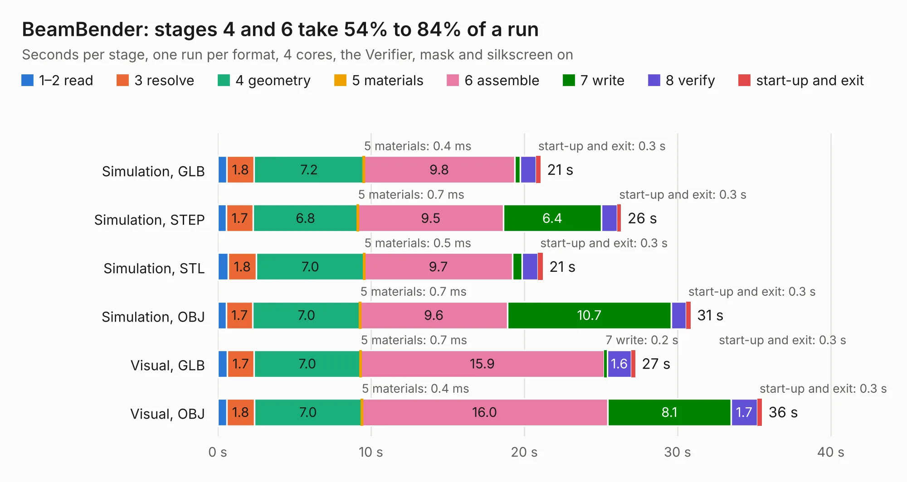

# 1375. BeamBender

Board 1,375 of the 3,118 of [Corpus Testing](../Corpus-Testing.md), on [Corpus Page 13](../CorpusTestingPages/Corpus-Testing-13.md#1375-beambender).

| Mode and format | 1–2 read | 3 resolve | 4 geometry | 5 materials | 6 assemble | 7 write | 8 verify | start-up and exit | Total |
|---|---:|---:|---:|---:|---:|---:|---:|---:|---:|
| Simulation, GLB | 0.6 | 1.8 | 7.2 | 0.4&nbsp;ms | 9.8 | 0.4 | 1.0 | 0.3 | 21.1 |
| Simulation, STEP | 0.6 | 1.7 | 6.8 | 0.7&nbsp;ms | 9.5 | 6.4 | 1.0 | 0.3 | 26.3 |
| Simulation, STL | 0.7 | 1.8 | 7.0 | 0.5&nbsp;ms | 9.7 | 0.6 | 1.0 | 0.3 | 21.2 |
| Simulation, OBJ | 0.6 | 1.7 | 7.0 | 0.7&nbsp;ms | 9.6 | 10.7 | 1.0 | 0.3 | 30.9 |
| Visual, GLB | 0.6 | 1.7 | 7.0 | 0.7&nbsp;ms | 15.9 | 0.2 | 1.6 | 0.3 | 27.2 |
| Visual, OBJ | 0.6 | 1.8 | 7.0 | 0.4&nbsp;ms | 16.0 | 8.1 | 1.7 | 0.3 | 35.5 |

<table align="center"><tr><td valign="top">

| Board | Repo: [jbilander/BeamBender](https://github.com/jbilander/BeamBender) Board: `BeamBender.kicad_pcb` |
|---|---|
| Folder | KiCad / A1200-A500 |
| Complexity | 310&nbsp;/&nbsp;1000 (size&nbsp;255, features&nbsp;55) |
| KESE&nbsp;features | through vias, rounded, trapezoid or chamfered pads, filled zones, curved board outline |
| Tested | 9th November 2026 |
| Copper&nbsp;layers | 4 |
| File&nbsp;format | KiCad 5 (20171130) |
| Parts,&nbsp;tracks,&nbsp;vias | 100, 1,402, 218 |
| Triangles,&nbsp;simulation | 1,833,394 in 186 parts |
| Verifier | PASS in all six runs |

</td><td valign="top">

<table>
<tr><th>File type</th><th>File size</th><th>Peak memory used</th></tr>
<tr><th colspan="3" align="left">Simulation</th></tr>
<tr><td>GLB</td><td align="right">63&nbsp;MB</td><td align="right">716&nbsp;MB</td></tr>
<tr><td>STEP</td><td align="right">268&nbsp;MB</td><td align="right">878&nbsp;MB</td></tr>
<tr><td>STL</td><td align="right">92&nbsp;MB</td><td align="right">706&nbsp;MB</td></tr>
<tr><td>OBJ</td><td align="right">190&nbsp;MB</td><td align="right">1.2&nbsp;GB</td></tr>
<tr><th colspan="3" align="left">Visual</th></tr>
<tr><td>GLB</td><td align="right">46&nbsp;MB</td><td align="right">826&nbsp;MB</td></tr>
<tr><td>OBJ</td><td align="right">138&nbsp;MB</td><td align="right">1.0&nbsp;GB</td></tr>
</table>

</td></tr></table>

| Previous | Next |
|:---|---:|
| [1374. N2360](b1374b_Amiga-N2630_KiCAD-Archive-A2630-New-KiCAD-Rev401-PLCC_N2360.md) | [1376. SF2000](b1376b_SF2000_SF2000.md) |
