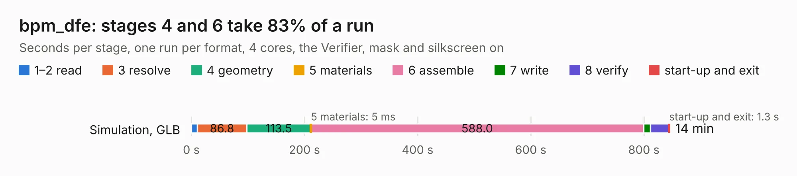

# 1376. bpm_dfe

Board 1,376 of the 3,138 of [Corpus Testing](../Corpus-Testing.md), on [Corpus Page 13](../CorpusTestingPages/Corpus-Testing-13.md#1376-bpm_dfe).

| Mode and format | 1–2 read | 3 resolve | 4 geometry | 5 materials | 6 assemble | 7 write | 8 verify | start-up and exit | Total |
|---|---:|---:|---:|---:|---:|---:|---:|---:|---:|
| Simulation, GLB | 10.9 | 86.8 | 113.5 | 5&nbsp;ms | 588.0 | 12.2 | 32.4 | 1.3 | 845.3 |
| Simulation, STEP |  |  |  |  |  |  |  |  | exceeded 11 GB on a 15 GB machine (stopped there, not a KESE failure); it will be run again on a machine with more memory |
| Simulation, STL |  |  |  |  |  |  |  |  | exceeded 11 GB on a 15 GB machine (stopped there, not a KESE failure); it will be run again on a machine with more memory |
| Simulation, OBJ |  |  |  |  |  |  |  |  | exceeded 11 GB on a 15 GB machine (stopped there, not a KESE failure); it will be run again on a machine with more memory |
| Visual, GLB |  |  |  |  |  |  |  |  | exceeded 11 GB on a 15 GB machine (stopped there, not a KESE failure); it will be run again on a machine with more memory |
| Visual, OBJ |  |  |  |  |  |  |  |  | exceeded 11 GB on a 15 GB machine (stopped there, not a KESE failure); it will be run again on a machine with more memory |

<table align="center"><tr><td valign="top">

| Board | Repo: [jamead/rfsocdfe-hw](https://github.com/jamead/rfsocdfe-hw) Board: `bpm_dfe.kicad_pcb` |
|---|---|
| Complexity | 548&nbsp;/&nbsp;1000 (size&nbsp;398, features&nbsp;150) |
| KESE&nbsp;features | through vias, padstacks, custom pads, rounded, trapezoid or chamfered pads, arc tracks, copper drawings, copper text, curved board outline, stack-up, dielectric εr and tanδ, mask and silkscreen colours |
| Tested | 9th November 2026 to 10th November 2026 |
| Copper&nbsp;layers | 20 |
| File&nbsp;format | KiCad 10 (20260206) |
| Parts,&nbsp;tracks,&nbsp;vias | 894, 28,449, 5,356 |
| Triangles,&nbsp;simulation | 63,452,914 in 1371 parts |
| Verifier | Simulation, STEP: exceeded 11 GB on a 15 GB machine (stopped there, not a KESE failure); it will be run again on a machine with more memory Simulation, STL: exceeded 11 GB on a 15 GB machine (stopped there, not a KESE failure); it will be run again on a machine with more memory Simulation, OBJ: exceeded 11 GB on a 15 GB machine (stopped there, not a KESE failure); it will be run again on a machine with more memory Visual, GLB: exceeded 11 GB on a 15 GB machine (stopped there, not a KESE failure); it will be run again on a machine with more memory Visual, OBJ: exceeded 11 GB on a 15 GB machine (stopped there, not a KESE failure); it will be run again on a machine with more memory |
| Run&nbsp;again | Simulation, GLB: failed in the corpus run, run again with the memory cap raised from 11 GB to 14.5 GB, and passed |

</td><td valign="top">

<table>
<tr><th>File type</th><th>File size</th><th>Peak memory used</th></tr>
<tr><th colspan="3" align="left">Simulation</th></tr>
<tr><td>GLB</td><td align="right">1.9&nbsp;GB</td><td align="right">14&nbsp;GB</td></tr>
<tr><td>STEP</td><td align="right">–</td><td align="right">11&nbsp;GB</td></tr>
<tr><td>STL</td><td align="right">–</td><td align="right">11&nbsp;GB</td></tr>
<tr><td>OBJ</td><td align="right">–</td><td align="right">11&nbsp;GB</td></tr>
<tr><th colspan="3" align="left">Visual</th></tr>
<tr><td>GLB</td><td align="right">–</td><td align="right">11&nbsp;GB</td></tr>
<tr><td>OBJ</td><td align="right">–</td><td align="right">11&nbsp;GB</td></tr>
</table>

</td></tr></table>

| Previous | Next |
|:---|---:|
| [1375. reform2-trackpad](b1375b_reform_reform2-trackpad.md) | [1377. bench_stm32_esc](b1377b_stm32-brushless-motor-controller_bench-stm32-esc.md) |
