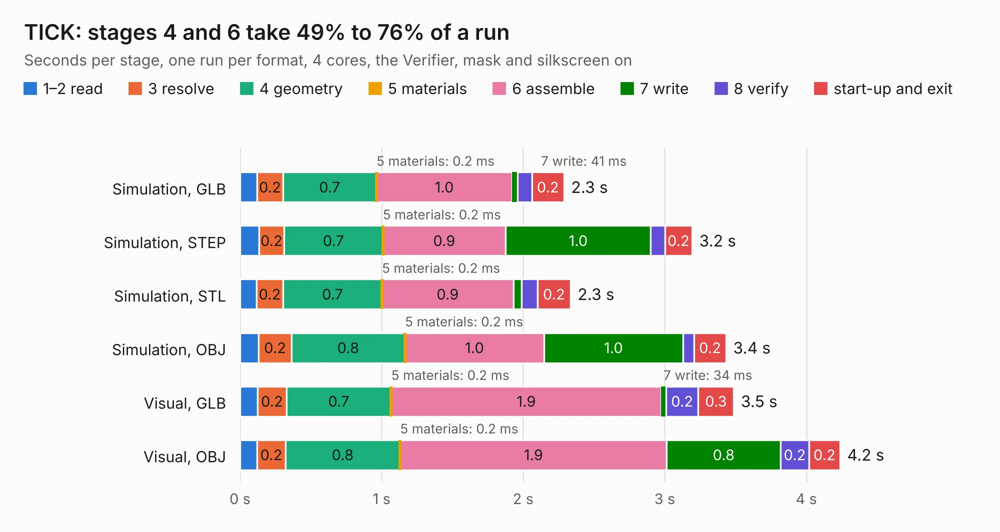

# 1377. TICK

Board 1,377 of the 3,130 of [Corpus Testing](../Corpus-Testing.md), on [Corpus Page 13](../CorpusTestingPages/Corpus-Testing-13.md#1377-tick).

| Mode and format | 1–2 read | 3 resolve | 4 geometry | 5 materials | 6 assemble | 7 write | 8 verify | start-up and exit | Total |
|---|---:|---:|---:|---:|---:|---:|---:|---:|---:|
| Simulation, GLB | 0.1 | 0.2 | 0.7 | 0.2&nbsp;ms | 1.0 | 41&nbsp;ms | 0.1 | 0.2 | 2.3 |
| Simulation, STEP | 0.1 | 0.2 | 0.7 | 0.2&nbsp;ms | 0.9 | 1.0 | 0.1 | 0.2 | 3.2 |
| Simulation, STL | 0.1 | 0.2 | 0.7 | 0.2&nbsp;ms | 0.9 | 58&nbsp;ms | 0.1 | 0.2 | 2.3 |
| Simulation, OBJ | 0.1 | 0.2 | 0.8 | 0.2&nbsp;ms | 1.0 | 1.0 | 78&nbsp;ms | 0.2 | 3.4 |
| Visual, GLB | 0.1 | 0.2 | 0.7 | 0.2&nbsp;ms | 1.9 | 34&nbsp;ms | 0.2 | 0.3 | 3.5 |
| Visual, OBJ | 0.1 | 0.2 | 0.8 | 0.2&nbsp;ms | 1.9 | 0.8 | 0.2 | 0.2 | 4.2 |

<table align="center"><tr><td valign="top">

| Board | Repo: [jasonsbeer/Amiga-2000-EATX](https://github.com/jasonsbeer/Amiga-2000-EATX) Board: `TICK.kicad_pcb` |
|---|---|
| Folder | TICK / TICK_OSC_KiCAD |
| Complexity | 162&nbsp;/&nbsp;1000 (size&nbsp;117, features&nbsp;45) |
| KESE&nbsp;features | through vias, rounded, trapezoid or chamfered pads, filled zones |
| Tested | 9th November 2026 |
| Copper&nbsp;layers | 2 |
| File&nbsp;format | KiCad 5 (20171130) |
| Parts,&nbsp;tracks,&nbsp;vias | 10, 66, 9 |
| Triangles,&nbsp;simulation | 189,498 in 34 parts |
| Verifier | PASS in all six runs |

</td><td valign="top">

<table>
<tr><th>File type</th><th>File size</th><th>Peak memory used</th></tr>
<tr><th colspan="3" align="left">Simulation</th></tr>
<tr><td>GLB</td><td align="right">6.5&nbsp;MB</td><td align="right">212&nbsp;MB</td></tr>
<tr><td>STEP</td><td align="right">31&nbsp;MB</td><td align="right">232&nbsp;MB</td></tr>
<tr><td>STL</td><td align="right">9.5&nbsp;MB</td><td align="right">213&nbsp;MB</td></tr>
<tr><td>OBJ</td><td align="right">19&nbsp;MB</td><td align="right">212&nbsp;MB</td></tr>
<tr><th colspan="3" align="left">Visual</th></tr>
<tr><td>GLB</td><td align="right">5.6&nbsp;MB</td><td align="right">217&nbsp;MB</td></tr>
<tr><td>OBJ</td><td align="right">16&nbsp;MB</td><td align="right">212&nbsp;MB</td></tr>
</table>

</td></tr></table>

| Previous | Next |
|:---|---:|
| [1376. TICK_AC](b1376b_Amiga-2000-EATX_TICK-AC.md) | [1378. N2360](b1378b_Amiga-N2630_KiCAD-A2630-New-KiCAD-Rev410-PGA_N2360.md) |
