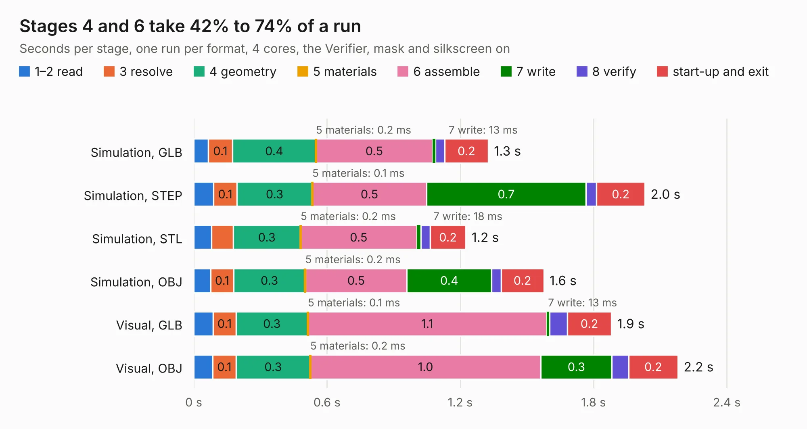

# 1378. OSO-SWAB-B1-00 Sensor Watch Accelerometer

Board 1,378 of the 3,101 of [Corpus Testing](../Corpus-Testing.md), on [Corpus Page 13](../CorpusTestingPages/Corpus-Testing-13.md#1378-oso-swab-b1-00-sensor-watch-accelerometer).

| Mode and format | 1–2 read | 3 resolve | 4 geometry | 5 materials | 6 assemble | 7 write | 8 verify | start-up and exit | Total |
|---|---:|---:|---:|---:|---:|---:|---:|---:|---:|
| Simulation, GLB | 65&nbsp;ms | 0.1 | 0.4 | 0.2&nbsp;ms | 0.5 | 13&nbsp;ms | 41&nbsp;ms | 0.2 | 1.3 |
| Simulation, STEP | 89&nbsp;ms | 0.1 | 0.3 | 0.1&nbsp;ms | 0.5 | 0.7 | 48&nbsp;ms | 0.2 | 2.0 |
| Simulation, STL | 80&nbsp;ms | 98&nbsp;ms | 0.3 | 0.2&nbsp;ms | 0.5 | 18&nbsp;ms | 42&nbsp;ms | 0.2 | 1.2 |
| Simulation, OBJ | 77&nbsp;ms | 0.1 | 0.3 | 0.2&nbsp;ms | 0.5 | 0.4 | 42&nbsp;ms | 0.2 | 1.6 |
| Visual, GLB | 88&nbsp;ms | 0.1 | 0.3 | 0.1&nbsp;ms | 1.1 | 13&nbsp;ms | 80&nbsp;ms | 0.2 | 1.9 |
| Visual, OBJ | 85&nbsp;ms | 0.1 | 0.3 | 0.2&nbsp;ms | 1.0 | 0.3 | 75&nbsp;ms | 0.2 | 2.2 |

<table align="center"><tr><td valign="top">

| Board | Repo: [joeycastillo/Sensor-Watch](https://github.com/joeycastillo/Sensor-Watch) Board: `OSO-SWAB-B1-00 Sensor Watch Accelerometer.kicad_pcb` |
|---|---|
| Folder | PCB / Sensor Boards / Kicad / OSO-SWAB-B1-00 Sensor Watch Accelerometer |
| Complexity | 182&nbsp;/&nbsp;1000 (size&nbsp;112, features&nbsp;70) |
| KESE&nbsp;features | through vias, rounded, trapezoid or chamfered pads, curved board outline, stack-up, dielectric εr and tanδ, mask and silkscreen colours |
| Tested | 9th November 2026 |
| Copper&nbsp;layers | 2 |
| File&nbsp;format | KiCad 6 (20211014) |
| Parts,&nbsp;tracks,&nbsp;vias | 4, 81, 12 |
| Triangles,&nbsp;simulation | 70,958 in 17 parts |
| Verifier | PASS in all six runs |

</td><td valign="top">

<table>
<tr><th>File type</th><th>File size</th><th>Peak memory used</th></tr>
<tr><th colspan="3" align="left">Simulation</th></tr>
<tr><td>GLB</td><td align="right">2.6&nbsp;MB</td><td align="right">177&nbsp;MB</td></tr>
<tr><td>STEP</td><td align="right">12&nbsp;MB</td><td align="right">177&nbsp;MB</td></tr>
<tr><td>STL</td><td align="right">3.5&nbsp;MB</td><td align="right">173&nbsp;MB</td></tr>
<tr><td>OBJ</td><td align="right">7.0&nbsp;MB</td><td align="right">182&nbsp;MB</td></tr>
<tr><th colspan="3" align="left">Visual</th></tr>
<tr><td>GLB</td><td align="right">2.2&nbsp;MB</td><td align="right">153&nbsp;MB</td></tr>
<tr><td>OBJ</td><td align="right">6.1&nbsp;MB</td><td align="right">153&nbsp;MB</td></tr>
</table>

</td></tr></table>

| Previous | Next |
|:---|---:|
| [1377. OSO-SWAT-C1](b1377b_Sensor-Watch_OSO-SWAT-C1.md) | [1379. Q3Q-SWAB-A1-00 Temperature + Test Points + OPT3001](b1379b_Sensor-Watch_Q3Q-SWAB-A1-00-Temperature-Test-Points-OPT3001.md) |
