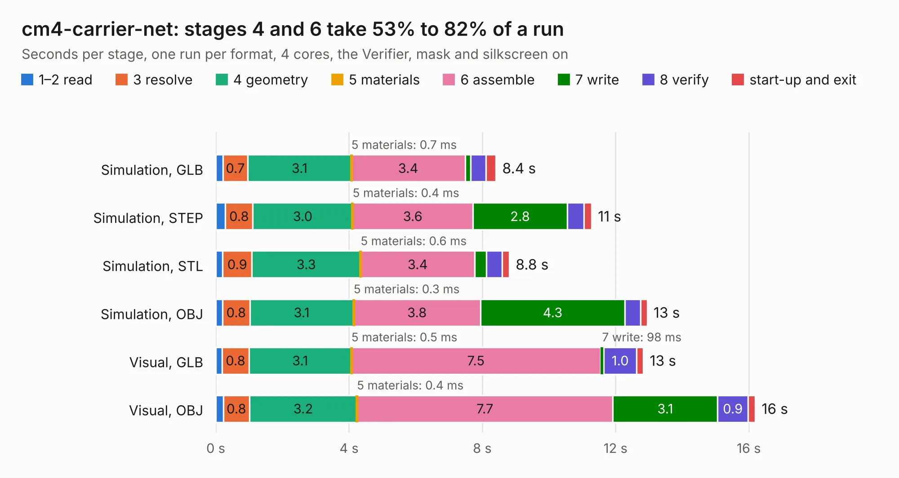

# 1379. cm4-carrier-net

Board 1,379 of the 3,111 of [Corpus Testing](../Corpus-Testing.md), on [Corpus Page 13](../CorpusTestingPages/Corpus-Testing-13.md#1379-cm4-carrier-net).

| Mode and format | 1–2 read | 3 resolve | 4 geometry | 5 materials | 6 assemble | 7 write | 8 verify | start-up and exit | Total |
|---|---:|---:|---:|---:|---:|---:|---:|---:|---:|
| Simulation, GLB | 0.2 | 0.7 | 3.1 | 0.7&nbsp;ms | 3.4 | 0.2 | 0.5 | 0.3 | 8.4 |
| Simulation, STEP | 0.3 | 0.8 | 3.0 | 0.4&nbsp;ms | 3.6 | 2.8 | 0.5 | 0.2 | 11.3 |
| Simulation, STL | 0.2 | 0.9 | 3.3 | 0.6&nbsp;ms | 3.4 | 0.4 | 0.5 | 0.2 | 8.8 |
| Simulation, OBJ | 0.2 | 0.8 | 3.1 | 0.3&nbsp;ms | 3.8 | 4.3 | 0.5 | 0.2 | 12.9 |
| Visual, GLB | 0.2 | 0.8 | 3.1 | 0.5&nbsp;ms | 7.5 | 98&nbsp;ms | 1.0 | 0.2 | 12.8 |
| Visual, OBJ | 0.2 | 0.8 | 3.2 | 0.4&nbsp;ms | 7.7 | 3.1 | 0.9 | 0.2 | 16.2 |

<table align="center"><tr><td valign="top">

| Board | Repo: [jkiv/cm4-carriers](https://github.com/jkiv/cm4-carriers) Board: `cm4-carrier-net.kicad_pcb` |
|---|---|
| Folder | hardware / cm4-carrier-net |
| Complexity | 272&nbsp;/&nbsp;1000 (size&nbsp;197, features&nbsp;75) |
| KESE&nbsp;features | through vias, slotted holes, rounded, trapezoid or chamfered pads, filled zones, copper text, curved board outline |
| Tested | 9th November 2026 |
| Copper&nbsp;layers | 4 |
| File&nbsp;format | KiCad 5 (20171130) |
| Parts,&nbsp;tracks,&nbsp;vias | 38, 1,560, 107 |
| Triangles,&nbsp;simulation | 930,710 in 109 parts |
| Verifier | PASS in all six runs |

</td><td valign="top">

<table>
<tr><th>File type</th><th>File size</th><th>Peak memory used</th></tr>
<tr><th colspan="3" align="left">Simulation</th></tr>
<tr><td>GLB</td><td align="right">31&nbsp;MB</td><td align="right">416&nbsp;MB</td></tr>
<tr><td>STEP</td><td align="right">133&nbsp;MB</td><td align="right">512&nbsp;MB</td></tr>
<tr><td>STL</td><td align="right">47&nbsp;MB</td><td align="right">446&nbsp;MB</td></tr>
<tr><td>OBJ</td><td align="right">94&nbsp;MB</td><td align="right">653&nbsp;MB</td></tr>
<tr><th colspan="3" align="left">Visual</th></tr>
<tr><td>GLB</td><td align="right">21&nbsp;MB</td><td align="right">563&nbsp;MB</td></tr>
<tr><td>OBJ</td><td align="right">63&nbsp;MB</td><td align="right">569&nbsp;MB</td></tr>
</table>

</td></tr></table>

| Previous | Next |
|:---|---:|
| [1378. Dragon32](b1378b_Dragon32Rev3_Dragon32.md) | [1380. cm4-carrier-template](b1380b_cm4-carriers_cm4-carrier-template.md) |
