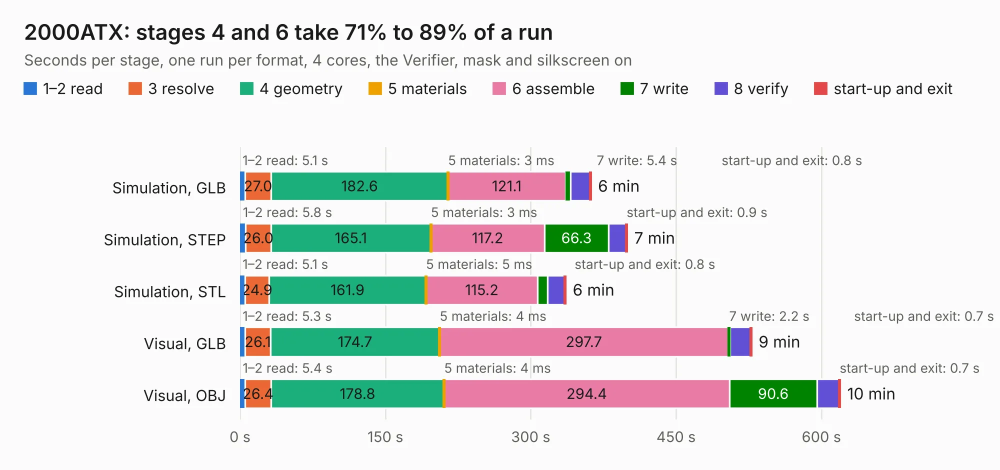

# 1380. 2000ATX

Board 1,380 of the 3,139 of [Corpus Testing](../Corpus-Testing.md), on [Corpus Page 13](../CorpusTestingPages/Corpus-Testing-13.md#1380-2000atx).

| Mode and format | 1–2 read | 3 resolve | 4 geometry | 5 materials | 6 assemble | 7 write | 8 verify | start-up and exit | Total |
|---|---:|---:|---:|---:|---:|---:|---:|---:|---:|
| Simulation, GLB | 5.1 | 27.0 | 182.6 | 3&nbsp;ms | 121.1 | 5.4 | 20.1 | 0.8 | 362.0 |
| Simulation, STEP | 5.8 | 26.0 | 165.1 | 3&nbsp;ms | 117.2 | 66.3 | 18.1 | 0.9 | 399.4 |
| Simulation, STL | 5.1 | 24.9 | 161.9 | 5&nbsp;ms | 115.2 | 10.2 | 17.8 | 0.8 | 336.0 |
| Simulation, OBJ |  |  |  |  |  |  |  |  | exceeded 11 GB on a 16 GB machine (stopped there, not a KESE failure); it will be run again on a machine with more memory |
| Visual, GLB | 5.3 | 26.1 | 174.7 | 4&nbsp;ms | 297.7 | 2.2 | 21.2 | 0.7 | 527.8 |
| Visual, OBJ | 5.4 | 26.4 | 178.8 | 4&nbsp;ms | 294.4 | 90.6 | 22.8 | 0.7 | 619.2 |

<table align="center"><tr><td valign="top">

| Board | Repo: [jasonsbeer/Amiga-2000-EATX](https://github.com/jasonsbeer/Amiga-2000-EATX) Board: `2000ATX.kicad_pcb` |
|---|---|
| Folder | 2000EATX-KiCAD-R31 |
| Complexity | 403&nbsp;/&nbsp;1000 (size&nbsp;303, features&nbsp;100) |
| KESE&nbsp;features | through vias, custom pads, rounded, trapezoid or chamfered pads, filled zones, copper drawings, stack-up, dielectric εr and tanδ |
| Tested | 9th November 2026 |
| Copper&nbsp;layers | 4 |
| File&nbsp;format | KiCad 8 (20240108) |
| Parts,&nbsp;tracks,&nbsp;vias | 601, 13,740, 1,212 |
| Triangles,&nbsp;simulation | 24,447,248 in 872 parts |
| Verifier | Simulation, OBJ: exceeded 11 GB on a 16 GB machine (stopped there, not a KESE failure); it will be run again on a machine with more memory |

</td><td valign="top">

<table>
<tr><th>File type</th><th>File size</th><th>Peak memory used</th></tr>
<tr><th colspan="3" align="left">Simulation</th></tr>
<tr><td>GLB</td><td align="right">834&nbsp;MB</td><td align="right">4.8&nbsp;GB</td></tr>
<tr><td>STEP</td><td align="right">3.9&nbsp;GB</td><td align="right">7.0&nbsp;GB</td></tr>
<tr><td>STL</td><td align="right">1.2&nbsp;GB</td><td align="right">5.2&nbsp;GB</td></tr>
<tr><td>OBJ</td><td align="right">–</td><td align="right">11&nbsp;GB</td></tr>
<tr><th colspan="3" align="left">Visual</th></tr>
<tr><td>GLB</td><td align="right">437&nbsp;MB</td><td align="right">6.9&nbsp;GB</td></tr>
<tr><td>OBJ</td><td align="right">1.4&nbsp;GB</td><td align="right">9.3&nbsp;GB</td></tr>
</table>

</td></tr></table>

| Previous | Next |
|:---|---:|
| [1379. VNA](b1379b_LibreVNA_VNA.md) | [1381. TICK](b1381b_Amiga-2000-EATX_TICK-TICK-Dual-0805_TICK.md) |
