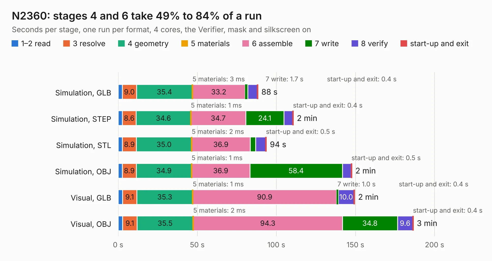

# 1381. N2360

Board 1,381 of the 3,132 of [Corpus Testing](../Corpus-Testing.md), on [Corpus Page 13](../CorpusTestingPages/Corpus-Testing-13.md#1381-n2360).

| Mode and format | 1–2 read | 3 resolve | 4 geometry | 5 materials | 6 assemble | 7 write | 8 verify | start-up and exit | Total |
|---|---:|---:|---:|---:|---:|---:|---:|---:|---:|
| Simulation, GLB | 2.6 | 9.0 | 35.4 | 3&nbsp;ms | 33.2 | 1.7 | 6.0 | 0.4 | 88.3 |
| Simulation, STEP | 2.7 | 8.6 | 34.6 | 1&nbsp;ms | 34.7 | 24.1 | 5.6 | 0.4 | 110.8 |
| Simulation, STL | 2.7 | 8.9 | 35.0 | 2&nbsp;ms | 36.9 | 3.5 | 6.3 | 0.5 | 93.7 |
| Simulation, OBJ | 2.6 | 8.9 | 34.9 | 1&nbsp;ms | 36.9 | 58.4 | 5.6 | 0.5 | 147.8 |
| Visual, GLB | 2.7 | 9.1 | 35.3 | 1&nbsp;ms | 90.9 | 1.0 | 10.0 | 0.4 | 149.5 |
| Visual, OBJ | 2.8 | 9.1 | 35.5 | 2&nbsp;ms | 94.3 | 34.8 | 9.6 | 0.4 | 186.6 |

<table align="center"><tr><td valign="top">

| Board | Repo: [jasonsbeer/Amiga-N2630](https://github.com/jasonsbeer/Amiga-N2630) Board: `N2360.kicad_pcb` |
|---|---|
| Folder | KiCAD / A2630-New-KiCAD-Rev410-PLCC |
| Complexity | 391&nbsp;/&nbsp;1000 (size&nbsp;296, features&nbsp;95) |
| KESE&nbsp;features | through vias, rounded, trapezoid or chamfered pads, filled zones, copper text, curved board outline, stack-up, dielectric εr and tanδ |
| Tested | 9th November 2026 |
| Copper&nbsp;layers | 4 |
| File&nbsp;format | KiCad 8 (20240108) |
| Parts,&nbsp;tracks,&nbsp;vias | 233, 7,314, 845 |
| Triangles,&nbsp;simulation | 9,182,036 in 471 parts |
| Verifier | PASS in all six runs |

</td><td valign="top">

<table>
<tr><th>File type</th><th>File size</th><th>Peak memory used</th></tr>
<tr><th colspan="3" align="left">Simulation</th></tr>
<tr><td>GLB</td><td align="right">313&nbsp;MB</td><td align="right">2.3&nbsp;GB</td></tr>
<tr><td>STEP</td><td align="right">1.4&nbsp;GB</td><td align="right">3.2&nbsp;GB</td></tr>
<tr><td>STL</td><td align="right">459&nbsp;MB</td><td align="right">2.3&nbsp;GB</td></tr>
<tr><td>OBJ</td><td align="right">993&nbsp;MB</td><td align="right">5.8&nbsp;GB</td></tr>
<tr><th colspan="3" align="left">Visual</th></tr>
<tr><td>GLB</td><td align="right">200&nbsp;MB</td><td align="right">3.2&nbsp;GB</td></tr>
<tr><td>OBJ</td><td align="right">647&nbsp;MB</td><td align="right">4.2&nbsp;GB</td></tr>
</table>

</td></tr></table>

| Previous | Next |
|:---|---:|
| [1380. N2360](b1380b_Amiga-N2630_KiCAD-A2630-New-KiCAD-Rev410-PGA_N2360.md) | [1382. N2360](b1382b_Amiga-N2630_KiCAD-Archive-A2630-New-KiCAD-Rev401-PGA_N2360.md) |
