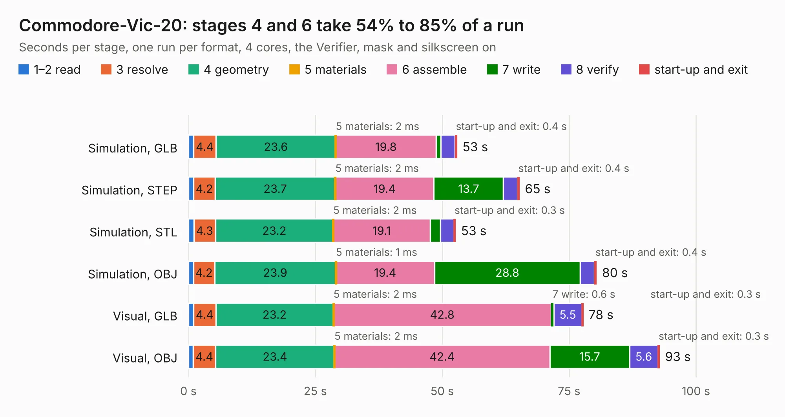

# 1382. Commodore-Vic-20

Board 1,382 of the 3,118 of [Corpus Testing](../Corpus-Testing.md), on [Corpus Page 13](../CorpusTestingPages/Corpus-Testing-13.md#1382-commodore-vic-20).

| Mode and format | 1–2 read | 3 resolve | 4 geometry | 5 materials | 6 assemble | 7 write | 8 verify | start-up and exit | Total |
|---|---:|---:|---:|---:|---:|---:|---:|---:|---:|
| Simulation, GLB | 1.0 | 4.4 | 23.6 | 2&nbsp;ms | 19.8 | 0.9 | 2.8 | 0.4 | 52.9 |
| Simulation, STEP | 1.0 | 4.2 | 23.7 | 2&nbsp;ms | 19.4 | 13.7 | 2.8 | 0.4 | 65.2 |
| Simulation, STL | 1.0 | 4.3 | 23.2 | 2&nbsp;ms | 19.1 | 2.1 | 2.6 | 0.3 | 52.6 |
| Simulation, OBJ | 1.0 | 4.2 | 23.9 | 1&nbsp;ms | 19.4 | 28.8 | 2.8 | 0.4 | 80.4 |
| Visual, GLB | 1.0 | 4.4 | 23.2 | 2&nbsp;ms | 42.8 | 0.6 | 5.5 | 0.3 | 77.7 |
| Visual, OBJ | 0.9 | 4.4 | 23.4 | 2&nbsp;ms | 42.4 | 15.7 | 5.6 | 0.3 | 92.8 |

<table align="center"><tr><td valign="top">

| Board | Repo: [jimbro1000/Commodore-Vic-20](https://github.com/jimbro1000/Commodore-Vic-20) Board: `Commodore-Vic-20.kicad_pcb` |
|---|---|
| Complexity | 265&nbsp;/&nbsp;1000 (size&nbsp;210, features&nbsp;55) |
| KESE&nbsp;features | through vias, slotted holes, rounded, trapezoid or chamfered pads, filled zones |
| Tested | 9th November 2026 |
| Copper&nbsp;layers | 2 |
| File&nbsp;format | KiCad 8 (20240108) |
| Parts,&nbsp;tracks,&nbsp;vias | 142, 4,040, 354 |
| Triangles,&nbsp;simulation | 5,241,754 in 218 parts |
| Verifier | PASS in all six runs |

</td><td valign="top">

<table>
<tr><th>File type</th><th>File size</th><th>Peak memory used</th></tr>
<tr><th colspan="3" align="left">Simulation</th></tr>
<tr><td>GLB</td><td align="right">175&nbsp;MB</td><td align="right">1.6&nbsp;GB</td></tr>
<tr><td>STEP</td><td align="right">731&nbsp;MB</td><td align="right">2.1&nbsp;GB</td></tr>
<tr><td>STL</td><td align="right">262&nbsp;MB</td><td align="right">1.5&nbsp;GB</td></tr>
<tr><td>OBJ</td><td align="right">552&nbsp;MB</td><td align="right">4.4&nbsp;GB</td></tr>
<tr><th colspan="3" align="left">Visual</th></tr>
<tr><td>GLB</td><td align="right">106&nbsp;MB</td><td align="right">1.8&nbsp;GB</td></tr>
<tr><td>OBJ</td><td align="right">339&nbsp;MB</td><td align="right">2.2&nbsp;GB</td></tr>
</table>

</td></tr></table>

| Previous | Next |
|:---|---:|
| [1381. Atari65XEC070067RevB](b1381b_Atari65-130XE-C070067_Atari65XEC070067RevB.md) | [1383. Dragon32](b1383b_Dragon32Issue2_Dragon32.md) |
