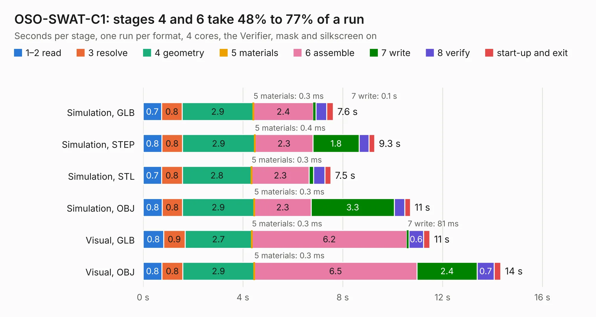

# 1382. OSO-SWAT-C1

Board 1,382 of the 3,106 of [Corpus Testing](../Corpus-Testing.md), on [Corpus Page 13](../CorpusTestingPages/Corpus-Testing-13.md#1382-oso-swat-c1).

| Mode and format | 1–2 read | 3 resolve | 4 geometry | 5 materials | 6 assemble | 7 write | 8 verify | start-up and exit | Total |
|---|---:|---:|---:|---:|---:|---:|---:|---:|---:|
| Simulation, GLB | 0.7 | 0.8 | 2.9 | 0.3&nbsp;ms | 2.4 | 0.1 | 0.4 | 0.3 | 7.6 |
| Simulation, STEP | 0.8 | 0.8 | 2.9 | 0.4&nbsp;ms | 2.3 | 1.8 | 0.4 | 0.2 | 9.3 |
| Simulation, STL | 0.7 | 0.8 | 2.8 | 0.3&nbsp;ms | 2.3 | 0.2 | 0.5 | 0.2 | 7.5 |
| Simulation, OBJ | 0.8 | 0.8 | 2.9 | 0.3&nbsp;ms | 2.3 | 3.3 | 0.4 | 0.2 | 10.7 |
| Visual, GLB | 0.8 | 0.9 | 2.7 | 0.3&nbsp;ms | 6.2 | 81&nbsp;ms | 0.6 | 0.3 | 11.5 |
| Visual, OBJ | 0.8 | 0.8 | 2.9 | 0.3&nbsp;ms | 6.5 | 2.4 | 0.7 | 0.3 | 14.3 |

<table align="center"><tr><td valign="top">

| Board | Repo: [joeycastillo/Sensor-Watch](https://github.com/joeycastillo/Sensor-Watch) Board: `OSO-SWAT-C1.kicad_pcb` |
|---|---|
| Folder | PCB / Main Boards / OSO-SWAT-C1 |
| Complexity | 301&nbsp;/&nbsp;1000 (size&nbsp;221, features&nbsp;80) |
| KESE&nbsp;features | through vias, rounded, trapezoid or chamfered pads, filled zones, stack-up, dielectric εr and tanδ, mask and silkscreen colours |
| Tested | 9th November 2026 |
| Copper&nbsp;layers | 4 |
| File&nbsp;format | KiCad 10 (20260206) |
| Parts,&nbsp;tracks,&nbsp;vias | 30, 587, 81 |
| Triangles,&nbsp;simulation | 658,516 in 80 parts |
| Verifier | PASS in all six runs |

</td><td valign="top">

<table>
<tr><th>File type</th><th>File size</th><th>Peak memory used</th></tr>
<tr><th colspan="3" align="left">Simulation</th></tr>
<tr><td>GLB</td><td align="right">23&nbsp;MB</td><td align="right">352&nbsp;MB</td></tr>
<tr><td>STEP</td><td align="right">99&nbsp;MB</td><td align="right">406&nbsp;MB</td></tr>
<tr><td>STL</td><td align="right">33&nbsp;MB</td><td align="right">341&nbsp;MB</td></tr>
<tr><td>OBJ</td><td align="right">68&nbsp;MB</td><td align="right">499&nbsp;MB</td></tr>
<tr><th colspan="3" align="left">Visual</th></tr>
<tr><td>GLB</td><td align="right">16&nbsp;MB</td><td align="right">432&nbsp;MB</td></tr>
<tr><td>OBJ</td><td align="right">50&nbsp;MB</td><td align="right">431&nbsp;MB</td></tr>
</table>

</td></tr></table>

| Previous | Next |
|:---|---:|
| [1381. OSO-SWAT-C1-rounded](b1381b_Sensor-Watch_OSO-SWAT-C1-rounded.md) | [1383. OSO-SWAB-B1-00 Sensor Watch Accelerometer](b1383b_Sensor-Watch_OSO-SWAB-B1-00-Sensor-Watch-Accelerometer.md) |
