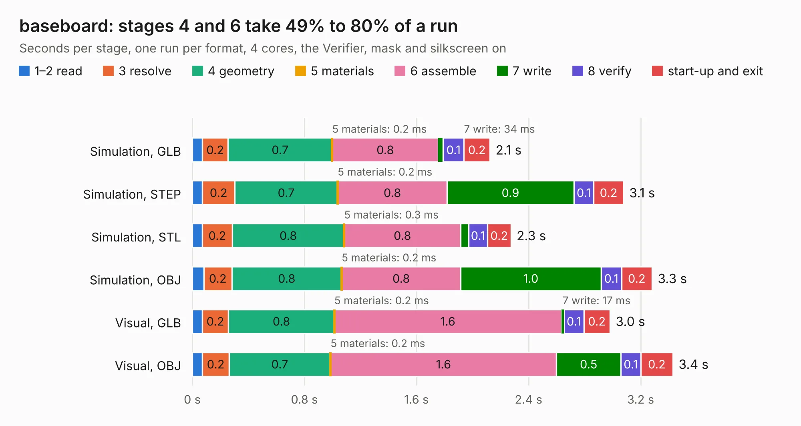

# 1382. baseboard

Board 1,382 of the 3,125 of [Corpus Testing](../Corpus-Testing.md), on [Corpus Page 13](../CorpusTestingPages/Corpus-Testing-13.md#1382-baseboard).

| Mode and format | 1–2 read | 3 resolve | 4 geometry | 5 materials | 6 assemble | 7 write | 8 verify | start-up and exit | Total |
|---|---:|---:|---:|---:|---:|---:|---:|---:|---:|
| Simulation, GLB | 72&nbsp;ms | 0.2 | 0.7 | 0.2&nbsp;ms | 0.8 | 34&nbsp;ms | 0.1 | 0.2 | 2.1 |
| Simulation, STEP | 72&nbsp;ms | 0.2 | 0.7 | 0.2&nbsp;ms | 0.8 | 0.9 | 0.1 | 0.2 | 3.1 |
| Simulation, STL | 71&nbsp;ms | 0.2 | 0.8 | 0.3&nbsp;ms | 0.8 | 56&nbsp;ms | 0.1 | 0.2 | 2.3 |
| Simulation, OBJ | 83&nbsp;ms | 0.2 | 0.8 | 0.2&nbsp;ms | 0.8 | 1.0 | 0.1 | 0.2 | 3.3 |
| Visual, GLB | 70&nbsp;ms | 0.2 | 0.8 | 0.2&nbsp;ms | 1.6 | 17&nbsp;ms | 0.1 | 0.2 | 3.0 |
| Visual, OBJ | 73&nbsp;ms | 0.2 | 0.7 | 0.2&nbsp;ms | 1.6 | 0.5 | 0.1 | 0.2 | 3.4 |

<table align="center"><tr><td valign="top">

| Board | Repo: [jescarri/baseboard](https://github.com/jescarri/baseboard) Board: `baseboard.kicad_pcb` |
|---|---|
| Complexity | 93&nbsp;/&nbsp;1000 (size&nbsp;53, features&nbsp;40) |
| KESE&nbsp;features | curved board outline, stack-up, dielectric εr and tanδ |
| Tested | 9th November 2026 |
| Copper&nbsp;layers | 4 |
| File&nbsp;format | KiCad 9 (20241229) |
| Parts,&nbsp;tracks,&nbsp;vias | 5, 0, 0 |
| Triangles,&nbsp;simulation | 249,774 in 50 parts |
| Verifier | PASS in all six runs |

</td><td valign="top">

<table>
<tr><th>File type</th><th>File size</th><th>Peak memory used</th></tr>
<tr><th colspan="3" align="left">Simulation</th></tr>
<tr><td>GLB</td><td align="right">7.2&nbsp;MB</td><td align="right">209&nbsp;MB</td></tr>
<tr><td>STEP</td><td align="right">20&nbsp;MB</td><td align="right">225&nbsp;MB</td></tr>
<tr><td>STL</td><td align="right">12&nbsp;MB</td><td align="right">208&nbsp;MB</td></tr>
<tr><td>OBJ</td><td align="right">25&nbsp;MB</td><td align="right">221&nbsp;MB</td></tr>
<tr><th colspan="3" align="left">Visual</th></tr>
<tr><td>GLB</td><td align="right">3.8&nbsp;MB</td><td align="right">187&nbsp;MB</td></tr>
<tr><td>OBJ</td><td align="right">11&nbsp;MB</td><td align="right">193&nbsp;MB</td></tr>
</table>

</td></tr></table>

| Previous | Next |
|:---|---:|
| [1381. SF2000](b1381b_SF2000_SF2000.md) | [1383. d1](b1383b_doppel-1_d1.md) |
