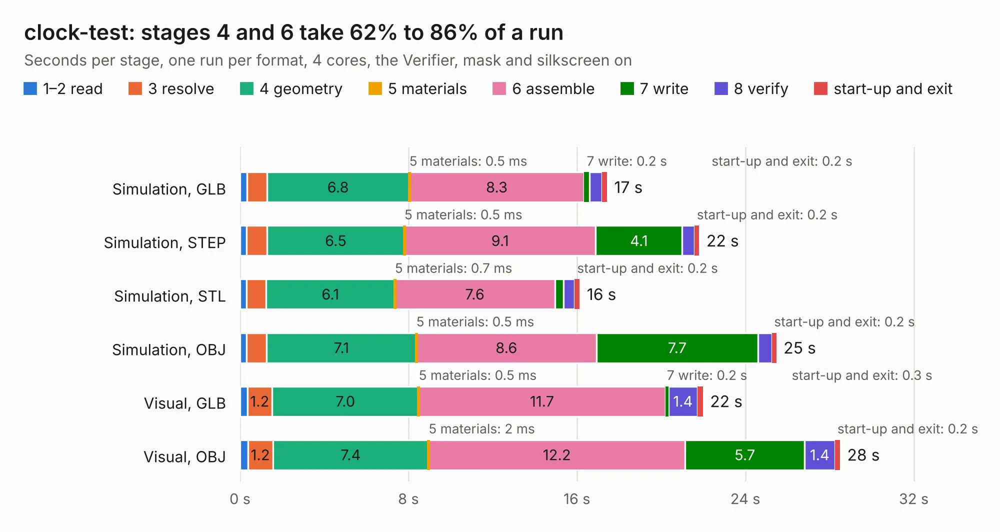

# 1385. clock-test

Board 1,385 of the 3,103 of [Corpus Testing](../Corpus-Testing.md), on [Corpus Page 13](../CorpusTestingPages/Corpus-Testing-13.md#1385-clock-test).

| Mode and format | 1–2 read | 3 resolve | 4 geometry | 5 materials | 6 assemble | 7 write | 8 verify | start-up and exit | Total |
|---|---:|---:|---:|---:|---:|---:|---:|---:|---:|
| Simulation, GLB | 0.3 | 0.9 | 6.8 | 0.5&nbsp;ms | 8.3 | 0.2 | 0.6 | 0.2 | 17.4 |
| Simulation, STEP | 0.3 | 1.0 | 6.5 | 0.5&nbsp;ms | 9.1 | 4.1 | 0.6 | 0.2 | 21.8 |
| Simulation, STL | 0.3 | 0.9 | 6.1 | 0.7&nbsp;ms | 7.6 | 0.4 | 0.5 | 0.2 | 16.1 |
| Simulation, OBJ | 0.3 | 0.9 | 7.1 | 0.5&nbsp;ms | 8.6 | 7.7 | 0.7 | 0.2 | 25.5 |
| Visual, GLB | 0.3 | 1.2 | 7.0 | 0.5&nbsp;ms | 11.7 | 0.2 | 1.4 | 0.3 | 22.0 |
| Visual, OBJ | 0.4 | 1.2 | 7.4 | 2&nbsp;ms | 12.2 | 5.7 | 1.4 | 0.2 | 28.5 |

<table align="center"><tr><td valign="top">

| Board | Repo: [joshajohnson/ecp5-mini](https://github.com/joshajohnson/ecp5-mini) Board: `clock-test.kicad_pcb` |
|---|---|
| Folder | breakouts / clock-test-0.1 |
| Complexity | 290&nbsp;/&nbsp;1000 (size&nbsp;185, features&nbsp;105) |
| KESE&nbsp;features | through vias, rounded, trapezoid or chamfered pads, filled zones, curved board outline, stack-up, dielectric εr and tanδ, copper finish, mask and silkscreen colours |
| Tested | 9th November 2026 |
| Copper&nbsp;layers | 2 |
| File&nbsp;format | KiCad 6 (20200916) |
| Parts,&nbsp;tracks,&nbsp;vias | 83, 1,218, 99 |
| Triangles,&nbsp;simulation | 1,195,948 in 141 parts |
| Verifier | PASS in all six runs |

</td><td valign="top">

<table>
<tr><th>File type</th><th>File size</th><th>Peak memory used</th></tr>
<tr><th colspan="3" align="left">Simulation</th></tr>
<tr><td>GLB</td><td align="right">43&nbsp;MB</td><td align="right">530&nbsp;MB</td></tr>
<tr><td>STEP</td><td align="right">233&nbsp;MB</td><td align="right">638&nbsp;MB</td></tr>
<tr><td>STL</td><td align="right">60&nbsp;MB</td><td align="right">524&nbsp;MB</td></tr>
<tr><td>OBJ</td><td align="right">127&nbsp;MB</td><td align="right">844&nbsp;MB</td></tr>
<tr><th colspan="3" align="left">Visual</th></tr>
<tr><td>GLB</td><td align="right">30&nbsp;MB</td><td align="right">598&nbsp;MB</td></tr>
<tr><td>OBJ</td><td align="right">89&nbsp;MB</td><td align="right">678&nbsp;MB</td></tr>
</table>

</td></tr></table>

| Previous | Next |
|:---|---:|
| [1384. Blixten](b1384b_blixten_Blixten.md) | [1386. octa-pmod](b1386b_ecp5-mini_breakouts-octa-pmod-0-1_octa-pmod.md) |
