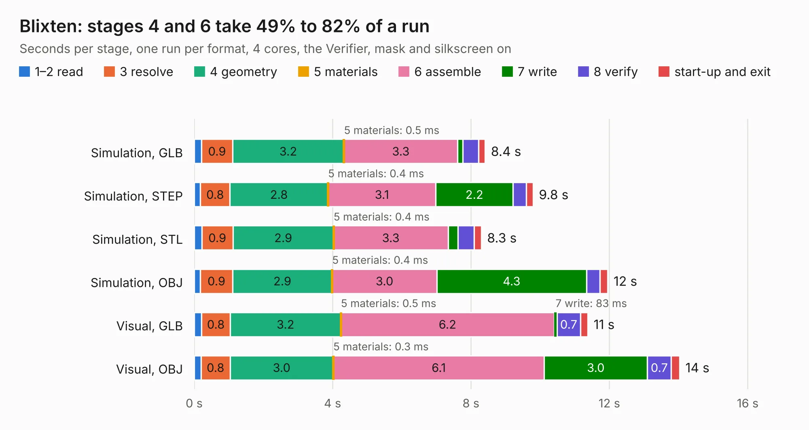

# 1386. Blixten

Board 1,386 of the 3,105 of [Corpus Testing](../Corpus-Testing.md), on [Corpus Page 13](../CorpusTestingPages/Corpus-Testing-13.md#1386-blixten).

| Mode and format | 1–2 read | 3 resolve | 4 geometry | 5 materials | 6 assemble | 7 write | 8 verify | start-up and exit | Total |
|---|---:|---:|---:|---:|---:|---:|---:|---:|---:|
| Simulation, GLB | 0.2 | 0.9 | 3.2 | 0.5&nbsp;ms | 3.3 | 0.2 | 0.5 | 0.2 | 8.4 |
| Simulation, STEP | 0.2 | 0.8 | 2.8 | 0.4&nbsp;ms | 3.1 | 2.2 | 0.4 | 0.2 | 9.8 |
| Simulation, STL | 0.2 | 0.9 | 2.9 | 0.4&nbsp;ms | 3.3 | 0.3 | 0.5 | 0.2 | 8.3 |
| Simulation, OBJ | 0.2 | 0.9 | 2.9 | 0.4&nbsp;ms | 3.0 | 4.3 | 0.4 | 0.2 | 12.0 |
| Visual, GLB | 0.2 | 0.8 | 3.2 | 0.5&nbsp;ms | 6.2 | 83&nbsp;ms | 0.7 | 0.2 | 11.4 |
| Visual, OBJ | 0.2 | 0.8 | 3.0 | 0.3&nbsp;ms | 6.1 | 3.0 | 0.7 | 0.2 | 14.0 |

<table align="center"><tr><td valign="top">

| Board | Repo: [jonpe960/blixten](https://github.com/jonpe960/blixten) Board: `Blixten.kicad_pcb` |
|---|---|
| Folder | Blixten LED Device |
| Complexity | 282&nbsp;/&nbsp;1000 (size&nbsp;247, features&nbsp;35) |
| KESE&nbsp;features | through vias, filled zones |
| Tested | 9th November 2026 |
| Copper&nbsp;layers | 4 |
| File&nbsp;format | KiCad 4 (4) |
| Parts,&nbsp;tracks,&nbsp;vias | 60, 1,140, 201 |
| Triangles,&nbsp;simulation | 1,020,116 in 80 parts |
| Verifier | PASS in all six runs |

</td><td valign="top">

<table>
<tr><th>File type</th><th>File size</th><th>Peak memory used</th></tr>
<tr><th colspan="3" align="left">Simulation</th></tr>
<tr><td>GLB</td><td align="right">35&nbsp;MB</td><td align="right">419&nbsp;MB</td></tr>
<tr><td>STEP</td><td align="right">131&nbsp;MB</td><td align="right">546&nbsp;MB</td></tr>
<tr><td>STL</td><td align="right">51&nbsp;MB</td><td align="right">429&nbsp;MB</td></tr>
<tr><td>OBJ</td><td align="right">104&nbsp;MB</td><td align="right">709&nbsp;MB</td></tr>
<tr><th colspan="3" align="left">Visual</th></tr>
<tr><td>GLB</td><td align="right">22&nbsp;MB</td><td align="right">525&nbsp;MB</td></tr>
<tr><td>OBJ</td><td align="right">65&nbsp;MB</td><td align="right">540&nbsp;MB</td></tr>
</table>

</td></tr></table>

| Previous | Next |
|:---|---:|
| [1385. gw](b1385b_blixten_gw.md) | [1387. clock-test](b1387b_ecp5-mini_clock-test.md) |
