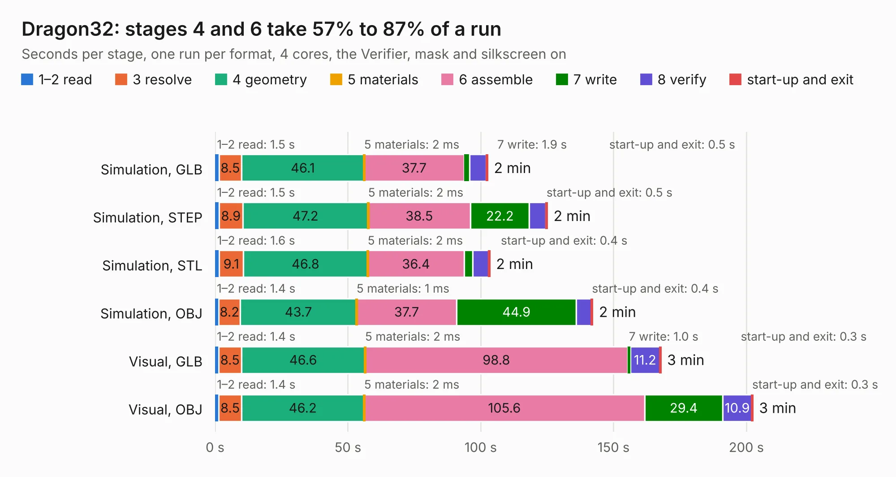

# 1387. Dragon32

Board 1,387 of the 3,123 of [Corpus Testing](../Corpus-Testing.md), on [Corpus Page 13](../CorpusTestingPages/Corpus-Testing-13.md#1387-dragon32).

| Mode and format | 1–2 read | 3 resolve | 4 geometry | 5 materials | 6 assemble | 7 write | 8 verify | start-up and exit | Total |
|---|---:|---:|---:|---:|---:|---:|---:|---:|---:|
| Simulation, GLB | 1.5 | 8.5 | 46.1 | 2&nbsp;ms | 37.7 | 1.9 | 6.4 | 0.5 | 102.6 |
| Simulation, STEP | 1.5 | 8.9 | 47.2 | 2&nbsp;ms | 38.5 | 22.2 | 6.2 | 0.5 | 125.0 |
| Simulation, STL | 1.6 | 9.1 | 46.8 | 2&nbsp;ms | 36.4 | 3.1 | 6.0 | 0.4 | 103.4 |
| Simulation, OBJ | 1.4 | 8.2 | 43.7 | 1&nbsp;ms | 37.7 | 44.9 | 5.8 | 0.4 | 142.1 |
| Visual, GLB | 1.4 | 8.5 | 46.6 | 2&nbsp;ms | 98.8 | 1.0 | 11.2 | 0.3 | 167.8 |
| Visual, OBJ | 1.4 | 8.5 | 46.2 | 2&nbsp;ms | 105.6 | 29.4 | 10.9 | 0.3 | 202.4 |

<table align="center"><tr><td valign="top">

| Board | Repo: [jimbro1000/Dragon32Issue2](https://github.com/jimbro1000/Dragon32Issue2) Board: `Dragon32.kicad_pcb` |
|---|---|
| Complexity | 295&nbsp;/&nbsp;1000 (size&nbsp;220, features&nbsp;75) |
| KESE&nbsp;features | through vias, slotted holes, rounded, trapezoid or chamfered pads, filled zones, copper text, curved board outline |
| Tested | 9th November 2026 |
| Copper&nbsp;layers | 2 |
| File&nbsp;format | KiCad 9 (20241229) |
| Parts,&nbsp;tracks,&nbsp;vias | 208, 4,774, 755 |
| Triangles,&nbsp;simulation | 9,542,056 in 311 parts |
| Verifier | PASS in all six runs |

</td><td valign="top">

<table>
<tr><th>File type</th><th>File size</th><th>Peak memory used</th></tr>
<tr><th colspan="3" align="left">Simulation</th></tr>
<tr><td>GLB</td><td align="right">330&nbsp;MB</td><td align="right">2.8&nbsp;GB</td></tr>
<tr><td>STEP</td><td align="right">1.7&nbsp;GB</td><td align="right">3.4&nbsp;GB</td></tr>
<tr><td>STL</td><td align="right">477&nbsp;MB</td><td align="right">2.7&nbsp;GB</td></tr>
<tr><td>OBJ</td><td align="right">1.0&nbsp;GB</td><td align="right">6.1&nbsp;GB</td></tr>
<tr><th colspan="3" align="left">Visual</th></tr>
<tr><td>GLB</td><td align="right">229&nbsp;MB</td><td align="right">3.6&nbsp;GB</td></tr>
<tr><td>OBJ</td><td align="right">733&nbsp;MB</td><td align="right">4.7&nbsp;GB</td></tr>
</table>

</td></tr></table>

| Previous | Next |
|:---|---:|
| [1386. Commodore-Vic-20](b1386b_Commodore-Vic-20_Commodore-Vic-20.md) | [1388. Dragon32](b1388b_Dragon32Rev3_Dragon32.md) |
