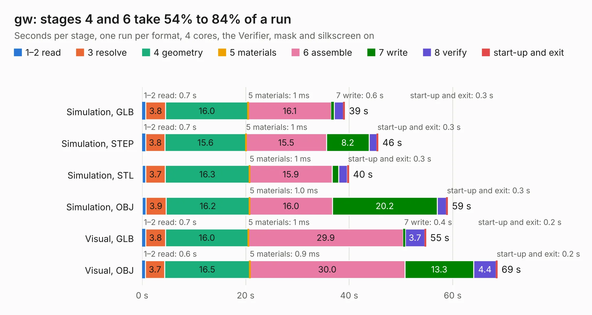

# 1388. gw

Board 1,388 of the 3,108 of [Corpus Testing](../Corpus-Testing.md), on [Corpus Page 13](../CorpusTestingPages/Corpus-Testing-13.md#1388-gw).

| Mode and format | 1–2 read | 3 resolve | 4 geometry | 5 materials | 6 assemble | 7 write | 8 verify | start-up and exit | Total |
|---|---:|---:|---:|---:|---:|---:|---:|---:|---:|
| Simulation, GLB | 0.7 | 3.8 | 16.0 | 1&nbsp;ms | 16.1 | 0.6 | 1.8 | 0.3 | 39.1 |
| Simulation, STEP | 0.7 | 3.8 | 15.6 | 1&nbsp;ms | 15.5 | 8.2 | 1.5 | 0.3 | 45.6 |
| Simulation, STL | 0.7 | 3.7 | 16.3 | 1&nbsp;ms | 15.9 | 1.3 | 1.7 | 0.3 | 39.9 |
| Simulation, OBJ | 0.7 | 3.9 | 16.2 | 1.0&nbsp;ms | 16.0 | 20.2 | 1.8 | 0.3 | 59.0 |
| Visual, GLB | 0.7 | 3.8 | 16.0 | 1&nbsp;ms | 29.9 | 0.4 | 3.7 | 0.2 | 54.8 |
| Visual, OBJ | 0.6 | 3.7 | 16.5 | 0.9&nbsp;ms | 30.0 | 13.3 | 4.4 | 0.2 | 68.6 |

<table align="center"><tr><td valign="top">

| Board | Repo: [jonpe960/blixten](https://github.com/jonpe960/blixten) Board: `gw.kicad_pcb` |
|---|---|
| Folder | Blixten Gateway |
| Complexity | 341&nbsp;/&nbsp;1000 (size&nbsp;296, features&nbsp;45) |
| KESE&nbsp;features | through vias, filled zones, copper text |
| Tested | 9th November 2026 |
| Copper&nbsp;layers | 4 |
| File&nbsp;format | KiCad 4 (4) |
| Parts,&nbsp;tracks,&nbsp;vias | 165, 3,785, 748 |
| Triangles,&nbsp;simulation | 3,831,544 in 277 parts |
| Verifier | PASS in all six runs |

</td><td valign="top">

<table>
<tr><th>File type</th><th>File size</th><th>Peak memory used</th></tr>
<tr><th colspan="3" align="left">Simulation</th></tr>
<tr><td>GLB</td><td align="right">131&nbsp;MB</td><td align="right">1.1&nbsp;GB</td></tr>
<tr><td>STEP</td><td align="right">509&nbsp;MB</td><td align="right">1.4&nbsp;GB</td></tr>
<tr><td>STL</td><td align="right">192&nbsp;MB</td><td align="right">1.1&nbsp;GB</td></tr>
<tr><td>OBJ</td><td align="right">405&nbsp;MB</td><td align="right">2.5&nbsp;GB</td></tr>
<tr><th colspan="3" align="left">Visual</th></tr>
<tr><td>GLB</td><td align="right">83&nbsp;MB</td><td align="right">1.4&nbsp;GB</td></tr>
<tr><td>OBJ</td><td align="right">262&nbsp;MB</td><td align="right">1.8&nbsp;GB</td></tr>
</table>

</td></tr></table>

| Previous | Next |
|:---|---:|
| [1387. 2057-ICE40HX4K-TQ144-breakout](b1387b_2057-ICE40HX4K-TQ144-breakout_2057-ICE40HX4K-TQ144-breakout.md) | [1389. Blixten](b1389b_blixten_Blixten.md) |
