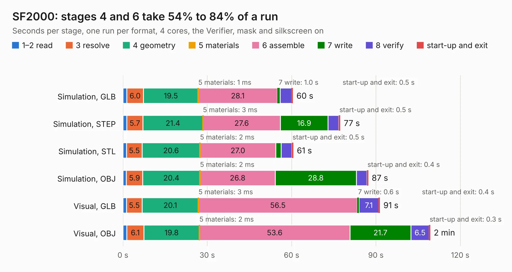

# 1389. SF2000

Board 1,389 of the 3,139 of [Corpus Testing](../Corpus-Testing.md), on [Corpus Page 13](../CorpusTestingPages/Corpus-Testing-13.md#1389-sf2000).

| Mode and format | 1–2 read | 3 resolve | 4 geometry | 5 materials | 6 assemble | 7 write | 8 verify | start-up and exit | Total |
|---|---:|---:|---:|---:|---:|---:|---:|---:|---:|
| Simulation, GLB | 1.3 | 6.0 | 19.5 | 1&nbsp;ms | 28.1 | 1.0 | 4.1 | 0.5 | 60.4 |
| Simulation, STEP | 1.4 | 5.7 | 21.4 | 3&nbsp;ms | 27.6 | 16.9 | 3.9 | 0.5 | 77.3 |
| Simulation, STL | 1.3 | 5.5 | 20.6 | 2&nbsp;ms | 27.0 | 1.9 | 3.8 | 0.5 | 60.6 |
| Simulation, OBJ | 1.2 | 5.9 | 20.4 | 2&nbsp;ms | 26.8 | 28.8 | 3.8 | 0.4 | 87.2 |
| Visual, GLB | 1.3 | 5.5 | 20.1 | 3&nbsp;ms | 56.5 | 0.6 | 7.1 | 0.4 | 91.4 |
| Visual, OBJ | 1.4 | 6.1 | 19.8 | 2&nbsp;ms | 53.6 | 21.7 | 6.5 | 0.3 | 109.3 |

<table align="center"><tr><td valign="top">

| Board | Repo: [jbilander/SF2000](https://github.com/jbilander/SF2000) Board: `SF2000.kicad_pcb` |
|---|---|
| Folder | KiCad |
| Complexity | 346&nbsp;/&nbsp;1000 (size&nbsp;291, features&nbsp;55) |
| KESE&nbsp;features | through vias, slotted holes, rounded, trapezoid or chamfered pads, filled zones |
| Tested | 9th November 2026 |
| Copper&nbsp;layers | 4 |
| File&nbsp;format | KiCad 5 (20171130) |
| Parts,&nbsp;tracks,&nbsp;vias | 134, 3,880, 579 |
| Triangles,&nbsp;simulation | 4,420,582 in 459 parts |
| Verifier | PASS in all six runs |

</td><td valign="top">

<table>
<tr><th>File type</th><th>File size</th><th>Peak memory used</th></tr>
<tr><th colspan="3" align="left">Simulation</th></tr>
<tr><td>GLB</td><td align="right">152&nbsp;MB</td><td align="right">1.4&nbsp;GB</td></tr>
<tr><td>STEP</td><td align="right">633&nbsp;MB</td><td align="right">1.8&nbsp;GB</td></tr>
<tr><td>STL</td><td align="right">221&nbsp;MB</td><td align="right">1.3&nbsp;GB</td></tr>
<tr><td>OBJ</td><td align="right">472&nbsp;MB</td><td align="right">2.9&nbsp;GB</td></tr>
<tr><th colspan="3" align="left">Visual</th></tr>
<tr><td>GLB</td><td align="right">113&nbsp;MB</td><td align="right">1.8&nbsp;GB</td></tr>
<tr><td>OBJ</td><td align="right">361&nbsp;MB</td><td align="right">2.3&nbsp;GB</td></tr>
</table>

</td></tr></table>

| Previous | Next |
|:---|---:|
| [1388. BeamBender](b1388b_BeamBender_BeamBender.md) | [1390. baseboard](b1390b_baseboard_baseboard.md) |
