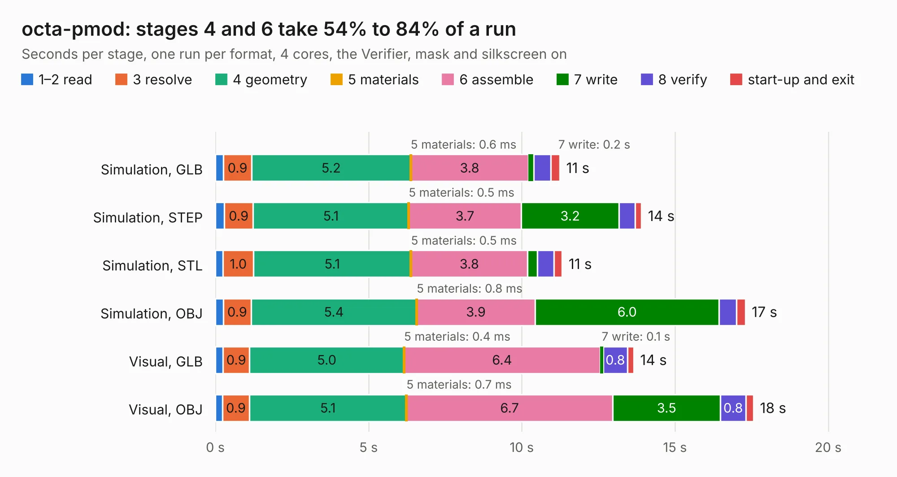

# 1390. octa-pmod

Board 1,390 of the 3,107 of [Corpus Testing](../Corpus-Testing.md), on [Corpus Page 13](../CorpusTestingPages/Corpus-Testing-13.md#1390-octa-pmod).

| Mode and format | 1–2 read | 3 resolve | 4 geometry | 5 materials | 6 assemble | 7 write | 8 verify | start-up and exit | Total |
|---|---:|---:|---:|---:|---:|---:|---:|---:|---:|
| Simulation, GLB | 0.3 | 0.9 | 5.2 | 0.6&nbsp;ms | 3.8 | 0.2 | 0.6 | 0.3 | 11.2 |
| Simulation, STEP | 0.3 | 0.9 | 5.1 | 0.5&nbsp;ms | 3.7 | 3.2 | 0.5 | 0.2 | 13.9 |
| Simulation, STL | 0.3 | 1.0 | 5.1 | 0.5&nbsp;ms | 3.8 | 0.3 | 0.5 | 0.3 | 11.3 |
| Simulation, OBJ | 0.3 | 0.9 | 5.4 | 0.8&nbsp;ms | 3.9 | 6.0 | 0.6 | 0.3 | 17.3 |
| Visual, GLB | 0.3 | 0.9 | 5.0 | 0.4&nbsp;ms | 6.4 | 0.1 | 0.8 | 0.2 | 13.7 |
| Visual, OBJ | 0.2 | 0.9 | 5.1 | 0.7&nbsp;ms | 6.7 | 3.5 | 0.8 | 0.3 | 17.6 |

<table align="center"><tr><td valign="top">

| Board | Repo: [joshajohnson/ecp5-mini](https://github.com/joshajohnson/ecp5-mini) Board: `octa-pmod.kicad_pcb` |
|---|---|
| Folder | breakouts / octa-pmod-0.1 |
| Complexity | 232&nbsp;/&nbsp;1000 (size&nbsp;142, features&nbsp;90) |
| KESE&nbsp;features | rounded, trapezoid or chamfered pads, filled zones, curved board outline, stack-up, dielectric εr and tanδ, copper finish, mask and silkscreen colours |
| Tested | 9th November 2026 |
| Copper&nbsp;layers | 2 |
| File&nbsp;format | KiCad 6 (20201002) |
| Parts,&nbsp;tracks,&nbsp;vias | 14, 343, 0 |
| Triangles,&nbsp;simulation | 1,044,278 in 78 parts |
| Verifier | PASS in all six runs |

</td><td valign="top">

<table>
<tr><th>File type</th><th>File size</th><th>Peak memory used</th></tr>
<tr><th colspan="3" align="left">Simulation</th></tr>
<tr><td>GLB</td><td align="right">34&nbsp;MB</td><td align="right">444&nbsp;MB</td></tr>
<tr><td>STEP</td><td align="right">140&nbsp;MB</td><td align="right">522&nbsp;MB</td></tr>
<tr><td>STL</td><td align="right">52&nbsp;MB</td><td align="right">447&nbsp;MB</td></tr>
<tr><td>OBJ</td><td align="right">104&nbsp;MB</td><td align="right">717&nbsp;MB</td></tr>
<tr><th colspan="3" align="left">Visual</th></tr>
<tr><td>GLB</td><td align="right">20&nbsp;MB</td><td align="right">523&nbsp;MB</td></tr>
<tr><td>OBJ</td><td align="right">60&nbsp;MB</td><td align="right">527&nbsp;MB</td></tr>
</table>

</td></tr></table>

| Previous | Next |
|:---|---:|
| [1389. clock-test](b1389b_ecp5-mini_clock-test.md) | [1391. octa-pmod](b1391b_ecp5-mini_breakouts-octa-pmod-0-2_octa-pmod.md) |
