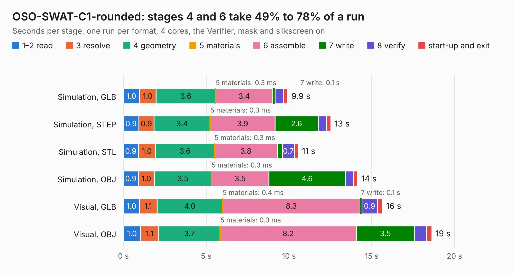

# 1391. OSO-SWAT-C1-rounded

Board 1,391 of the 3,117 of [Corpus Testing](../Corpus-Testing.md), on [Corpus Page 13](../CorpusTestingPages/Corpus-Testing-13.md#1391-oso-swat-c1-rounded).

| Mode and format | 1–2 read | 3 resolve | 4 geometry | 5 materials | 6 assemble | 7 write | 8 verify | start-up and exit | Total |
|---|---:|---:|---:|---:|---:|---:|---:|---:|---:|
| Simulation, GLB | 1.0 | 1.0 | 3.6 | 0.3&nbsp;ms | 3.4 | 0.1 | 0.5 | 0.3 | 9.9 |
| Simulation, STEP | 0.9 | 0.9 | 3.4 | 0.3&nbsp;ms | 3.9 | 2.6 | 0.5 | 0.3 | 12.5 |
| Simulation, STL | 0.9 | 1.0 | 3.6 | 0.3&nbsp;ms | 3.8 | 0.3 | 0.7 | 0.2 | 10.6 |
| Simulation, OBJ | 0.9 | 1.0 | 3.5 | 0.3&nbsp;ms | 3.5 | 4.6 | 0.5 | 0.2 | 14.1 |
| Visual, GLB | 1.0 | 1.1 | 4.0 | 0.4&nbsp;ms | 8.3 | 0.1 | 0.9 | 0.3 | 15.6 |
| Visual, OBJ | 1.0 | 1.1 | 3.7 | 0.3&nbsp;ms | 8.2 | 3.5 | 0.7 | 0.3 | 18.6 |

<table align="center"><tr><td valign="top">

| Board | Repo: [joeycastillo/Sensor-Watch](https://github.com/joeycastillo/Sensor-Watch) Board: `OSO-SWAT-C1-rounded.kicad_pcb` |
|---|---|
| Folder | PCB / Main Boards / OSO-SWAT-C1 |
| Complexity | 347&nbsp;/&nbsp;1000 (size&nbsp;227, features&nbsp;120) |
| KESE&nbsp;features | through vias, rounded, trapezoid or chamfered pads, arc tracks, filled zones, stack-up, dielectric εr and tanδ, mask and silkscreen colours, castellated pads |
| Tested | 9th November 2026 |
| Copper&nbsp;layers | 4 |
| File&nbsp;format | KiCad 8 (20240108) |
| Parts,&nbsp;tracks,&nbsp;vias | 31, 939, 81 |
| Triangles,&nbsp;simulation | 768,128 in 80 parts |
| Verifier | PASS in all six runs |

</td><td valign="top">

<table>
<tr><th>File type</th><th>File size</th><th>Peak memory used</th></tr>
<tr><th colspan="3" align="left">Simulation</th></tr>
<tr><td>GLB</td><td align="right">27&nbsp;MB</td><td align="right">370&nbsp;MB</td></tr>
<tr><td>STEP</td><td align="right">114&nbsp;MB</td><td align="right">459&nbsp;MB</td></tr>
<tr><td>STL</td><td align="right">38&nbsp;MB</td><td align="right">373&nbsp;MB</td></tr>
<tr><td>OBJ</td><td align="right">79&nbsp;MB</td><td align="right">596&nbsp;MB</td></tr>
<tr><th colspan="3" align="left">Visual</th></tr>
<tr><td>GLB</td><td align="right">20&nbsp;MB</td><td align="right">481&nbsp;MB</td></tr>
<tr><td>OBJ</td><td align="right">59&nbsp;MB</td><td align="right">509&nbsp;MB</td></tr>
</table>

</td></tr></table>

| Previous | Next |
|:---|---:|
| [1390. OSO-SWAT-C1-jig](b1390b_Sensor-Watch_OSO-SWAT-C1-jig.md) | [1392. OSO-SWAT-C1](b1392b_Sensor-Watch_OSO-SWAT-C1.md) |
