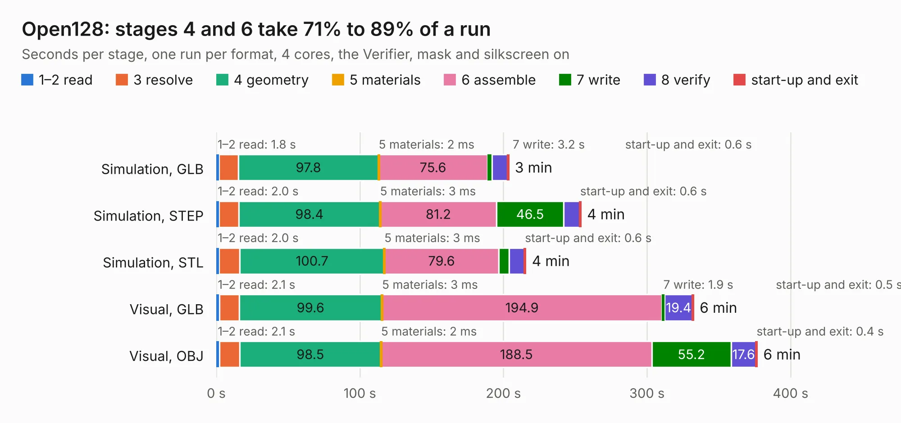

# 1391. Open128

Board 1,391 of the 3,139 of [Corpus Testing](../Corpus-Testing.md), on [Corpus Page 13](../CorpusTestingPages/Corpus-Testing-13.md#1391-open128).

| Mode and format | 1–2 read | 3 resolve | 4 geometry | 5 materials | 6 assemble | 7 write | 8 verify | start-up and exit | Total |
|---|---:|---:|---:|---:|---:|---:|---:|---:|---:|
| Simulation, GLB | 1.8 | 13.4 | 97.8 | 2&nbsp;ms | 75.6 | 3.2 | 10.9 | 0.6 | 203.5 |
| Simulation, STEP | 2.0 | 13.8 | 98.4 | 3&nbsp;ms | 81.2 | 46.5 | 11.4 | 0.6 | 253.7 |
| Simulation, STL | 2.0 | 14.4 | 100.7 | 3&nbsp;ms | 79.6 | 7.4 | 10.6 | 0.6 | 215.3 |
| Simulation, OBJ |  |  |  |  |  |  |  |  | exceeded 11 GB on a 16 GB machine (stopped there, not a KESE failure); it will be run again on a machine with more memory |
| Visual, GLB | 2.1 | 13.8 | 99.6 | 3&nbsp;ms | 194.9 | 1.9 | 19.4 | 0.5 | 332.2 |
| Visual, OBJ | 2.1 | 14.2 | 98.5 | 2&nbsp;ms | 188.5 | 55.2 | 17.6 | 0.4 | 376.5 |

<table align="center"><tr><td valign="top">

| Board | Repo: [jgrip/open128](https://github.com/jgrip/open128) Board: `Open128.kicad_pcb` |
|---|---|
| Complexity | 333&nbsp;/&nbsp;1000 (size&nbsp;243, features&nbsp;90) |
| KESE&nbsp;features | through vias, slotted holes, custom pads, filled zones, copper drawings, copper text, curved board outline |
| Tested | 9th November 2026 |
| Copper&nbsp;layers | 2 |
| File&nbsp;format | KiCad 5 (20171130) |
| Parts,&nbsp;tracks,&nbsp;vias | 366, 16,410, 1,119 |
| Triangles,&nbsp;simulation | 16,912,120 in 459 parts |
| Verifier | Simulation, OBJ: exceeded 11 GB on a 16 GB machine (stopped there, not a KESE failure); it will be run again on a machine with more memory |

</td><td valign="top">

<table>
<tr><th>File type</th><th>File size</th><th>Peak memory used</th></tr>
<tr><th colspan="3" align="left">Simulation</th></tr>
<tr><td>GLB</td><td align="right">584&nbsp;MB</td><td align="right">3.6&nbsp;GB</td></tr>
<tr><td>STEP</td><td align="right">3.2&nbsp;GB</td><td align="right">5.5&nbsp;GB</td></tr>
<tr><td>STL</td><td align="right">846&nbsp;MB</td><td align="right">3.5&nbsp;GB</td></tr>
<tr><td>OBJ</td><td align="right">–</td><td align="right">11&nbsp;GB</td></tr>
<tr><th colspan="3" align="left">Visual</th></tr>
<tr><td>GLB</td><td align="right">363&nbsp;MB</td><td align="right">5.5&nbsp;GB</td></tr>
<tr><td>OBJ</td><td align="right">1.2&nbsp;GB</td><td align="right">9.8&nbsp;GB</td></tr>
</table>

</td></tr></table>

| Previous | Next |
|:---|---:|
| [1390. baseboard](b1390b_baseboard_baseboard.md) | [1392. d1](b1392b_doppel-1_d1.md) |
