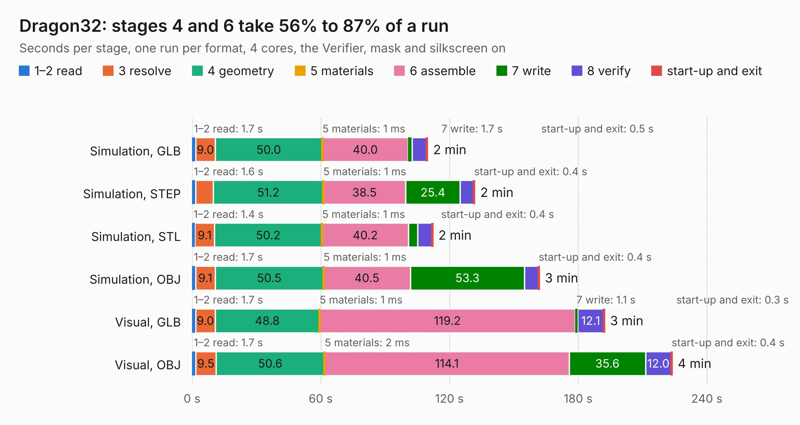

# 1392. Dragon32

Board 1,392 of the 3,130 of [Corpus Testing](../Corpus-Testing.md), on [Corpus Page 13](../CorpusTestingPages/Corpus-Testing-13.md#1392-dragon32).

| Mode and format | 1–2 read | 3 resolve | 4 geometry | 5 materials | 6 assemble | 7 write | 8 verify | start-up and exit | Total |
|---|---:|---:|---:|---:|---:|---:|---:|---:|---:|
| Simulation, GLB | 1.7 | 9.0 | 50.0 | 1&nbsp;ms | 40.0 | 1.7 | 6.7 | 0.5 | 109.8 |
| Simulation, STEP | 1.6 | 8.4 | 51.2 | 1&nbsp;ms | 38.5 | 25.4 | 6.3 | 0.4 | 131.7 |
| Simulation, STL | 1.4 | 9.1 | 50.2 | 1&nbsp;ms | 40.2 | 4.3 | 6.6 | 0.4 | 112.2 |
| Simulation, OBJ | 1.7 | 9.1 | 50.5 | 1&nbsp;ms | 40.5 | 53.3 | 6.4 | 0.4 | 161.8 |
| Visual, GLB | 1.7 | 9.0 | 48.8 | 1&nbsp;ms | 119.2 | 1.1 | 12.1 | 0.3 | 192.2 |
| Visual, OBJ | 1.7 | 9.5 | 50.6 | 2&nbsp;ms | 114.1 | 35.6 | 12.0 | 0.4 | 223.8 |

<table align="center"><tr><td valign="top">

| Board | Repo: [jimbro1000/Dragon32Rev3](https://github.com/jimbro1000/Dragon32Rev3) Board: `Dragon32.kicad_pcb` |
|---|---|
| Complexity | 324&nbsp;/&nbsp;1000 (size&nbsp;219, features&nbsp;105) |
| KESE&nbsp;features | through vias, slotted holes, rounded, trapezoid or chamfered pads, filled zones, copper text, curved board outline, stack-up, dielectric εr and tanδ |
| Tested | 9th November 2026 |
| Copper&nbsp;layers | 2 |
| File&nbsp;format | KiCad 9 (20241229) |
| Parts,&nbsp;tracks,&nbsp;vias | 169, 4,819, 960 |
| Triangles,&nbsp;simulation | 9,734,010 in 275 parts |
| Verifier | PASS in all six runs |

</td><td valign="top">

<table>
<tr><th>File type</th><th>File size</th><th>Peak memory used</th></tr>
<tr><th colspan="3" align="left">Simulation</th></tr>
<tr><td>GLB</td><td align="right">335&nbsp;MB</td><td align="right">2.9&nbsp;GB</td></tr>
<tr><td>STEP</td><td align="right">1.7&nbsp;GB</td><td align="right">3.5&nbsp;GB</td></tr>
<tr><td>STL</td><td align="right">487&nbsp;MB</td><td align="right">3.1&nbsp;GB</td></tr>
<tr><td>OBJ</td><td align="right">1.1&nbsp;GB</td><td align="right">6.2&nbsp;GB</td></tr>
<tr><th colspan="3" align="left">Visual</th></tr>
<tr><td>GLB</td><td align="right">240&nbsp;MB</td><td align="right">3.7&nbsp;GB</td></tr>
<tr><td>OBJ</td><td align="right">773&nbsp;MB</td><td align="right">4.9&nbsp;GB</td></tr>
</table>

</td></tr></table>

| Previous | Next |
|:---|---:|
| [1391. Dragon32](b1391b_Dragon32Issue2_Dragon32.md) | [1393. cm4-carrier-net](b1393b_cm4-carriers_cm4-carrier-net.md) |
