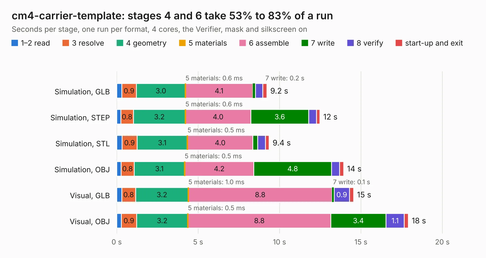

# 1392. cm4-carrier-template

Board 1,392 of the 3,127 of [Corpus Testing](../Corpus-Testing.md), on [Corpus Page 13](../CorpusTestingPages/Corpus-Testing-13.md#1392-cm4-carrier-template).

| Mode and format | 1–2 read | 3 resolve | 4 geometry | 5 materials | 6 assemble | 7 write | 8 verify | start-up and exit | Total |
|---|---:|---:|---:|---:|---:|---:|---:|---:|---:|
| Simulation, GLB | 0.3 | 0.9 | 3.0 | 0.6&nbsp;ms | 4.1 | 0.2 | 0.4 | 0.3 | 9.2 |
| Simulation, STEP | 0.2 | 0.8 | 3.2 | 0.6&nbsp;ms | 4.0 | 3.6 | 0.5 | 0.2 | 12.5 |
| Simulation, STL | 0.3 | 0.9 | 3.1 | 0.5&nbsp;ms | 4.0 | 0.3 | 0.5 | 0.2 | 9.4 |
| Simulation, OBJ | 0.3 | 0.8 | 3.1 | 0.5&nbsp;ms | 4.2 | 4.8 | 0.5 | 0.2 | 13.9 |
| Visual, GLB | 0.3 | 0.8 | 3.2 | 1.0&nbsp;ms | 8.8 | 0.1 | 0.9 | 0.2 | 14.5 |
| Visual, OBJ | 0.3 | 0.9 | 3.2 | 0.5&nbsp;ms | 8.8 | 3.4 | 1.1 | 0.2 | 17.9 |

<table align="center"><tr><td valign="top">

| Board | Repo: [jkiv/cm4-carriers](https://github.com/jkiv/cm4-carriers) Board: `cm4-carrier-template.kicad_pcb` |
|---|---|
| Folder | hardware / cm4-carrier-template |
| Complexity | 273&nbsp;/&nbsp;1000 (size&nbsp;208, features&nbsp;65) |
| KESE&nbsp;features | through vias, slotted holes, rounded, trapezoid or chamfered pads, filled zones, curved board outline |
| Tested | 9th November 2026 |
| Copper&nbsp;layers | 4 |
| File&nbsp;format | KiCad 5 (20171130) |
| Parts,&nbsp;tracks,&nbsp;vias | 35, 3,631, 107 |
| Triangles,&nbsp;simulation | 1,017,770 in 108 parts |
| Verifier | PASS in all six runs |

</td><td valign="top">

<table>
<tr><th>File type</th><th>File size</th><th>Peak memory used</th></tr>
<tr><th colspan="3" align="left">Simulation</th></tr>
<tr><td>GLB</td><td align="right">34&nbsp;MB</td><td align="right">474&nbsp;MB</td></tr>
<tr><td>STEP</td><td align="right">160&nbsp;MB</td><td align="right">547&nbsp;MB</td></tr>
<tr><td>STL</td><td align="right">51&nbsp;MB</td><td align="right">460&nbsp;MB</td></tr>
<tr><td>OBJ</td><td align="right">103&nbsp;MB</td><td align="right">704&nbsp;MB</td></tr>
<tr><th colspan="3" align="left">Visual</th></tr>
<tr><td>GLB</td><td align="right">23&nbsp;MB</td><td align="right">671&nbsp;MB</td></tr>
<tr><td>OBJ</td><td align="right">71&nbsp;MB</td><td align="right">684&nbsp;MB</td></tr>
</table>

</td></tr></table>

| Previous | Next |
|:---|---:|
| [1391. cm4-carrier-net](b1391b_cm4-carriers_cm4-carrier-net.md) | [1393. astra_piNas](b1393b_astra-pinas_astra-piNas.md) |
