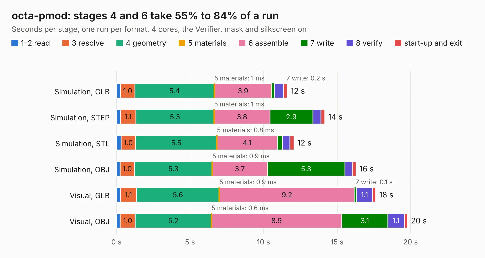

# 1394. octa-pmod

Board 1,394 of the 3,109 of [Corpus Testing](../Corpus-Testing.md), on [Corpus Page 13](../CorpusTestingPages/Corpus-Testing-13.md#1394-octa-pmod).

| Mode and format | 1–2 read | 3 resolve | 4 geometry | 5 materials | 6 assemble | 7 write | 8 verify | start-up and exit | Total |
|---|---:|---:|---:|---:|---:|---:|---:|---:|---:|
| Simulation, GLB | 0.3 | 1.0 | 5.4 | 1&nbsp;ms | 3.9 | 0.2 | 0.6 | 0.3 | 11.6 |
| Simulation, STEP | 0.3 | 1.1 | 5.3 | 1&nbsp;ms | 3.8 | 2.9 | 0.6 | 0.3 | 14.2 |
| Simulation, STL | 0.3 | 1.0 | 5.5 | 0.8&nbsp;ms | 4.1 | 0.3 | 0.5 | 0.3 | 12.1 |
| Simulation, OBJ | 0.3 | 1.0 | 5.3 | 0.9&nbsp;ms | 3.7 | 5.3 | 0.5 | 0.3 | 16.3 |
| Visual, GLB | 0.3 | 1.1 | 5.6 | 0.9&nbsp;ms | 9.2 | 0.1 | 1.1 | 0.2 | 17.6 |
| Visual, OBJ | 0.2 | 1.0 | 5.2 | 0.6&nbsp;ms | 8.9 | 3.1 | 1.1 | 0.2 | 19.8 |

<table align="center"><tr><td valign="top">

| Board | Repo: [joshajohnson/ecp5-mini](https://github.com/joshajohnson/ecp5-mini) Board: `octa-pmod.kicad_pcb` |
|---|---|
| Folder | breakouts / octa-pmod-horizontal-0.1 |
| Complexity | 249&nbsp;/&nbsp;1000 (size&nbsp;144, features&nbsp;105) |
| KESE&nbsp;features | through vias, rounded, trapezoid or chamfered pads, filled zones, curved board outline, stack-up, dielectric εr and tanδ, copper finish, mask and silkscreen colours |
| Tested | 9th November 2026 |
| Copper&nbsp;layers | 2 |
| File&nbsp;format | KiCad 6 (20201002) |
| Parts,&nbsp;tracks,&nbsp;vias | 16, 338, 6 |
| Triangles,&nbsp;simulation | 1,159,322 in 78 parts |
| Verifier | PASS in all six runs |

</td><td valign="top">

<table>
<tr><th>File type</th><th>File size</th><th>Peak memory used</th></tr>
<tr><th colspan="3" align="left">Simulation</th></tr>
<tr><td>GLB</td><td align="right">38&nbsp;MB</td><td align="right">497&nbsp;MB</td></tr>
<tr><td>STEP</td><td align="right">164&nbsp;MB</td><td align="right">583&nbsp;MB</td></tr>
<tr><td>STL</td><td align="right">58&nbsp;MB</td><td align="right">496&nbsp;MB</td></tr>
<tr><td>OBJ</td><td align="right">117&nbsp;MB</td><td align="right">810&nbsp;MB</td></tr>
<tr><th colspan="3" align="left">Visual</th></tr>
<tr><td>GLB</td><td align="right">26&nbsp;MB</td><td align="right">705&nbsp;MB</td></tr>
<tr><td>OBJ</td><td align="right">77&nbsp;MB</td><td align="right">641&nbsp;MB</td></tr>
</table>

</td></tr></table>

| Previous | Next |
|:---|---:|
| [1393. octa-pmod](b1393b_ecp5-mini_breakouts-octa-pmod-0-2_octa-pmod.md) | [1395. octa-pmod](b1395b_ecp5-mini_breakouts-octa-pmod-horizontal-0-2_octa-pmod.md) |
