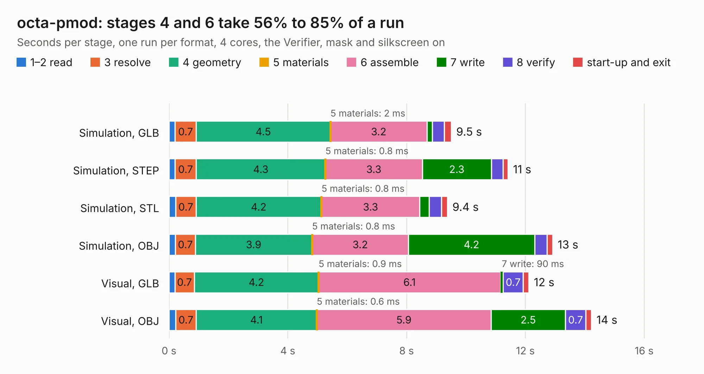

# 1395. octa-pmod

Board 1,395 of the 3,111 of [Corpus Testing](../Corpus-Testing.md), on [Corpus Page 13](../CorpusTestingPages/Corpus-Testing-13.md#1395-octa-pmod).

| Mode and format | 1–2 read | 3 resolve | 4 geometry | 5 materials | 6 assemble | 7 write | 8 verify | start-up and exit | Total |
|---|---:|---:|---:|---:|---:|---:|---:|---:|---:|
| Simulation, GLB | 0.2 | 0.7 | 4.5 | 2&nbsp;ms | 3.2 | 0.2 | 0.4 | 0.2 | 9.5 |
| Simulation, STEP | 0.2 | 0.7 | 4.3 | 0.8&nbsp;ms | 3.3 | 2.3 | 0.4 | 0.2 | 11.4 |
| Simulation, STL | 0.2 | 0.7 | 4.2 | 0.8&nbsp;ms | 3.3 | 0.3 | 0.4 | 0.2 | 9.4 |
| Simulation, OBJ | 0.2 | 0.7 | 3.9 | 0.8&nbsp;ms | 3.2 | 4.2 | 0.4 | 0.2 | 12.9 |
| Visual, GLB | 0.2 | 0.7 | 4.2 | 0.9&nbsp;ms | 6.1 | 90&nbsp;ms | 0.7 | 0.2 | 12.1 |
| Visual, OBJ | 0.2 | 0.7 | 4.1 | 0.6&nbsp;ms | 5.9 | 2.5 | 0.7 | 0.2 | 14.2 |

<table align="center"><tr><td valign="top">

| Board | Repo: [joshajohnson/ecp5-mini](https://github.com/joshajohnson/ecp5-mini) Board: `octa-pmod.kicad_pcb` |
|---|---|
| Folder | breakouts / octa-pmod-0.2 |
| Complexity | 241&nbsp;/&nbsp;1000 (size&nbsp;151, features&nbsp;90) |
| KESE&nbsp;features | rounded, trapezoid or chamfered pads, filled zones, curved board outline, stack-up, dielectric εr and tanδ, copper finish, mask and silkscreen colours |
| Tested | 9th November 2026 |
| Copper&nbsp;layers | 2 |
| File&nbsp;format | KiCad 6 (20201220) |
| Parts,&nbsp;tracks,&nbsp;vias | 14, 618, 0 |
| Triangles,&nbsp;simulation | 1,101,224 in 78 parts |
| Verifier | PASS in all six runs |

</td><td valign="top">

<table>
<tr><th>File type</th><th>File size</th><th>Peak memory used</th></tr>
<tr><th colspan="3" align="left">Simulation</th></tr>
<tr><td>GLB</td><td align="right">37&nbsp;MB</td><td align="right">484&nbsp;MB</td></tr>
<tr><td>STEP</td><td align="right">155&nbsp;MB</td><td align="right">547&nbsp;MB</td></tr>
<tr><td>STL</td><td align="right">55&nbsp;MB</td><td align="right">450&nbsp;MB</td></tr>
<tr><td>OBJ</td><td align="right">110&nbsp;MB</td><td align="right">775&nbsp;MB</td></tr>
<tr><th colspan="3" align="left">Visual</th></tr>
<tr><td>GLB</td><td align="right">22&nbsp;MB</td><td align="right">568&nbsp;MB</td></tr>
<tr><td>OBJ</td><td align="right">65&nbsp;MB</td><td align="right">558&nbsp;MB</td></tr>
</table>

</td></tr></table>

| Previous | Next |
|:---|---:|
| [1394. octa-pmod](b1394b_ecp5-mini_breakouts-octa-pmod-0-1_octa-pmod.md) | [1396. octa-pmod](b1396b_ecp5-mini_breakouts-octa-pmod-horizontal-0-1_octa-pmod.md) |
