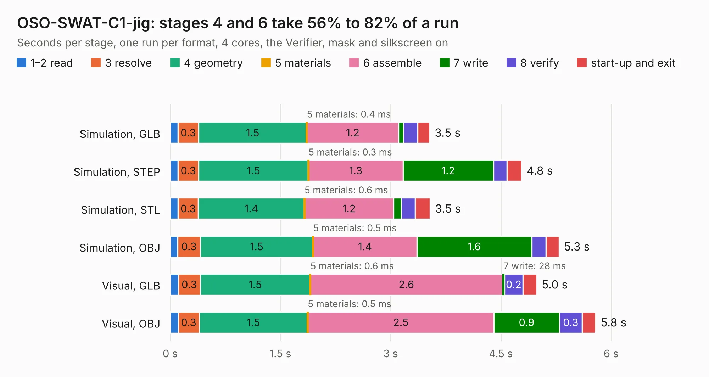

# 1399. OSO-SWAT-C1-jig

Board 1,399 of the 3,130 of [Corpus Testing](../Corpus-Testing.md), on [Corpus Page 13](../CorpusTestingPages/Corpus-Testing-13.md#1399-oso-swat-c1-jig).

| Mode and format | 1–2 read | 3 resolve | 4 geometry | 5 materials | 6 assemble | 7 write | 8 verify | start-up and exit | Total |
|---|---:|---:|---:|---:|---:|---:|---:|---:|---:|
| Simulation, GLB | 0.1 | 0.3 | 1.5 | 0.4&nbsp;ms | 1.2 | 64&nbsp;ms | 0.2 | 0.2 | 3.5 |
| Simulation, STEP | 0.1 | 0.3 | 1.5 | 0.3&nbsp;ms | 1.3 | 1.2 | 0.2 | 0.2 | 4.8 |
| Simulation, STL | 0.1 | 0.3 | 1.4 | 0.6&nbsp;ms | 1.2 | 0.1 | 0.2 | 0.2 | 3.5 |
| Simulation, OBJ | 0.1 | 0.3 | 1.5 | 0.5&nbsp;ms | 1.4 | 1.6 | 0.2 | 0.2 | 5.3 |
| Visual, GLB | 0.1 | 0.3 | 1.5 | 0.6&nbsp;ms | 2.6 | 28&nbsp;ms | 0.2 | 0.2 | 5.0 |
| Visual, OBJ | 0.1 | 0.3 | 1.5 | 0.5&nbsp;ms | 2.5 | 0.9 | 0.3 | 0.2 | 5.8 |

<table align="center"><tr><td valign="top">

| Board | Repo: [joeycastillo/Sensor-Watch](https://github.com/joeycastillo/Sensor-Watch) Board: `OSO-SWAT-C1-jig.kicad_pcb` |
|---|---|
| Folder | PCB / Main Boards / OSO-SWAT-C1 / OSO-SWAT-C1-jig |
| Complexity | 44&nbsp;/&nbsp;1000 (size&nbsp;44, features&nbsp;0) |
| Tested | 9th November 2026 |
| Copper&nbsp;layers | 2 |
| File&nbsp;format | KiCad 10 (20260206) |
| Parts,&nbsp;tracks,&nbsp;vias | 11, 0, 0 |
| Triangles,&nbsp;simulation | 406,776 in 112 parts |
| Verifier | PASS in all six runs |

</td><td valign="top">

<table>
<tr><th>File type</th><th>File size</th><th>Peak memory used</th></tr>
<tr><th colspan="3" align="left">Simulation</th></tr>
<tr><td>GLB</td><td align="right">13&nbsp;MB</td><td align="right">249&nbsp;MB</td></tr>
<tr><td>STEP</td><td align="right">42&nbsp;MB</td><td align="right">292&nbsp;MB</td></tr>
<tr><td>STL</td><td align="right">20&nbsp;MB</td><td align="right">250&nbsp;MB</td></tr>
<tr><td>OBJ</td><td align="right">41&nbsp;MB</td><td align="right">326&nbsp;MB</td></tr>
<tr><th colspan="3" align="left">Visual</th></tr>
<tr><td>GLB</td><td align="right">7.9&nbsp;MB</td><td align="right">293&nbsp;MB</td></tr>
<tr><td>OBJ</td><td align="right">23&nbsp;MB</td><td align="right">288&nbsp;MB</td></tr>
</table>

</td></tr></table>

| Previous | Next |
|:---|---:|
| [1398. OSO-SWAT-B1](b1398b_Sensor-Watch_OSO-SWAT-B1.md) | [1400. OSO-SWAT-C1-rounded](b1400b_Sensor-Watch_OSO-SWAT-C1-rounded.md) |
