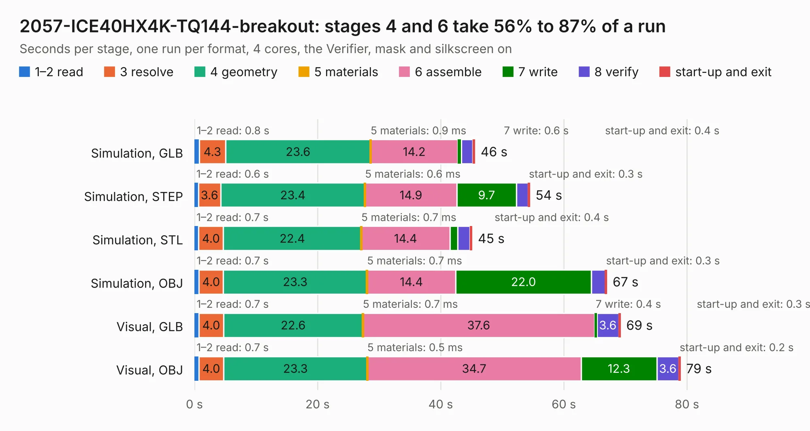

# 1401. 2057-ICE40HX4K-TQ144-breakout

Board 1,401 of the 3,124 of [Corpus Testing](../Corpus-Testing.md), on [Corpus Page 13](../CorpusTestingPages/Corpus-Testing-13.md#1401-2057-ice40hx4k-tq144-breakout).

| Mode and format | 1–2 read | 3 resolve | 4 geometry | 5 materials | 6 assemble | 7 write | 8 verify | start-up and exit | Total |
|---|---:|---:|---:|---:|---:|---:|---:|---:|---:|
| Simulation, GLB | 0.8 | 4.3 | 23.6 | 0.9&nbsp;ms | 14.2 | 0.6 | 1.8 | 0.4 | 45.5 |
| Simulation, STEP | 0.6 | 3.6 | 23.4 | 0.6&nbsp;ms | 14.9 | 9.7 | 1.9 | 0.3 | 54.5 |
| Simulation, STL | 0.7 | 4.0 | 22.4 | 0.7&nbsp;ms | 14.4 | 1.3 | 1.9 | 0.4 | 45.1 |
| Simulation, OBJ | 0.7 | 4.0 | 23.3 | 0.7&nbsp;ms | 14.4 | 22.0 | 2.3 | 0.3 | 67.0 |
| Visual, GLB | 0.7 | 4.0 | 22.6 | 0.7&nbsp;ms | 37.6 | 0.4 | 3.6 | 0.3 | 69.2 |
| Visual, OBJ | 0.7 | 4.0 | 23.3 | 0.5&nbsp;ms | 34.7 | 12.3 | 3.6 | 0.2 | 78.9 |

<table align="center"><tr><td valign="top">

| Board | Repo: [johnwinans/2057-ICE40HX4K-TQ144-breakout](https://github.com/johnwinans/2057-ICE40HX4K-TQ144-breakout) Board: `2057-ICE40HX4K-TQ144-breakout.kicad_pcb` |
|---|---|
| Complexity | 310&nbsp;/&nbsp;1000 (size&nbsp;245, features&nbsp;65) |
| KESE&nbsp;features | through vias, slotted holes, rounded, trapezoid or chamfered pads, filled zones, curved board outline |
| Tested | 9th November 2026 |
| Copper&nbsp;layers | 4 |
| File&nbsp;format | KiCad 5 (20171130) |
| Parts,&nbsp;tracks,&nbsp;vias | 72, 1,453, 211 |
| Triangles,&nbsp;simulation | 3,669,038 in 195 parts |
| Verifier | PASS in all six runs |

</td><td valign="top">

<table>
<tr><th>File type</th><th>File size</th><th>Peak memory used</th></tr>
<tr><th colspan="3" align="left">Simulation</th></tr>
<tr><td>GLB</td><td align="right">126&nbsp;MB</td><td align="right">1.1&nbsp;GB</td></tr>
<tr><td>STEP</td><td align="right">556&nbsp;MB</td><td align="right">1.3&nbsp;GB</td></tr>
<tr><td>STL</td><td align="right">183&nbsp;MB</td><td align="right">1.1&nbsp;GB</td></tr>
<tr><td>OBJ</td><td align="right">394&nbsp;MB</td><td align="right">2.4&nbsp;GB</td></tr>
<tr><th colspan="3" align="left">Visual</th></tr>
<tr><td>GLB</td><td align="right">76&nbsp;MB</td><td align="right">1.2&nbsp;GB</td></tr>
<tr><td>OBJ</td><td align="right">236&nbsp;MB</td><td align="right">1.7&nbsp;GB</td></tr>
</table>

</td></tr></table>

| Previous | Next |
|:---|---:|
| [1400. Q3Q-SWAB-A1-00 Temperature + Test Points + OPT3001](b1400b_Sensor-Watch_Q3Q-SWAB-A1-00-Temperature-Test-Points-OPT3001.md) | [1402. gw](b1402b_blixten_gw.md) |
