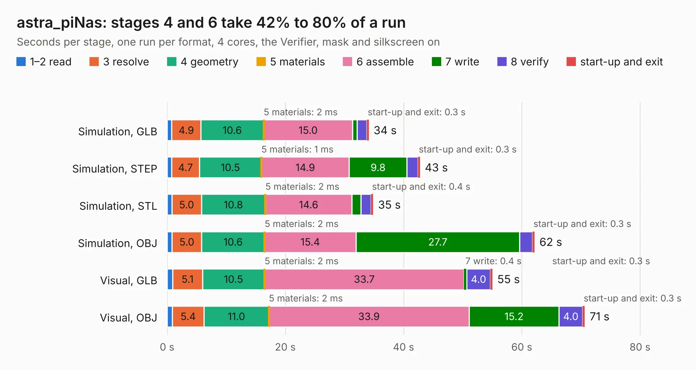

# 1401. astra_piNas

Board 1,401 of the 3,139 of [Corpus Testing](../Corpus-Testing.md), on [Corpus Page 13](../CorpusTestingPages/Corpus-Testing-13.md#1401-astra_pinas).

| Mode and format | 1–2 read | 3 resolve | 4 geometry | 5 materials | 6 assemble | 7 write | 8 verify | start-up and exit | Total |
|---|---:|---:|---:|---:|---:|---:|---:|---:|---:|
| Simulation, GLB | 0.8 | 4.9 | 10.6 | 2&nbsp;ms | 15.0 | 0.7 | 1.7 | 0.3 | 34.1 |
| Simulation, STEP | 0.8 | 4.7 | 10.5 | 1&nbsp;ms | 14.9 | 9.8 | 1.9 | 0.3 | 42.8 |
| Simulation, STL | 0.8 | 5.0 | 10.8 | 2&nbsp;ms | 14.6 | 1.5 | 1.7 | 0.4 | 34.9 |
| Simulation, OBJ | 0.8 | 5.0 | 10.6 | 2&nbsp;ms | 15.4 | 27.7 | 2.2 | 0.3 | 62.1 |
| Visual, GLB | 0.9 | 5.1 | 10.5 | 2&nbsp;ms | 33.7 | 0.4 | 4.0 | 0.3 | 55.0 |
| Visual, OBJ | 0.9 | 5.4 | 11.0 | 2&nbsp;ms | 33.9 | 15.2 | 4.0 | 0.3 | 70.6 |

<table align="center"><tr><td valign="top">

| Board | Repo: [jlcjak/astra_pinas](https://github.com/jlcjak/astra_pinas) Board: `astra_piNas.kicad_pcb` |
|---|---|
| Complexity | 402&nbsp;/&nbsp;1000 (size&nbsp;277, features&nbsp;125) |
| KESE&nbsp;features | through vias, slotted holes, custom pads, rounded, trapezoid or chamfered pads, filled zones, copper drawings, stack-up, dielectric εr and tanδ, copper finish |
| Tested | 9th November 2026 |
| Copper&nbsp;layers | 6 |
| File&nbsp;format | KiCad 10 (20260206) |
| Parts,&nbsp;tracks,&nbsp;vias | 170, 2,408, 692 |
| Triangles,&nbsp;simulation | 4,388,718 in 390 parts |
| Verifier | PASS in all six runs |

</td><td valign="top">

<table>
<tr><th>File type</th><th>File size</th><th>Peak memory used</th></tr>
<tr><th colspan="3" align="left">Simulation</th></tr>
<tr><td>GLB</td><td align="right">145&nbsp;MB</td><td align="right">1.3&nbsp;GB</td></tr>
<tr><td>STEP</td><td align="right">425&nbsp;MB</td><td align="right">1.7&nbsp;GB</td></tr>
<tr><td>STL</td><td align="right">219&nbsp;MB</td><td align="right">1.4&nbsp;GB</td></tr>
<tr><td>OBJ</td><td align="right">466&nbsp;MB</td><td align="right">2.8&nbsp;GB</td></tr>
<tr><th colspan="3" align="left">Visual</th></tr>
<tr><td>GLB</td><td align="right">78&nbsp;MB</td><td align="right">1.5&nbsp;GB</td></tr>
<tr><td>OBJ</td><td align="right">255&nbsp;MB</td><td align="right">1.8&nbsp;GB</td></tr>
</table>

</td></tr></table>

| Previous | Next |
|:---|---:|
| [1400. cm4-carrier-template](b1400b_cm4-carriers_cm4-carrier-template.md) | [1402. RK3576 SBCv2](b1402b_open-source-sbc-board_RK3576-SBCv2.md) |
