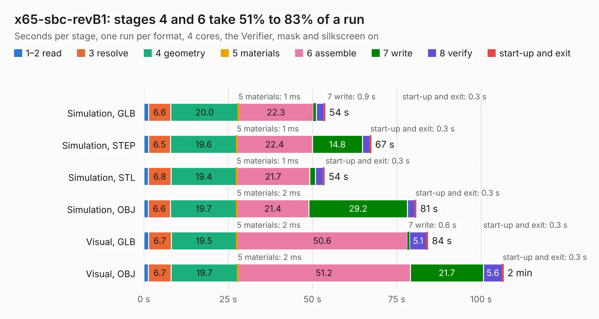

# 1401. x65-sbc-revB1

Board 1,401 of the 3,105 of [Corpus Testing](../Corpus-Testing.md), on [Corpus Page 13](../CorpusTestingPages/Corpus-Testing-13.md#1401-x65-sbc-revb1).

| Mode and format | 1–2 read | 3 resolve | 4 geometry | 5 materials | 6 assemble | 7 write | 8 verify | start-up and exit | Total |
|---|---:|---:|---:|---:|---:|---:|---:|---:|---:|
| Simulation, GLB | 1.4 | 6.6 | 20.0 | 1&nbsp;ms | 22.3 | 0.9 | 2.2 | 0.3 | 53.7 |
| Simulation, STEP | 1.4 | 6.5 | 19.6 | 1&nbsp;ms | 22.4 | 14.8 | 2.2 | 0.3 | 67.3 |
| Simulation, STL | 1.4 | 6.8 | 19.4 | 1&nbsp;ms | 21.7 | 1.7 | 2.3 | 0.3 | 53.5 |
| Simulation, OBJ | 1.3 | 6.6 | 19.7 | 2&nbsp;ms | 21.4 | 29.2 | 2.3 | 0.3 | 80.7 |
| Visual, GLB | 1.4 | 6.7 | 19.5 | 2&nbsp;ms | 50.6 | 0.6 | 5.1 | 0.3 | 84.2 |
| Visual, OBJ | 1.4 | 6.7 | 19.7 | 2&nbsp;ms | 51.2 | 21.7 | 5.6 | 0.3 | 106.6 |

<table align="center"><tr><td valign="top">

| Board | Repo: [jsyk/x65](https://github.com/jsyk/x65) Board: `x65-sbc-revB1.kicad_pcb` |
|---|---|
| Folder | pcb / x65-sbc-revB1 |
| Complexity | 442&nbsp;/&nbsp;1000 (size&nbsp;297, features&nbsp;145) |
| KESE&nbsp;features | through vias, slotted holes, custom pads, rounded, trapezoid or chamfered pads, filled zones, copper drawings, copper text, curved board outline, knockout text, stack-up, dielectric εr and tanδ |
| Tested | 9th November 2026 |
| Copper&nbsp;layers | 4 |
| File&nbsp;format | KiCad 7 (20221018) |
| Parts,&nbsp;tracks,&nbsp;vias | 331, 4,600, 622 |
| Triangles,&nbsp;simulation | 5,550,440 in 375 parts |
| Verifier | PASS in all six runs |

</td><td valign="top">

<table>
<tr><th>File type</th><th>File size</th><th>Peak memory used</th></tr>
<tr><th colspan="3" align="left">Simulation</th></tr>
<tr><td>GLB</td><td align="right">190&nbsp;MB</td><td align="right">1.5&nbsp;GB</td></tr>
<tr><td>STEP</td><td align="right">826&nbsp;MB</td><td align="right">2.1&nbsp;GB</td></tr>
<tr><td>STL</td><td align="right">278&nbsp;MB</td><td align="right">1.6&nbsp;GB</td></tr>
<tr><td>OBJ</td><td align="right">592&nbsp;MB</td><td align="right">3.6&nbsp;GB</td></tr>
<tr><th colspan="3" align="left">Visual</th></tr>
<tr><td>GLB</td><td align="right">136&nbsp;MB</td><td align="right">2.1&nbsp;GB</td></tr>
<tr><td>OBJ</td><td align="right">430&nbsp;MB</td><td align="right">2.8&nbsp;GB</td></tr>
</table>

</td></tr></table>

| Previous | Next |
|:---|---:|
| [1400. x65-sbc-revA1](b1400b_x65_x65-sbc-revA1.md) | [1402. DFTBoard](b1402b_zynqpcb_DFTBoard.md) |
