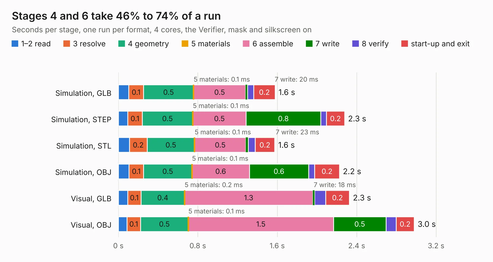

# 1402. Q3Q-SWAB-A1-00 Temperature + Test Points + OPT3001

Board 1,402 of the 3,129 of [Corpus Testing](../Corpus-Testing.md), on [Corpus Page 13](../CorpusTestingPages/Corpus-Testing-13.md#1402-q3q-swab-a1-00-temperature--test-points--opt3001).

| Mode and format | 1–2 read | 3 resolve | 4 geometry | 5 materials | 6 assemble | 7 write | 8 verify | start-up and exit | Total |
|---|---:|---:|---:|---:|---:|---:|---:|---:|---:|
| Simulation, GLB | 0.1 | 0.1 | 0.5 | 0.1&nbsp;ms | 0.5 | 20&nbsp;ms | 62&nbsp;ms | 0.2 | 1.6 |
| Simulation, STEP | 95&nbsp;ms | 0.1 | 0.5 | 0.1&nbsp;ms | 0.5 | 0.8 | 56&nbsp;ms | 0.2 | 2.3 |
| Simulation, STL | 0.1 | 0.2 | 0.5 | 0.1&nbsp;ms | 0.5 | 23&nbsp;ms | 70&nbsp;ms | 0.2 | 1.6 |
| Simulation, OBJ | 0.1 | 0.1 | 0.5 | 0.1&nbsp;ms | 0.6 | 0.6 | 61&nbsp;ms | 0.2 | 2.2 |
| Visual, GLB | 93&nbsp;ms | 0.1 | 0.4 | 0.2&nbsp;ms | 1.3 | 18&nbsp;ms | 0.1 | 0.2 | 2.3 |
| Visual, OBJ | 87&nbsp;ms | 0.1 | 0.5 | 0.1&nbsp;ms | 1.5 | 0.5 | 0.1 | 0.2 | 3.0 |

<table align="center"><tr><td valign="top">

| Board | Repo: [joeycastillo/Sensor-Watch](https://github.com/joeycastillo/Sensor-Watch) Board: `Q3Q-SWAB-A1-00 Temperature + Test Points + OPT3001.kicad_pcb` |
|---|---|
| Folder | PCB / Sensor Boards / Q3Q-SWAB-A1-00 Temperature + Test Points + OPT3001 |
| Complexity | 147&nbsp;/&nbsp;1000 (size&nbsp;112, features&nbsp;35) |
| KESE&nbsp;features | through vias, rounded, trapezoid or chamfered pads, curved board outline |
| Tested | 9th November 2026 |
| Copper&nbsp;layers | 2 |
| File&nbsp;format | KiCad 5 (20171130) |
| Parts,&nbsp;tracks,&nbsp;vias | 4, 79, 11 |
| Triangles,&nbsp;simulation | 91,820 in 23 parts |
| Verifier | PASS in all six runs |

</td><td valign="top">

<table>
<tr><th>File type</th><th>File size</th><th>Peak memory used</th></tr>
<tr><th colspan="3" align="left">Simulation</th></tr>
<tr><td>GLB</td><td align="right">3.4&nbsp;MB</td><td align="right">182&nbsp;MB</td></tr>
<tr><td>STEP</td><td align="right">17&nbsp;MB</td><td align="right">193&nbsp;MB</td></tr>
<tr><td>STL</td><td align="right">4.6&nbsp;MB</td><td align="right">186&nbsp;MB</td></tr>
<tr><td>OBJ</td><td align="right">9.3&nbsp;MB</td><td align="right">177&nbsp;MB</td></tr>
<tr><th colspan="3" align="left">Visual</th></tr>
<tr><td>GLB</td><td align="right">3.2&nbsp;MB</td><td align="right">155&nbsp;MB</td></tr>
<tr><td>OBJ</td><td align="right">8.8&nbsp;MB</td><td align="right">155&nbsp;MB</td></tr>
</table>

</td></tr></table>

| Previous | Next |
|:---|---:|
| [1401. OSO-SWAB-B1-00 Sensor Watch Accelerometer](b1401b_Sensor-Watch_OSO-SWAB-B1-00-Sensor-Watch-Accelerometer.md) | [1403. 2057-ICE40HX4K-TQ144-breakout](b1403b_2057-ICE40HX4K-TQ144-breakout_2057-ICE40HX4K-TQ144-breakout.md) |
